```{=openxml}
<w:p><w:pPr><w:pStyle w:val="CoverText"/><w:spacing w:before="0" w:after="0"/></w:pPr><w:r><w:rPr></w:rPr><w:t xml:space="preserve">[DERS KODU] – Data Mining</w:t></w:r></w:p><w:p><w:pPr><w:pStyle w:val="CoverText"/><w:spacing w:before="0" w:after="0"/></w:pPr><w:r><w:rPr></w:rPr><w:t xml:space="preserve">Şube: [ŞUBE]</w:t></w:r></w:p><w:p><w:pPr><w:pStyle w:val="CoverText"/><w:spacing w:before="3200" w:after="120"/></w:pPr><w:r><w:rPr><w:b/><w:bCs/></w:rPr><w:t xml:space="preserve">Vize Projesi (Midterm Project)</w:t></w:r></w:p><w:p><w:pPr><w:pStyle w:val="CoverText"/><w:spacing w:before="0" w:after="0"/></w:pPr><w:r><w:rPr><w:b/><w:bCs/></w:rPr><w:t xml:space="preserve">İstanbul Airbnb İlanlarında Fiyatı Etkileyen Faktörler: Doğrusal ve İkili Lojistik Regresyon Analizi</w:t></w:r></w:p><w:p><w:pPr><w:pStyle w:val="CoverText"/><w:spacing w:before="3200" w:after="0"/></w:pPr><w:r><w:rPr></w:rPr><w:t xml:space="preserve">Teslim Tarihi: [TESLİM TARİHİ]</w:t></w:r></w:p><w:p><w:pPr><w:pStyle w:val="CoverText"/><w:spacing w:before="3000" w:after="0"/></w:pPr><w:r><w:rPr></w:rPr><w:t xml:space="preserve">Hazırlayanlar:</w:t></w:r></w:p><w:p><w:pPr><w:pStyle w:val="CoverText"/><w:spacing w:before="0" w:after="0"/></w:pPr><w:r><w:rPr></w:rPr><w:t xml:space="preserve">[AD SOYAD 1]</w:t></w:r></w:p><w:p><w:pPr><w:pStyle w:val="CoverText"/><w:spacing w:before="0" w:after="0"/></w:pPr><w:r><w:rPr></w:rPr><w:t xml:space="preserve">[AD SOYAD 2]</w:t></w:r></w:p>
```

```{=typst}
#page(numbering: none)[
  #set align(center)
  #set par(justify: false)
  \[DERS KODU\] – Data Mining \
  Şube: \[ŞUBE\]
  #v(1fr)
  *Vize Projesi (Midterm Project)* \
  #v(0.6em)
  *İstanbul Airbnb İlanlarında Fiyatı Etkileyen Faktörler: Doğrusal ve İkili Lojistik Regresyon Analizi*
  #v(1fr)
  Teslim Tarihi: \[TESLİM TARİHİ\]
  #v(1fr)
  Hazırlayanlar: \
  \[AD SOYAD 1\] \
  \[AD SOYAD 2\]
  #v(2em)
]
```


# 1. Giriş

Kısa dönem konaklama platformlarında bir ilanın gecelik fiyatı; mekânın büyüklüğü, kiralanan alanın türü ve ev sahibinin platformdaki itibarı gibi pek çok özelliğe bağlıdır. Bu projede, Inside Airbnb tarafından yayımlanan İstanbul ilan verisi (Inside Airbnb, 2026) kullanılarak gecelik fiyatı etkileyen faktörler incelenmiştir.

Projenin amacı, gerçek bir veri seti üzerinde veri ön işleme, doğrusal regresyon ve ikili lojistik regresyon tekniklerini RStudio ortamında, R programlama dili (R Core Team, 2024) ile uygulamaktır. Çalışma üç ana aşamadan oluşmaktadır:

1. **Veri aktarımı, keşfi ve ön işleme:** Ham verideki tip hataları, eksik değerler, tutarsız kategoriler, uç değerler ve olası veri giriş hataları tespit edilmiş ve gerekçeli kararlarla giderilmiştir.
2. **Doğrusal regresyon:** Sayısal bağımlı değişken olan gecelik fiyat (`price`, TL), önce tek bir sayısal değişkenle (basit doğrusal regresyon), ardından sayısal ve kategorik değişkenlerin birlikte yer aldığı bir modelle (çoklu doğrusal regresyon) açıklanmıştır.
3. **İkili lojistik regresyon:** Fiyat, medyan eşiğine göre "yüksek fiyatlı" ve "düşük/orta fiyatlı" olarak ikiye ayrılmış; bir ilanın yüksek fiyatlı olma odds'u dört farklı lojistik modelle incelenmiş ve bu modellerin uyumu ile sınıflandırma başarısı değerlendirilmiştir.

Bütün analizlerde aynı temizlenmiş veri seti ve aynı temel bağımlı değişken (`price`) kullanılmıştır. Lojistik regresyonda kullanılan ikili değişken, doğrusal regresyondaki sayısal fiyattan türetilmiştir.

# 2. Veri Seti Tanımı

## 2.1. Veri kaynağı

- **Veri seti:** Inside Airbnb – Istanbul, Marmara, Turkey; "Detailed Listings data" (`listings.csv.gz`).
- **Tarih:** 25 Eylül 2026 tarihli veri yayını (veri toplama: 28–29 Eylül 2026).
- **Kaynak:** Inside Airbnb (2026), <https://insideairbnb.com/get-the-data/>. Veri, Creative Commons lisansı ile paylaşılmaktadır.
- Her satır, İstanbul'daki bir Airbnb ilanını temsil etmektedir.

## 2.2. Gözlem ve değişken sayısı

- **Ham veri:** 27.232 gözlem (ilan) ve 90 değişken.
- **Temizlenmiş veri:** 16.303 gözlem ve 10 değişken. Bu sayıya ham veriden analizde kullanılmayan sütunlar çıkarılarak ve Bölüm 3.3'te açıklanan satır filtreleri uygulanarak ulaşılmıştır.

Temiz veri seti yönergenin 1.1 maddesindeki bütün şartları karşılamaktadır:

- En az 100 gözlem: 16.303 gözlem.
- En az 4 sayısal değişken: 6 sayısal değişken (`price`, `accommodates`, `bedrooms`, `bathrooms`, `number_of_reviews`, `availability_365`).
- En az 3 kategorik değişken: `host_is_superhost`, `room_type` ve `shared_bath`. Bağımlı değişken olan `high_price` bu sayıya dahil edilmemiştir.
- En az bir iki kategorili bağımsız değişken: `host_is_superhost` ve `shared_bath`.
- En az bir 3+ kategorili bağımsız değişken: `room_type` (4 kategori).

## 2.3. Değişken açıklama tablosu

Temizlenmiş veri setindeki değişkenlerin türleri, analizdeki rolleri, kaynakları ve değer aralıkları Tablo 1'de özetlenmiştir. Tablo 1'de görüldüğü gibi veri seti iki bağımlı değişken, beş sayısal ve üç kategorik bağımsız değişkenden oluşmaktadır.

Table: Tablo 1. Temizlenmiş veri setindeki değişkenler

| Değişken | Tür | Rol | Açıklama | Kaynak | Aralık / Düzeyler (n) |
|:-------------|:------------|:-------------|:---------------------|:--------------|:---------------------|
| price | Sayısal (sürekli) | Bağımlı değişken (doğrusal regresyon) | İlanın gecelik fiyatı (TL) | Ham price, metinden sayıya çevrildi | 542 – 38.286,33 |
| high_​price | Kategorik (ikili, 0/1) | Bağımlı değişken (lojistik regresyon) | 1 = fiyat > medyan (4.457,5 TL); 0 = fiyat ≤ medyan | price'tan türetildi | 0 (8.162); 1 (8.141) |
| accommodates | Sayısal (kesikli) | Bağımsız | Ağırlanabilecek en fazla misafir sayısı | Ham | 1 – 16 |
| bedrooms | Sayısal (kesikli) | Bağımsız | Yatak odası sayısı | Ham | 0 – 15 |
| bathrooms | Sayısal | Bağımsız | Banyo sayısı (yarım banyo = 0,5) | bathrooms_​text'ten türetildi | 0 – 15 |
| number_​of_​reviews | Sayısal (kesikli) | Bağımsız | Alınan toplam yorum sayısı | Ham | 0 – 1.862 |
| availability_​365 | Sayısal (kesikli) | Bağımsız | Önümüzdeki 365 gün içinde müsait gün sayısı | Ham | 0 – 365 |
| host_​is_​superhost | Kategorik (ikili) | Bağımsız | Ev sahibinin Superhost statüsü (referans: No) | Ham (t/f), No/Yes olarak kodlandı | No (10.827); Yes (5.476) |
| room_​type | Kategorik (4 kategori) | Bağımsız | Kiralanan alanın türü (referans: Entire home/apt) | Ham | Entire home/apt (11.777); Private room (4.172); Hotel room (228); Shared room (126) |
| shared_​bath | Kategorik (ikili) | Bağımsız | Banyonun paylaşımlı olup olmadığı (referans: No) | bathrooms_​text'ten türetildi | No (15.645); Yes (658) |

## 2.4. Sayısal bağımlı değişken

Doğrusal regresyonun bağımlı değişkeni, ilanın gecelik fiyatı olan `price` değişkenidir. Ham veride bu değişken `"$4,736.32"` biçiminde metin olarak saklanmaktadır. Değerlerin önünde `$` işareti bulunsa da birim Türk Lirasıdır. Temizlenmiş veride fiyatın:

- minimumu 542 TL ve maksimumu 38.286 TL,
- medyanı 4.457,5 TL ve ortalaması 5.679,73 TL'dir.

Ortalamanın medyandan büyük olması, dağılımın sağa çarpık olduğunu göstermektedir.

## 2.5. İkili bağımlı değişkenin oluşturulması

Lojistik regresyon için `price` değişkeninden `high_price` adlı ikili bir değişken türetilmiştir:

$$high\_price = \begin{cases} 1 & \text{price} > 4457{,}5 \text{ TL (hedef sonuç: yüksek fiyat)} \\ 0 & \text{price} \le 4457{,}5 \text{ TL (referans sonuç: düşük/orta fiyat)} \end{cases}$$

**Eşiğin gerekçesi.** Sınıflandırma eşiği olarak temizlenmiş verideki fiyat medyanı (4.457,5 TL) seçilmiştir. Bu seçimin üç gerekçesi vardır:

- **Dengeli sınıflar:** Medyan, veriyi neredeyse eşit iki gruba ayırır. Böylece bir sınıfın baskın olmasından kaynaklanan yanıltıcı sınıflandırma başarısının önüne geçilir.
- **Uç değerlere dayanıklılık:** Fiyat dağılımı sağa çarpık olduğundan ortalama (5.679,73 TL) uç değerlerden etkilenir; medyan ise etkilenmez.
- **Nesnellik:** Medyan, keyfi bir TL değerine dayanmayan, veriden nesnel olarak elde edilen bir eşiktir. Yönerge de medyanı kabul edilebilir eşikler arasında saymaktadır.

Böylece `high_price = 1`, ilgili ilanın İstanbul'daki kısa dönem ilanlarının fiyat bakımından üst yarısında yer aldığı anlamına gelmektedir. Eşik, bütün temizleme adımları tamamlandıktan sonra son veri üzerinden hesaplanmıştır. Oluşturulan değişkenin sınıf dağılımı Tablo 2'de verilmiştir.

Table: Tablo 2. İkili bağımlı değişkenin (high_price) dağılımı

| high_​price | Anlam | Gözlem sayısı | Yüzde |
|---|---|---:|---:|
| 0 | Düşük/orta fiyat (referans) | 8.162 | %50,06 |
| 1 | Yüksek fiyat (hedef) | 8.141 | %49,94 |
| **Toplam** | | **16.303** | **%100** |

Tablo 2'de görüldüğü gibi iki sınıf neredeyse eşit büyüklüktedir. Değişkenin doğru oluşturulduğu üç kontrolle doğrulanmıştır:

- 0 grubundaki fiyatlar 542 – 4.457,5 TL, 1 grubundaki fiyatlar 4.458 – 38.286,33 TL aralığındadır. Yani 0 grubunun en yüksek fiyatı medyanı aşmamakta, 1 grubunun en düşük fiyatı ise medyanın üzerindedir.
- Değişken yalnızca 0 ve 1 değerlerini almaktadır ve eksik değer içermemektedir.
- Kural bağımsız olarak yeniden hesaplandığında bütün satırlarda aynı sonuç elde edilmiştir.

Gruplar tam olarak %50'ye %50 değildir. Bunun nedeni, fiyatı tam medyana eşit olan 11 ilanın "büyüktür" kuralı gereği 0 grubuna düşmesidir. Orijinal `price` değişkeni, kendi ikili dönüşümünü tahmin etmek için hiçbir lojistik modelde bağımsız değişken olarak kullanılmamıştır.

```r
price_median <- median(df$price)
df <- df %>% mutate(high_price = if_else(price > price_median, 1L, 0L))
```

# 3. Veri Keşfi ve Ön İşleme

## 3.1. Verinin RStudio'ya aktarılması

Ham veri dosyası, gzip ile sıkıştırılmış bir CSV (virgülle ayrılmış değerler) dosyasıdır (`.csv.gz`). Dosya, tidyverse paket koleksiyonundaki (Wickham et al., 2019) `readr` paketinin `read_csv()` fonksiyonuyla doğrudan, önceden açılmasına gerek kalmadan okunmuştur. Sütun tiplerinin güvenilir biçimde tahmin edilmesi için fonksiyonun bütün satırlara bakması sağlanmıştır (`guess_max = 30000`). Okuma sırasında hiçbir ayrıştırma (parsing) hatası oluşmamıştır.

```r
library(tidyverse)
listings <- read_csv("data/listings.csv.gz", guess_max = 30000, show_col_types = FALSE)
dim(listings)   # 27232 90
```

- **Dosya formatı:** CSV, gzip ile sıkıştırılmış (`.csv.gz`).
- **Kullanılan R fonksiyonu:** `readr::read_csv()`.
- **Gözlem sayısı:** 27.232.
- **Değişken sayısı:** 90.

## 3.2. İlk inceleme ve tespit edilen sorunlar

Veri seti önce `head()`, `dim()`, `str()` ve `summary()` fonksiyonlarıyla incelenmiştir:

- **`head()`:** Her satırın bir ilan olduğu ve `price` değişkeninin `"$4,736.32"` gibi metin olarak saklandığı görülmüştür.
- **`dim()`:** Verinin 27.232 satır ve 90 sütundan oluştuğunu doğrulamıştır.
- **`str()`:** 47 sayısal, 20 metin (character), 17 mantıksal (logical) ve 6 tarih (Date) tipinde değişken bulunduğunu göstermiştir.
- **`summary()`:** Sayısal değişkenlerin dağılımını ve eksik değer sayılarını ortaya koymuştur.

Bu incelemelerle bulunan sorunlar Tablo 3'te özetlenmiştir.

Table: Tablo 3. İlk incelemede tespit edilen veri sorunları

| Sorun türü | Sorun | Değişken | Satır sayısı | Örnek |
|:------------|:-------------------------|:--------------------|--------:|:------------------------------|
| Yanlış veri tipi | Sayı, metin olarak saklanmış ($ ve virgül) | price | 24.553 | "$4,736.32" |
| Yanlış veri tipi | Tamamen boş sütun (mantıksal okundu, tümü NA) | 13 sütun (ör. bathrooms, instant_​bookable, host_​since) | 27.232 | (tüm değerler boş) |
| Yanlış veri tipi | Banyo sayısı yalnızca metin içinde | bathrooms_​text | 27.121 | "1.5 shared baths" |
| Eksik değer | Eksik fiyat | price | 2.679 | (boş hücre) |
| Eksik değer | Hiç yorum almamış ilanlarda eksik puan | review_​scores_​rating | 9.661 | (boş hücre) |
| Eksik değer | Hiç yorum almamış ilanlarda eksik değer | reviews_​per_​month | 9.661 | (boş hücre) |
| Eksik değer | Eksik değer | beds | 413 | (boş hücre) |
| Eksik değer | Eksik değer | bathrooms_​text | 111 | (boş hücre) |
| Eksik değer | Eksik değer | bedrooms | 23 | (boş hücre) |
| Tutarsız kategori | Sayı içermeyen banyo metinleri | bathrooms_​text | 157 | Half-bath / No bathroom / Private half-bath / Shared half-bath |
| Tutarsız kategori | Çok küçük kategoriler | room_​type | 430 | Hotel room (272), Shared room (158) |
| Tutarsız kategori | Çok sayıda kategori (39 ilçe) | neighbourhood_​cleansed | 27.232 | Beyoğlu 7.447 … en küçük ilçeler < 20 |
| Tutarsız kategori | Çok sayıda / çok küçük kategori (88 düzey) | property_​type | 440 | 88 düzey |
| Tutarsız kategori | Karışık serbest metin biçimleri | license | 17.703 | 34-1476 / Exempt / Non-real estate listing |
| Olağandışı değer | Uç değer (Q3 + 1,5×IQR üstü) | price | 1.656 | 4.989.148,47 |
| Olağandışı değer | Şüpheli sık değer (muhtemelen aylık kiralık) | minimum_​nights | 9.087 | 100 |
| Olağandışı değer | Uç değer (365 geceden fazla) | minimum_​nights | 14 | 1.000 |
| Olağandışı değer | Uç değer | bedrooms / beds | 37 | bedrooms maks. 50, beds maks. 67 |
| Giriş hatası | Geçersiz değer (ölçek 1–5) | review_​scores_​rating | 1 | 0 |
| Giriş hatası | Misafir sayısından fazla yatak odası | bedrooms – accommodates | 241 | 5 yatak odası, 2 misafir |
| Giriş hatası | Misafir başına 2'den fazla yatak | beds – accommodates | 177 | 8 yatak, 2 misafir |
| Giriş hatası | Airbnb üst sınırının (1.125) aşılması | maximum_​nights | 5 | 7.000 |
| Giriş hatası | Bütün ev/daire olup 0 banyo | bathrooms_​text | 89 | Entire home/apt, 0 baths |

Tespit edilen sorunların ayrıntıları şunlardır:

**Yanlış veri tipleri**

- `price` metin olarak saklandığından sayısal işlemlerde kullanılamamaktadır.
- 13 sütun tamamen boştur. `read_csv()` bu sütunların tipini tahmin edemediği için onları mantıksal (logical) tipte okumuştur.
- Banyo sayısı, sayısal bir sütun yerine yalnızca `"1.5 shared baths"` gibi metinlerde yer almaktadır.
- `host_is_superhost` değişkeni ham dosyada `t`/`f` olarak yazılıdır; `read_csv()` bu değişkeni doğrudan mantıksal tipe çevirmiş olduğundan burada bir tip sorunu yoktur.

**Eksik değerler**

- Eksik fiyatlar bağımlı değişkende yer aldığından ilgili ilanlar regresyonda kullanılamaz.
- Eksik puanların (9.661) tamamı hiç yorum almamış (`number_of_reviews = 0`) ilanlara aittir. Dolayısıyla bu eksiklik bir veri hatası değil, yapısal bir eksikliktir.

**Olağandışı sayısal değerler**

- Fiyat dağılımı aşırı sağa çarpıktır: medyan 3.710 TL, %99'luk dilim 38.317,80 TL, maksimum ise yaklaşık 4,99 milyon TL'dir.
- `minimum_nights` değişkeninde 100 değeri en sık görülen ikinci değerdir (9.087 ilan). Bu yığılma, verinin önemli bir kısmının aylık/uzun dönem kiralık ilanlardan oluştuğuna işaret etmektedir.

**Olası veri giriş hataları**

- Misafir sayısından fazla yatak odası bulunan ilanlar ve banyosuz "bütün ev/daire" ilanları mantıksal olarak tutarsızdır. Bu nedenle olası veri giriş hatası olarak değerlendirilmiştir.

## 3.3. Veri temizleme ve hazırlama

Ham dosya hiçbir aşamada değiştirilmemiştir; bütün düzeltmeler R kodu içinde yapılmıştır. Uygulanan adımlar ve her adımdan önceki ve sonraki satır sayıları Tablo 4'te verilmiştir.

Table: Tablo 4. Temizleme adımları ve satır sayıları

| Adım | İşlem | Önce | Sonra | Çıkarılan |
|:-----|:---------------------------------------------------|------------:|------------:|------------:|
| 1 | Yalnızca kullanılacak değişkenleri tutma (sütun işlemi) | 27.232 | 27.232 | 0 |
| 2 | price değişkenini metinden sayıya çevirme | – | – | – |
| 3 | Eksik fiyatlı ilanları çıkarma | 27.232 | 24.553 | 2.679 |
| 4 | %1 – %99 persentil dışındaki fiyatları çıkarma | 24.553 | 24.065 | 488 |
| 5 | minimum_​nights > 30 olan ilanları çıkarma | 24.065 | 16.493 | 7.572 |
| 6 | bathrooms_​text'ten bathrooms ve shared_​bath türetme | – | – | – |
| 7a | bedrooms > accommodates olan ilanları çıkarma | 16.493 | 16.454 | 39 |
| 7b | Banyo sayısı 0 olan "Entire home/apt" ilanlarını çıkarma | 16.454 | 16.399 | 55 |
| 7c | bathrooms > accommodates olan ilanları çıkarma | 16.399 | 16.371 | 28 |
| 8 | Eksik bedrooms / bathrooms içeren satırları çıkarma | 16.371 | 16.303 | 68 |
| 9 | Kategorik değişkenleri factor'e çevirme ve referansları belirleme | – | – | – |

Sonuç olarak ham verinin %59,9'u (16.303 ilan) analizde kullanılmıştır. Her adımın gerekçesi aşağıda açıklanmıştır.

**Adım 1 – Değişken seçimi.** Analizde kullanılacak değişkenler tutulmuş, diğerleri çıkarılmıştır. Çıkarılan sütunlar arasında URL'ler, serbest metinler, 13 tamamen boş sütun, lisans bilgisi ve puan alt boyutları yer almaktadır.

- `minimum_nights` Adım 5'teki filtre için, `bathrooms_text` ise Adım 6'daki dönüşüm için geçici olarak tutulmuştur.
- Bu seçimle Tablo 3'teki bazı sorunlar kendiliğinden ortadan kalkmıştır, çünkü ilgili değişkenler analizde kullanılmamaktadır: boş sütunlar, `beds` değişkenindeki eksik ve uç değerler, `maximum_nights` sınır aşımı, `property_type` ve `license` karmaşası.
- **Puan değişkeninin kullanılmaması:** `review_scores_rating` modele alınmamıştır. İlanların %35,5'inde (9.661 ilan) eksik olan bu değişken kullanılsaydı, hiç yorum almamış ilanların tamamının analiz dışında kalması gerekecekti. Eksik puanları doldurmak ise "yorum almamış ilanın puanı olmaz" gerçeğiyle çelişen yapay değerler üretecekti. Bu değişkenin çıkarılmasıyla tek geçersiz puan değeri (0) sorunu da ortadan kalkmıştır.

**Adım 2 – Tip dönüşümü.** `price` değişkeni `parse_number()` fonksiyonuyla sayıya çevrilmiştir. Fonksiyon `$` işaretini ve binlik ayıracı kaldırmaktadır (`"$4,736.32"` → 4736,32).

**Adım 3 – Eksik fiyatlar.** Fiyatı eksik 2.679 ilan çıkarılmıştır. Bağımlı değişkenin ortalama veya medyan gibi bir değerle doldurulması yapay veri üreteceğinden silme tercih edilmiştir.

**Adım 4 – Fiyat uç değerleri.** Eksik fiyatlar çıkarıldıktan sonra fiyatın %1 persentili (417,28 TL) ve %99 persentili (38.317,80 TL) hesaplanmış; bu aralığın dışında kalan 488 ilan çıkarılmıştır.

- Doğrusal regresyonda kullanılan en küçük kareler yöntemi uç değerlere çok duyarlıdır. Milyonlarca TL'lik birkaç değer, regresyon doğrusunu kendine doğru çekerek katsayıları yanıltıcı hâle getirebilir.
- Persentile dayalı bir kural, keyfi bir TL sınırı yerine dağılımın kendisine dayanan, her iki uçtaki aşırı değerleri simetrik biçimde ayıklayan nesnel bir yöntemdir.

**Adım 5 – Uzun dönem kiralıklar.** En az 30 gecelik konaklama şartı koyan (`minimum_nights > 30`) 7.572 ilan çıkarılmış, ardından `minimum_nights` değişkeni de veriden silinmiştir.

- Bu ilanlar fiilen aylık/uzun dönem kiralıktır; "gecelik fiyatları" kısa dönem konaklama ilanlarıyla karşılaştırılabilir değildir.
- Bu adımla, ilk incelemede görülen 100 gecelik yığılma da temizlenmiştir.
- Analizin kapsamı böylece 30 gece ve altı kısa dönem konaklama ilanlarıyla sınırlanmıştır.

**Adım 6 – Yeni değişkenler.** `bathrooms_text` metninden iki yeni değişken türetilmiştir.

- **`bathrooms` (sayısal):**
  - Metinde bir sayı varsa o sayı alınmıştır ("1.5 shared baths" → 1,5).
  - Sayı içermeyen "Half-bath", "Private half-bath" ve "Shared half-bath" değerleri 0,5 olarak kodlanmıştır.
  - "No bathroom" değeri 0 olarak kodlanmıştır; bu değere sahip ilanlar önceki adımlarda zaten çıkmıştır.
- **`shared_bath` (iki kategorili):** Metinde "shared" ifadesi geçiyorsa "Yes", geçmiyorsa "No" değerini almıştır. Bu değişken, yönergenin istediği üçüncü kategorik değişkendir.

**Adım 7 – Veri giriş hataları.** Mantıksal olarak tutarsız üç durum veri giriş hatası kabul edilmiştir.

- **7a:** Misafir sayısından fazla yatak odası bulunan 39 ilan çıkarılmıştır (ör. 2 misafirlik 5 yatak odası).
- **7b:** Bütün bir evin veya dairenin banyosuz olması mümkün olmadığından banyo sayısı 0 olan 55 "Entire home/apt" ilanı çıkarılmıştır.
- **7c:** Aynı mantıkla banyo sayısı misafir sayısını aşan 28 ilan çıkarılmıştır. Bu ilanlarda, örneğin 2 kişilik bir özel oda için 34 banyo gibi değerlerin bir otel veya hostel binasının toplam banyo sayısının tek bir ilana yazılmasından kaynaklandığı düşünülmektedir. Bu kuraldan sonra banyo sayısının maksimumu 15'e inmiştir.
- **Oda ilanlarında 0 banyo:** Banyo sayısı 0 olan oda ilanları (Private, Shared, Hotel room) veride tutulmuştur. Bu ilanlarda 0 değeri, odaya ait bir banyo bulunmadığını ve ortak bir banyonun kullanıldığını ifade eder; yani bir veri hatası değildir. 0 banyo yalnızca "Entire home/apt" ilanlarında hata kabul edilmiştir.

**Adım 8 – Kalan eksik değerler.** `bedrooms` veya `bathrooms` değişkeni eksik olan 68 satır çıkarılmıştır. Bu satırlar örneklemin çok küçük bir bölümünü oluşturduğundan, silme işlemi örneklem büyüklüğünü önemli ölçüde etkilememekte ve yapay değer üretilmesini önlemektedir.

**Adım 9 – Kategorik değişkenlerin yeniden kodlanması.** Kategorik değişkenler factor'e çevrilmiş ve her birinin ilk düzeyi referans kategori olarak belirlenmiştir:

- `host_is_superhost`: TRUE/FALSE değerleri "Yes"/"No" olarak yeniden kodlanmıştır; referans kategori "No" (Superhost değil).
- `room_type`: referans kategori "Entire home/apt". Bu kategori en büyük grup olduğu için seçilmiştir.
- `shared_bath`: referans kategori "No" (özel banyo).

Bu referans kategoriler bütün doğrusal ve lojistik modellerde aynı şekilde kullanılmıştır.

Temizleme sürecinin temel kod satırları aşağıda verilmiştir; kodun tamamı Ek'tedir.

```r
df <- df %>% mutate(price = parse_number(price))                 # metin -> sayi
df <- df %>% filter(!is.na(price))                                # eksik fiyat
p01 <- quantile(df$price, 0.01); p99 <- quantile(df$price, 0.99)
df <- df %>% filter(price >= p01, price <= p99)                   # %1 - %99
df <- df %>% filter(minimum_nights <= 30) %>% select(-minimum_nights)
df <- df %>% filter(is.na(bedrooms) | bedrooms <= accommodates)   # giris hatasi
df <- df %>% filter(!(room_type == "Entire home/apt" & !is.na(bathrooms) & bathrooms == 0))
df <- df %>% filter(is.na(bathrooms) | bathrooms <= accommodates) # giris hatasi
df <- df %>% filter(!is.na(bedrooms), !is.na(bathrooms))          # kalan eksikler
```

## 3.4. Son veri setinin doğrulanması

Temizleme ve değişken oluşturma işlemlerinden sonra veri seti `str()`, `summary()` ve `dim()` fonksiyonlarıyla yeniden incelenmiştir.

- **`dim()`:** Son veri seti **16.303 gözlem ve 10 değişkenden** oluşmaktadır ve hiç eksik değer içermemektedir.
- **`str()`:** Değişken tipleri amaca uygundur. Altı değişken sayısal (numeric), üç değişken factor, `high_price` ise 0/1 değerli tamsayıdır.

Sayısal değişkenlerin özet istatistikleri Tablo 5'te verilmiştir.

Table: Tablo 5. Son veri setindeki sayısal değişkenlerin özet istatistikleri (summary() çıktısı)

| Değişken | Min. | 1. Çeyrek | Medyan | Ortalama | 3. Çeyrek | Maks. |
|:---------------------|------------:|------------:|------------:|------------:|------------:|------------:|
| price (TL) | 542 | 3.000 | 4.458 | 5.680 | 6.744 | 38.286 |
| accommodates | 1 | 2 | 3 | 3,708 | 4 | 16 |
| bedrooms | 0 | 1 | 1 | 1,427 | 2 | 15 |
| bathrooms | 0 | 1 | 1 | 1,179 | 1 | 15 |
| number_​of_​reviews | 0 | 1 | 9 | 33,87 | 41 | 1.862 |
| availability_​365 | 0 | 255 | 342 | 289,9 | 362 | 365 |

Veri seti aşağıdaki nedenlerle regresyon analizlerine hazırdır:

- Eksik değer yoktur.
- Değişken tipleri doğrudur ve kategorik değişkenlerin referans kategorileri tanımlıdır.
- Mantıksız girişler ve aşırı fiyatlar ayıklanmıştır.
- Doğrusal regresyon için sayısal bağımlı değişken (`price`), lojistik regresyon için ondan türetilen ikili bağımlı değişken (`high_price`) hazırdır.

Bununla birlikte bazı özellikler yorumlarda göz önünde tutulmuştur:

- `price` hâlâ sağa çarpıktır (ortalama > medyan).
- `number_of_reviews` çok çarpıktır (medyan 9, maksimum 1.862).
- Hotel room (228), Shared room (126) ve `shared_bath = Yes` (658) grupları küçüktür.

# 4. Doğrusal Regresyon Sonuçları

## 4.1. Basit doğrusal regresyon

**Değişkenler ve seçim gerekçesi.**

- **Bağımlı değişken (Y):** `price` (gecelik fiyat, TL).
- **Bağımsız değişken (X):** `accommodates` (ilanın ağırlayabileceği en fazla misafir sayısı).

`accommodates` üç nedenle seçilmiştir:

- **Kuramsal beklenti:** Daha fazla misafir ağırlayabilen bir mekânın daha yüksek fiyatlı olması beklenir.
- **Eksiksizlik:** Değişkende eksik değer yoktur.
- **Güçlü ilişki:** Fiyatla orta-güçlü pozitif bir doğrusal ilişkisi vardır (r = 0,5319). Medyan fiyat da kapasiteyle düzenli olarak artmaktadır: 1 kişilik ilanlarda 2.040 TL, 2 kişilik ilanlarda 3.100 TL, 4 kişilik ilanlarda 5.016 TL ve 6 kişilik ilanlarda 7.245 TL.

Model şu şekildedir:

$$price = \beta_0 + \beta_1 \cdot accommodates + \varepsilon$$

Model R'da `lm(price ~ accommodates, data = listings)` komutuyla tahmin edilmiş, sonuçlar Tablo 6'da verilmiştir.

Table: Tablo 6. Basit doğrusal regresyon sonuçları (Y = price)

| Terim | B | Std. hata | t | p |
|---|---:|---:|---:|---:|
| (Sabit) | 1.789,30 | 56,38 | 31,74 | < 0,001 |
| accommodates | 1.049,31 | 13,08 | 80,20 | < 0,001 |
| **Model istatistikleri** | | | | |
| F (1; 16.301) | 6.431,74 | | | < 0,001 |
| R² | 0,2829 | | | |
| Düzeltilmiş R² | 0,2829 | | | |

*Not: n = 16.303. Artıkların standart hatası 3.668 TL.*

**Modelin genel anlamlılığı.** F testinin hipotezleri şunlardır:

- H₀: Model fiyatı açıklamamaktadır (β₁ = 0).
- H₁: Model fiyatı açıklamaktadır (β₁ ≠ 0).

F(1; 16.301) = 6.431,74 ve p < 0,001 olduğundan H₀ reddedilmiştir. Model istatistiksel olarak anlamlıdır.

**Bağımsız değişkenin anlamlılığı.** `accommodates` için t = 80,20 ve p < 0,001 bulunmuştur. Kapasitenin fiyat üzerinde etkisi olmadığını öne süren H₀ reddedilmiştir; `accommodates` anlamlı bir açıklayıcı değişkendir.

**Katsayının yorumu.**

- **B₁ = 1.049,31:** İlanın kapasitesi bir kişi arttığında gecelik fiyat ortalama yaklaşık 1.049 TL artmaktadır. Katsayının pozitif işareti kuramsal beklentiyle uyumludur.
- **Sabit terim (B₀ = 1.789,30):** Kapasitenin 0 olduğu durumdaki tahmini fiyattır. Veride 0 kişilik ilan bulunmadığından pratik bir anlamı yoktur.

**Tahmini regresyon denklemi:**

$$\widehat{price} = 1789{,}30 + 1049{,}31 \times accommodates$$

**R² ve düzeltilmiş R².** R² = 0,2829 değeri, fiyattaki değişkenliğin %28,3'ünün tek başına kişi kapasitesiyle açıklandığını göstermektedir. Kalan değişkenlik modelde yer almayan etkenlerden (ör. konum, oda tipi, mekânın niteliği) kaynaklanmaktadır. Modelde tek bir bağımsız değişken bulunduğu ve gözlem sayısı çok yüksek olduğu için düzeltilmiş R² (0,2829) R² ile neredeyse aynıdır.

**Tahmin değerleri.** Model, veri setindeki her ilan için bir tahmini fiyat üretmiştir. Örneğin, gerçek fiyatı 33.791 TL olan 12 kişilik bir ilan için tahmin 14.381,03 TL'dir. Bu örnek, tek değişkenli modelin lüks ve pahalı ilanların fiyatını düşük tahmin ettiğini göstermektedir. Tablo 7'de iki örnek ilan için tahmini fiyatlar verilmiştir.

Table: Tablo 7. Basit doğrusal regresyon modeline göre tahmini fiyatlar

| accommodates | Tahmini fiyat (TL) |
|---:|---:|
| 2 | 3.887,92 |
| 4 | 5.986,55 |

Örneğin 2 kişilik bir ilanın tahmini fiyatı 1.789,30 + 1.049,31 × 2 = 3.887,92 TL'dir. Bu tahminler gözlenen medyan fiyatlardan (2 kişi 3.100 TL, 4 kişi 5.016 TL) yüksektir. Bunun nedeni, en küçük kareler yönteminin ortalamaya dayalı tahmin üretmesi ve sağa çarpık fiyat dağılımında ortalamanın pahalı ilanlardan etkilenmesidir.

**Bulguların yorumu.** Kişi kapasitesi, gecelik fiyatın istatistiksel olarak anlamlı ve pozitif bir belirleyicisidir. Ancak modelin açıklama gücü orta düzeydedir: fiyattaki değişkenliğin büyük bölümü kapasite dışındaki etkenlere bağlıdır. Bu sonuç, birden fazla değişkenin birlikte kullanıldığı bir modelin gerekliliğine işaret etmektedir.

## 4.2. Çoklu doğrusal regresyon

### 4.2.1. Step 1 – Başlangıç modeli

Başlangıç modelinde bağımlı değişken `price` olmuştur. Bağımsız değişkenler şunlardır:

- **Sayısal (5):** `accommodates`, `bedrooms`, `bathrooms`, `number_of_reviews`, `availability_365`.
- **İki kategorili (2):** `host_is_superhost` (referans: No) ve `shared_bath` (referans: No).
- **Üç ve daha fazla kategorili (1):** `room_type` (referans: Entire home/apt).

Kategorik değişkenler factor'e çevrilmiştir. R, referans dışındaki her kategori için 0/1 değerli bir kukla (dummy) değişken oluşturur. Kukla değişkenlerin katsayıları, ilgili kategorinin referans kategoriye göre farkını gösterir.

$$price = \beta_0 + \beta_1 X_1 + \beta_2 X_2 + \dots + \beta_{10} X_{10} + \varepsilon$$

Table: Tablo 8. Başlangıç çoklu doğrusal regresyon modeli (Yönerge: Table 1 – Initial Multiple Linear Regression Model)

| Terim | B | Std. hata | t | p | Sonuç |
|:-----------------------------------|--------------:|-----------:|-----------:|----------:|:-------------|
| (Sabit) | 254,31 | 110,67 | 2,298 | 0,022 | anlamlı |
| accommodates | 373,97 | 22,03 | 16,977 | < 0,001 | anlamlı |
| bedrooms | 1.267,08 | 54,93 | 23,068 | < 0,001 | anlamlı |
| bathrooms | 1.379,35 | 66,31 | 20,801 | < 0,001 | anlamlı |
| number_​of_​reviews | −4,26 | 0,46 | −9,217 | < 0,001 | anlamlı |
| availability_​365 | 1,36 | 0,27 | 4,972 | < 0,001 | anlamlı |
| host_​is_​superhost: Yes | 1.054,27 | 59,66 | 17,672 | < 0,001 | anlamlı |
| shared_​bath: Yes | −859,04 | 158,84 | −5,408 | < 0,001 | anlamlı |
| room_​type: Private room | −119,10 | 70,17 | −1,697 | 0,090 | anlamsız |
| room_​type: Hotel room | 4.455,75 | 233,26 | 19,102 | < 0,001 | anlamlı |
| room_​type: Shared room | 482,37 | 349,09 | 1,382 | 0,167 | anlamsız |
| room_​type (bütün olarak, kısmi F, df = 3) | F = 128,33 | | | < 0,001 | anlamlı |
| **Model istatistikleri** | | | | | |
| F (10; 16.292) | 972,21 | | | < 0,001 | anlamlı |
| R² | 0,3737 | | | | |
| Düzeltilmiş R² | 0,3733 | | | | |
| Gözlem sayısı | 16.303 | | | | |

**Genel anlamlılık.** F(10; 16.292) = 972,21 ve p < 0,001 olduğundan, en az bir bağımsız değişkenin fiyatı açıkladığı sonucuna varılmıştır. Başlangıç modeli istatistiksel olarak anlamlıdır.

**Değişkenlerin anlamlılığı.**

- Sayısal değişkenlerin ve iki kategorili değişkenlerin tamamı %5 düzeyinde anlamlıdır (Tablo 8).
- `room_type` değişkeninin kuklalarına tek tek bakıldığında, Hotel room kuklası anlamlıyken Private room (p = 0,090) ve Shared room (p = 0,167) kuklaları anlamlı değildir.
- Yönerge, üç ve daha fazla kategorili bir değişkenin anlamlılığının tek tek kukla katsayılarına göre değil, değişken bütün olarak ele alınarak değerlendirilmesini istemektedir. Bu nedenle `room_type`, `car` paketindeki `Anova()` fonksiyonuyla (Type II; Fox & Weisberg, 2019) kısmi F testine tabi tutulmuştur. Bu test, değişkenin üç kuklasını birlikte sınamaktadır.
- Test sonucu F(3; 16.292) = 128,33 ve p < 0,001'dir. `room_type` bütün olarak anlamlıdır.

Buna göre başlangıç modelindeki sekiz değişkenin **tamamı anlamlıdır**; anlamsız değişken bulunmamaktadır. Başlangıç modeli revizyon sonucunda değişmediği için sayısal ve kategorik katsayıların yorumu (Step 1, madde 8), tekrara düşmemek amacıyla Bölüm 4.2.3'te son model üzerinden bir arada yapılmıştır.

### 4.2.2. Step 2 – Model revizyonu

Revizyon kuralı, p ≥ 0,05 olan değişkenlerin en yüksek p değerinden başlanarak birer birer çıkarılması ve modelin her seferinde yeniden tahmin edilmesidir. Bu kural uygulanmış, ancak başlangıç modelinde anlamsız değişken bulunmadığından **hiçbir değişken çıkarılmamıştır**.

- Değişkenlerin tamamının anlamlı çıkmasının bir nedeni, örneklemin büyük olmasıdır (16.303 gözlem). Büyük örneklemde standart hatalar küçülür ve küçük etkiler bile istatistiksel olarak anlamlı hâle gelir.
- Bu yüzden son model, başlangıç modeliyle aynıdır.

### 4.2.3. Step 3 – Son model

Step 2'de hiçbir değişken çıkarılmadığından son model başlangıç modeliyle aynıdır. Son model, yönergenin istediği biçimde ayrı bir tablo olarak Tablo 9'da sunulmuştur; katsayılar Tablo 8 ile aynıdır.

Table: Tablo 9. Son çoklu doğrusal regresyon modeli (Yönerge: Table 2 – Final Multiple Linear Regression Model)

| Terim | B | Std. hata | t | p |
|:---------------------------------------|---------------:|-------------:|-------------:|-------------:|
| (Sabit) | 254,31 | 110,67 | 2,298 | 0,022 |
| accommodates | 373,97 | 22,03 | 16,977 | < 0,001 |
| bedrooms | 1.267,08 | 54,93 | 23,068 | < 0,001 |
| bathrooms | 1.379,35 | 66,31 | 20,801 | < 0,001 |
| number_​of_​reviews | −4,26 | 0,46 | −9,217 | < 0,001 |
| availability_​365 | 1,36 | 0,27 | 4,972 | < 0,001 |
| host_​is_​superhost: Yes | 1.054,27 | 59,66 | 17,672 | < 0,001 |
| shared_​bath: Yes | −859,04 | 158,84 | −5,408 | < 0,001 |
| room_​type: Private room | −119,10 | 70,17 | −1,697 | 0,090 |
| room_​type: Hotel room | 4.455,75 | 233,26 | 19,102 | < 0,001 |
| room_​type: Shared room | 482,37 | 349,09 | 1,382 | 0,167 |
| room_​type (bütün olarak, kısmi F, df = 3) | F = 128,33 | | | < 0,001 |
| F (10; 16.292) | 972,21 | | | < 0,001 |
| R² | 0,3737 | | | |
| Düzeltilmiş R² | 0,3733 | | | |

*Not: `room_type` değişkeni bütün olarak anlamlıdır (car::Anova kısmi F testi: F(3; 16.292) = 128,33, p < 0,001). Private room ve Shared room kuklaları tek başlarına anlamlı değildir. Ancak çok kategorili bir değişken bütün olarak değerlendirildiğinden (Yönerge 2.2, Step 2), `room_type` bütün kategorileriyle birlikte modelde tutulmuştur.*

**Son modelin anlamlılığı ve denklemi.** Son model istatistiksel olarak anlamlıdır (F(10; 16.292) = 972,21, p < 0,001). Kukla değişkenler ilgili kategori için 1, diğer durumlarda 0 değerini almak üzere tahmini denklem şöyledir:

$$\widehat{price} = 254{,}31 + 373{,}97\,accommodates + 1267{,}08\,bedrooms + 1379{,}35\,bathrooms - 4{,}26\,reviews + 1{,}36\,availability + 1054{,}27\,Superhost - 859{,}04\,SharedBath - 119{,}10\,PrivateRoom + 4455{,}75\,HotelRoom + 482{,}37\,SharedRoom$$

Denklemde `reviews` = `number_of_reviews`, `availability` = `availability_365` anlamındadır.

**Sayısal katsayıların yorumu.** Bütün yorumlar diğer değişkenler sabitken geçerlidir.

- **`bedrooms` (B = 1.267,08):** Diğer değişkenler sabitken bir ek yatak odası, gecelik fiyatı ortalama 1.267 TL artırmaktadır.
- **`bathrooms` (B = 1.379,35):** Diğer değişkenler sabitken bir ek banyo, fiyatı ortalama 1.379 TL artırmaktadır.
- **`accommodates` (B = 373,97):** Diğer değişkenler sabitken bir kişilik ek kapasite, fiyatı ortalama 374 TL artırmaktadır.
  - Bu etki, basit regresyondaki 1.049,31 TL'den belirgin biçimde küçüktür. Kapasite genellikle yatak odası ve banyo sayısıyla birlikte arttığından, basit modelde bu değişkenlerin etkisi de `accommodates` katsayısına yüklenmekteydi.
  - Çoklu modelde etkiler birbirinden ayrıştırılmış ve katsayı, kapasitenin kendi etkisini gösterir hâle gelmiştir.
- **`number_of_reviews` (B = −4,26):** Diğer değişkenler sabitken her ek yorum, fiyatın ortalama 4,26 TL düşük olmasıyla ilişkilidir.
- **`availability_365` (B = 1,36):** Diğer değişkenler sabitken yıl içinde bir gün daha müsait olmak, fiyatı ortalama 1,36 TL artırmaktadır.

**Kategorik katsayıların yorumu.** Yorumlar referans kategoriye göre ve diğer değişkenler sabitken geçerlidir.

- **`host_is_superhost` = Yes (B = 1.054,27):** Superhost olan ev sahiplerinin ilanları, diğer değişkenler sabitken, Superhost olmayanların ilanlarına göre ortalama 1.054 TL daha pahalıdır.
- **`shared_bath` = Yes (B = −859,04):** Paylaşımlı banyolu ilanlar, diğer değişkenler sabitken, özel banyolu ilanlara göre ortalama 859 TL daha ucuzdur.
- **`room_type` = Hotel room (B = 4.455,75):** Otel odaları, aynı kapasite, yatak odası ve banyo sayısına sahip bütün ev/dairelere göre ortalama 4.456 TL daha pahalıdır.
- **`room_type` = Private room ve Shared room:** Bu kuklalar tek başlarına anlamlı değildir. Diğer değişkenler sabitken özel odaların ve paylaşımlı odaların fiyatı, bütün ev/dairelerden istatistiksel olarak farklı değildir.
  - Ham ortalamalar arasında büyük bir fark vardır: bütün ev/dairelerde ortalama fiyat 6.155,73 TL iken özel odalarda 4.255,84 TL'dir.
  - Bu farkın büyük kısmı, özel odaların daha az yatak odasına (ortalama 1,04, bütün ev/dairelerde 1,58), banyoya ve kapasiteye sahip olmasından kaynaklanmaktadır. Model bu farkları zaten ilgili sayısal değişkenlerle açıklamaktadır.

**Özel kural (Special Rule).** Son modelde hem sayısal hem kategorik bağımsız değişkenler bulunmaktadır. Bu nedenle sayısal (ör. `bedrooms`) ve kategorik (ör. `host_is_superhost`) katsayılar doğrudan son modelden yorumlanmıştır; başlangıç modelinden ayrıca bir katsayı yorumlanmasına gerek kalmamıştır.

**İstatistiksel anlamlılık ve pratik önem.** Büyük örneklemde istatistiksel anlamlılık, etkinin pratikte önemli olduğu anlamına gelmez. Örneğin `availability_365` anlamlıdır (p < 0,001), ancak bir günlük ek müsaitliğin fiyata katkısı yalnızca 1,36 TL'dir. Yatak odası, banyo ve Superhost statüsü ise hem anlamlı hem de binlerce TL düzeyinde, pratikte önemli etkilere sahiptir.

**R², düzeltilmiş R² ve başlangıç modeliyle karşılaştırma.** Model karşılaştırması Tablo 10'da verilmiştir.

Table: Tablo 10. Doğrusal regresyon modellerinin karşılaştırılması

| Model | Bağımsız değişken sayısı | F | R² | Düzeltilmiş R² |
|:-------------------------------------------|---------------:|-------------:|------------:|------------:|
| Basit doğrusal regresyon (accommodates) | 1 | 6.431,74 | 0,2829 | 0,2829 |
| Çoklu regresyon – başlangıç modeli | 8 | 972,21 | 0,3737 | 0,3733 |
| Çoklu regresyon – son model | 8 | 972,21 | 0,3737 | 0,3733 |

- Son model, fiyattaki değişkenliğin yaklaşık %37,4'ünü açıklamaktadır (R² = 0,3737).
- Düzeltilmiş R² (0,3733) R²'ye çok yakındır. Bu yakınlık, modele eklenen değişkenlerin açıklama gücüne gerçek bir katkı sağladığını göstermektedir.
- Hiçbir değişken çıkarılmadığından son modelin açıklama gücü başlangıç modeliyle aynıdır.
- Basit regresyona göre R², 0,2829'dan 0,3737'ye yükselmiş, artıkların standart hatası ise 3.668 TL'den 3.429 TL'ye düşmüştür. Ek değişkenler fiyatı açıklamaya anlamlı bir katkı sağlamıştır.

# 5. İkili Lojistik Regresyon Sonuçları

Bu bölümde, Bölüm 2.5'te oluşturulan `high_price` değişkeni (1 = yüksek fiyat) dört lojistik regresyon modelinin bağımlı değişkeni olarak kullanılmıştır. Modeller `glm(..., family = binomial)` ile tahmin edilmiştir. Genel model şöyledir:

$$\text{logit}(p) = \ln\left[\frac{p}{1-p}\right] = \beta_0 + \beta_1 X_1 + \dots + \beta_k X_k$$

**Temel kavramlar.** Yorumlarda kullanılan kavramlar şunlardır:

- **p:** İlanın yüksek fiyatlı olma olasılığı.
- **Odds:** p/(1 − p), yani olayın gerçekleşme olasılığının gerçekleşmeme olasılığına oranı.
- **B katsayısı:** X'teki bir birimlik artışın log-odds üzerindeki etkisi.
- **Exp(B) (odds oranı):** X bir birim arttığında odds'un kaç katına çıktığı. Exp(B) > 1 odds'un arttığını, Exp(B) < 1 azaldığını gösterir.

Exp(B), olasılığın değil **odds'un** çarpımsal değişimini ifade eder. Odds'un iki katına çıkması, olasılığın iki katına çıkması anlamına gelmez. Örneğin bir ilan için olasılık 0,27'den 0,59'a yükselirken odds 0,37'den 1,44'e çıkmaktadır (Tablo 12).

Katsayıların anlamlılığı Wald z testiyle değerlendirilmiştir. Bütün modellerde sınıflandırma eşiği 0,50'dir.

**Uyum iyiliği ölçütleri.** Her model için Hosmer–Lemeshow (HL) testi `ResourceSelection` paketindeki `hoslem.test()` fonksiyonuyla (Lele et al., 2023); McFadden, Cox & Snell ve Nagelkerke pseudo R² değerleri ise `DescTools` paketindeki `PseudoR2()` fonksiyonuyla (Signorell, 2025) hesaplanmıştır.

- **Hosmer–Lemeshow testi:** İlanları tahmini olasılığa göre on gruba ayırır ve her gruptaki gözlenen ile beklenen yüksek fiyatlı ilan sayılarını karşılaştırır.
  - H₀ "model veriye uymaktadır" şeklindedir.
  - Bu nedenle **p > 0,05 iyi uyum**, p < 0,05 ise kötü uyum anlamına gelir.
- **Pseudo R² değerleri neden doğrusal R² gibi yorumlanmaz:**
  - Lojistik regresyonda bağımlı değişken yalnızca 0 ve 1 değerlerini alır ve model en küçük kareler yerine en çok olabilirlik (maximum likelihood) yöntemiyle tahmin edilir. Bu nedenle doğrusal regresyondaki anlamıyla bir "açıklanan varyans oranı" yoktur.
  - Pseudo R² değerleri, modelin olabilirliğinin yalnızca sabit terim içeren modele göre ne kadar iyileştiğini ölçer. "Varyansın %X'i açıklandı" biçiminde yorumlanamazlar.
  - **McFadden R²** doğası gereği düşük değerler alır; 0,2–0,4 aralığı iyi bir uyum olarak kabul edilir.
  - **Cox & Snell R²** ikili bağımlı değişkende 1'e ulaşamaz. Bu veride ulaşabileceği en yüksek değer 0,7500'dür.
  - **Nagelkerke R²**, Cox & Snell değerini bu en yüksek değere bölerek 0–1 aralığına ölçekler.
  - Bu ölçütler en anlamlı biçimde aynı veri üzerindeki modelleri birbiriyle karşılaştırmak için kullanılır.

**Sınıflandırma başarısı.** Bağımlı değişkenin dağılımı neredeyse eşittir: 8.162 ilan 0 (%50,06), 8.141 ilan 1 (%49,94) değerini almaktadır. Hiçbir değişken kullanmadan bütün ilanları çoğunluk sınıfı olan "0" olarak tahmin eden bir yaklaşım bile %50,06 doğruluk elde ederdi. Bu nedenle accuracy değerleri bu **taban orana (%50,06)** göre yorumlanmıştır.

## 5.1. Model 1 – Sayısal bağımsız değişken (accommodates)

Model 1'de yüksek fiyatlı olma durumu yalnızca kişi kapasitesiyle açıklanmıştır. Modelin katsayıları Tablo 11'de verilmiştir.

Table: Tablo 11. Model 1 katsayıları (high_price ~ accommodates)

| Terim | B | Std. hata | z | p | Exp(B) |
|---|---:|---:|---:|---:|---:|
| (Sabit) | −2,3503 | 0,0470 | −50,017 | < 0,001 | 0,0953 |
| accommodates | 0,6782 | 0,0134 | 50,638 | < 0,001 | 1,9704 |

**Anlamlılık ve katsayılar.** `accommodates` anlamlıdır (z = 50,64, p < 0,001).

- **B = 0,6782:** Katsayının pozitif olması, kapasite arttıkça yüksek fiyatlı olma olasılığının da arttığını gösterir. Teknik olarak bir kişilik kapasite artışı log-odds'u 0,6782 artırmaktadır.
- **Exp(B) = 1,9704:** **Kapasite bir kişi arttığında, ilanın yüksek fiyatlı olma odds'u 1,97 katına çıkmaktadır (%97,0 artış).**
- **Sabit terim:** Exp(B₀) = 0,0953 kapasitenin 0 olduğu durumdaki odds'tur ve pratik bir anlamı yoktur.

**Tahmini lojistik regresyon denklemi:**

$$\text{logit}(p) = \ln\left[\frac{p}{1-p}\right] = -2{,}3503 + 0{,}6782 \times accommodates$$

$$p = \frac{1}{1 + e^{-(-2{,}3503 + 0{,}6782 \times accommodates)}}$$

Table: Tablo 12. Model 1'e göre tahmini olasılıklar

| accommodates | logit | Odds | Tahmini olasılık |
|---:|---:|---:|---:|
| 2 | −0,9939 | 0,3701 | 0,2701 |
| 4 | 0,3626 | 1,4370 | 0,5897 |
| 6 | 1,7190 | 5,5790 | 0,8480 |

**Tahmini olasılıklar.** 2 kişilik bir ilanın yüksek fiyatlı olma olasılığı 0,2701, 4 kişilik bir ilanın 0,5897, 6 kişilik bir ilanın ise 0,8480'dir. Veri setindeki bütün ilanlar için tahmini olasılıklar 0,1581 ile 0,9998 arasında değişmektedir.

Tablo 12 odds ile olasılık arasındaki farkı da açıkça göstermektedir. Odds her iki kişilik artışta aynı oranda çarpılarak büyürken, olasılıktaki artış sabit değildir: 2'den 4 kişiye geçişte olasılık 0,2701'den 0,5897'ye, 4'ten 6 kişiye geçişte ise 0,5897'den 0,8480'e yükselmektedir.

**Uyum iyiliği.**

- **Hosmer–Lemeshow testi:** χ² = 37,14, df = 4, p < 0,001; H₀ reddedilmiştir ve uyum yetersizdir.
  - Test için on grup istenmiş, ancak yalnızca altı grup oluşabilmiştir. `accommodates` değişkeni yalnızca 16 farklı değer almakta ve ilanların %35,23'ü (5.743 ilan) 2 kişiliktir. Aynı tahmini olasılığa sahip çok sayıda ilan bulunduğundan grup sınırları çakışmış ve serbestlik derecesi 6 − 2 = 4 olmuştur.
- **Pseudo R²:** McFadden 0,1803, Cox & Snell 0,2211, Nagelkerke 0,2948. Tek değişkenli bir model için McFadden değeri iyi uyum sınırına (0,2) yakındır.

Table: Tablo 13. Model 1 karışıklık matrisi (eşik = 0,50)

| | Tahmin: 0 | Tahmin: 1 |
|---|---:|---:|
| **Gerçek: 0** | TN = 6.361 | FP = 1.801 |
| **Gerçek: 1** | FN = 2.866 | TP = 5.275 |

**Sınıflandırma başarısı.** Tablo 13'teki karışıklık matrisine göre accuracy = (5.275 + 6.361) / 16.303 = **0,7137 (%71,37)**. Model, %50,06'lık taban orana göre 21,31 puanlık bir iyileşme sağlamaktadır. Yanlış negatiflerin (2.866) yanlış pozitiflerden (1.801) fazla olması, modelin küçük kapasiteli ama yüksek fiyatlı ilanları kaçırmaya daha yatkın olduğunu göstermektedir.

{width=95%}

**Grafiğin yorumu.** Şekil 1, kapasite arttıkça yüksek fiyatlı olma olasılığının S biçiminde arttığını göstermektedir.

- Olasılık 1 kişilik ilanlarda yaklaşık 0,16'dır ve 3 ile 4 kişi arasında 0,50 eşiğini geçmektedir. Bu nedenle 0,50 eşiğinde 4 ve üzeri kişilik ilanlar "yüksek fiyatlı" olarak sınıflandırılmaktadır.
- Eğri orta kapasitelerde dik, uçlarda yatıktır. En büyük olasılık artışı 2–6 kişi aralığındadır; 8 kişinin üzerinde olasılık 1'e yaklaştığı için ek kapasite olasılığı çok az değiştirmektedir.

## 5.2. Model 2 – İki kategorili bağımsız değişken (host_is_superhost)

Referans kategori **No** (Superhost olmayan ev sahibi) olarak belirlenmiştir. Modelin katsayıları Tablo 14'te verilmiştir.

Table: Tablo 14. Model 2 katsayıları (high_price ~ host_is_superhost)

| Terim | B | Std. hata | z | p | Exp(B) |
|---|---:|---:|---:|---:|---:|
| (Sabit) | −0,3089 | 0,0195 | −15,881 | < 0,001 | 0,7343 |
| host_​is_​superhost: Yes | 0,9260 | 0,0344 | 26,950 | < 0,001 | 2,5244 |

**Anlamlılık ve katsayılar.** Superhost statüsü anlamlıdır (z = 26,95, p < 0,001).

- **B = 0,9260:** Katsayının pozitif olması, Superhost ilanlarının yüksek fiyatlı olma olasılığının daha yüksek olduğunu göstermektedir.
- **Exp(B) = 2,5244:** **Superhost olan ev sahiplerinin ilanlarının yüksek fiyatlı olma odds'u, Superhost olmayanların ilanlarının odds'unun 2,52 katıdır.**
- **Sabit terim:** Exp(B₀) = 0,7343 referans grubun (Superhost olmayan) odds'udur.

Gruplara göre tahmini değerler şöyledir:

- **Superhost olmayan ilanlar:** Olasılık 0,4234, odds 0,7343.
- **Superhost ilanları:** Olasılık 0,6496, odds 1,8536.

Odds'lar oranlandığında Exp(B) değeri elde edilir; olasılıkların oranı ise 2,52 değildir. Bu nedenle sonuç "olasılık 2,52 kat artar" biçiminde yorumlanamaz.

**Uyum iyiliği.**

- **Hosmer–Lemeshow testi bu modelde uygulanamamıştır.** Gerekçesi şudur:
  - Modelde yalnızca bir iki kategorili değişken bulunduğundan, aynı kategorideki bütün ilanlara aynı olasılık atanmaktadır. Modelde yalnızca iki farklı tahmini olasılık vardır ve bu nedenle test için gereken on grup oluşturulamaz.
  - Daha temel bir neden olarak, bu model "doymuş" (saturated) bir modeldir: her kategori için tahmin edilen olasılık, o kategorideki gerçek yüksek fiyat oranına tam olarak eşittir. Gözlenen ve beklenen değerler tanım gereği eşit olduğundan, test hesaplansa bile uyum hakkında bilgi vermez.
  - Bu nedenle modelin uyumu pseudo R² değerleriyle değerlendirilmiştir.
- **Pseudo R²:** McFadden 0,0333, Cox & Snell 0,0451, Nagelkerke 0,0602. Değerler çok düşüktür. Superhost statüsü anlamlı bir değişken olmakla birlikte, tek başına yüksek fiyatı açıklamakta zayıf kalmaktadır.

Table: Tablo 15. Model 2 karışıklık matrisi (eşik = 0,50)

| | Tahmin: 0 | Tahmin: 1 |
|---|---:|---:|
| **Gerçek: 0** | TN = 6.243 | FP = 1.919 |
| **Gerçek: 1** | FN = 4.584 | TP = 3.557 |

**Sınıflandırma başarısı.** Tablo 15'teki karışıklık matrisine göre accuracy = (3.557 + 6.243) / 16.303 = **0,6011 (%60,11)**; taban orana göre iyileşme 10,05 puandır.

- Model, Superhost olan bütün ilanları "yüksek" (p = 0,6496), olmayanları "düşük" (p = 0,4234) olarak sınıflandırmaktadır.
- Yüksek fiyatlı ilanların önemli bir kısmının ev sahibi Superhost olmadığından yanlış negatif sayısı yüksektir (4.584).

{width=85%}

**Grafiğin yorumu.** Modelde sayısal bir bağımsız değişken bulunmadığından sürekli bir lojistik eğri çizilememiştir. Yönerge 4.3, kategorik değişkenlerin referans kategoriden diğer kategorilere geçtiğinde olasılığın nasıl değiştiğinin yorumlanmasını öngörmektedir. Bu nedenle Şekil 2'de her kategori için tahmini olasılık gösterilmiştir. Referans kategoriden (No: 0,4234) Superhost kategorisine (Yes: 0,6496) geçildiğinde, yüksek fiyatlı olma olasılığı 0,50 eşiğinin altından üstüne çıkmaktadır.

## 5.3. Model 3 – Çok kategorili bağımsız değişken (room_type)

`room_type` değişkeni dört düzeyli bir factor'e çevrilmiştir. Referans kategori **Entire home/apt** olarak belirlenmiştir. Modelin katsayıları Tablo 16'da verilmiştir.

Table: Tablo 16. Model 3 katsayıları (high_price ~ room_type)

| Terim | B | Std. hata | z | p | Exp(B) |
|---|---:|---:|---:|---:|---:|
| (Sabit) | 0,3184 | 0,0187 | 17,058 | < 0,001 | 1,3749 |
| room_​type: Private room | −1,2749 | 0,0393 | −32,450 | < 0,001 | 0,2794 |
| room_​type: Hotel room | 0,2018 | 0,1382 | 1,460 | 0,144 | 1,2236 |
| room_​type: Shared room | −1,8717 | 0,2354 | −7,951 | < 0,001 | 0,1539 |

**Anlamlılık.** `room_type`, olabilirlik oranı ki-kare testiyle (`car::Anova`; Fox & Weisberg, 2019) bütün olarak sınanmıştır. Test sonucu χ²(3) = 1.222,9 ve p < 0,001'dir; `room_type` bütün olarak anlamlıdır.

**Kategorilerin odds'unun referans kategoriye göre farkı:**

- **Private room (Exp(B) = 0,2794, p < 0,001):** Özel odaların yüksek fiyatlı olma odds'u, bütün ev/dairelerin odds'unun 0,28 katıdır, yani %72,1 daha düşüktür.
- **Hotel room (Exp(B) = 1,2236, p = 0,144):** Otel odalarının odds'u bütün ev/dairelere göre %22,4 daha yüksektir. Ancak bu fark istatistiksel olarak anlamlı değildir; bu modelde otel odaları ile bütün ev/daireler arasında anlamlı bir fark bulunmamaktadır. Kategoride yalnızca 228 ilan bulunması standart hatayı büyütmektedir.
- **Shared room (Exp(B) = 0,1539, p < 0,001):** Paylaşımlı odaların odds'u, bütün ev/dairelerin odds'unun 0,15 katıdır, yani %84,6 daha düşüktür.
- **Sabit terim:** Exp(B₀) = 1,3749 referans kategorinin (Entire home/apt) odds'udur.

**Uyum iyiliği.**

- **Hosmer–Lemeshow testi bu modelde de uygulanamamıştır.** Model 2'de açıklanan gerekçe burada da geçerlidir:
  - Modelde yalnızca dört farklı tahmini olasılık bulunmaktadır ve on grup oluşturulamaz.
  - Model doymuştur; her kategorinin tahmini olasılığı, o kategorideki gerçek oranla aynıdır.
  - Test zorla hesaplansa bile gözlenen ve beklenen değerler eşit olduğundan "mükemmel uyum" gibi görünen ancak bilgi taşımayan bir sonuç verecektir. Bu nedenle test sonucu üretilmemiştir.
- **Pseudo R²:** McFadden 0,0541, Cox & Snell 0,0723, Nagelkerke 0,0964. Oda tipi anlamlı olmakla birlikte tek başına açıklama gücü düşüktür.

Table: Tablo 17. Model 3 karışıklık matrisi (eşik = 0,50)

| | Tahmin: 0 | Tahmin: 1 |
|---|---:|---:|
| **Gerçek: 0** | TN = 3.118 | FP = 5.044 |
| **Gerçek: 1** | FN = 1.180 | TP = 6.961 |

**Sınıflandırma başarısı.** Tablo 17'deki karışıklık matrisine göre accuracy = (6.961 + 3.118) / 16.303 = **0,6182 (%61,82)**; taban orana göre iyileşme 11,76 puandır.

- Model, tahmini olasılığı 0,50'nin üzerinde olan Entire home/apt ve Hotel room ilanlarının tamamını "yüksek", Private room ve Shared room ilanlarının tamamını "düşük" olarak sınıflandırmaktadır.
- Ucuz bütün ev/daireler de "yüksek" olarak sınıflandırıldığından yanlış pozitif sayısı yüksektir (5.044).

{width=95%}

**Grafiğin yorumu.** Model 2'de olduğu gibi, sayısal bağımsız değişken bulunmadığından Şekil 3'te kategori bazında tahmini olasılıklar gösterilmiştir. Bu gösterim, yönerge 4.3'ün kategoriler arası değişime ilişkin yorum ifadesine uygundur. Referans kategoriye (Entire home/apt: 0,5789) göre:

- Hotel room'da olasılık hafifçe yükselmektedir (0,6272).
- Private room'da (0,2776) ve Shared room'da (0,1746) olasılık belirgin biçimde düşmektedir.

Oda kiralamak, bütün ev/daire kiralamaya göre yüksek fiyatlı olma olasılığını açıkça azaltmaktadır.

## 5.4. Model 4 – Karma bağımsız değişkenli çoklu lojistik regresyon

Bu modelde, çoklu doğrusal regresyondaki değişkenlerin tamamı kullanılmıştır:

- **Sayısal:** `accommodates`, `bedrooms`, `bathrooms`, `number_of_reviews`, `availability_365`.
- **Kategorik:** `host_is_superhost` (referans: No), `shared_bath` (referans: No), `room_type` (referans: Entire home/apt).

Modelin katsayıları, Exp(B) değerleri ve odds'taki yüzde değişimler Tablo 18'de verilmiştir.

Table: Tablo 18. Model 4 katsayıları (karma model)

| Terim | B | Std. hata | z | p | Exp(B) | Odds değişimi |
|:---------------------------|-----------:|-----------:|-----------:|-----------:|-----------:|-----------:|
| (Sabit) | −3,1880 | 0,1071 | −29,761 | < 0,001 | 0,0413 | |
| accommodates | 0,3791 | 0,0187 | 20,233 | < 0,001 | 1,4609 | +%46,09 |
| bedrooms | 0,7159 | 0,0462 | 15,500 | < 0,001 | 2,0461 | +%104,61 |
| bathrooms | 0,6209 | 0,0815 | 7,618 | < 0,001 | 1,8607 | +%86,07 |
| number_​of_​reviews | −0,0034 | 0,0003 | −9,828 | < 0,001 | 0,9966 | −%0,34 |
| availability_​365 | 0,0005 | 0,0002 | 2,785 | 0,005 | 1,0005 | +%0,05 |
| host_​is_​superhost: Yes | 0,9203 | 0,0411 | 22,407 | < 0,001 | 2,5100 | +%151,00 |
| shared_​bath: Yes | −0,3349 | 0,1193 | −2,806 | 0,005 | 0,7154 | −%28,46 |
| room_​type: Private room | −0,3713 | 0,0474 | −7,838 | < 0,001 | 0,6898 | −%31,02 |
| room_​type: Hotel room | 1,4046 | 0,1459 | 9,624 | < 0,001 | 4,0738 | +%307,38 |
| room_​type: Shared room | −0,3366 | 0,2853 | −1,180 | 0,238 | 0,7142 | −%28,58 |

**Anlamlılık.** Bütün değişkenler %5 düzeyinde anlamlıdır.

- Tek dereceli değişkenlerin anlamlılığı Wald z testiyle değerlendirilmiştir.
- `room_type` bütün olarak olabilirlik oranı testiyle sınanmış ve anlamlı bulunmuştur (χ²(3) = 187,03, p < 0,001).
- Shared room kuklası tek başına anlamlı değildir (p = 0,238). Ancak değişken bütün olarak değerlendirildiğinden modelde tutulmuştur.

**Sayısal katsayıların yorumu.** Bütün yorumlar diğer değişkenler sabitken ve bir birimlik artış için geçerlidir.

- **`bedrooms` (Exp(B) = 2,0461):** Bir ek yatak odası, yüksek fiyatlı olma odds'unu 2,05 katına çıkarmaktadır. Bu, modeldeki en güçlü sayısal etkidir.
- **`bathrooms` (Exp(B) = 1,8607):** Bir ek banyo odds'u 1,86 katına çıkarmaktadır.
- **`accommodates` (Exp(B) = 1,4609):** Bir kişilik ek kapasite odds'u %46,09 artırmaktadır. Model 1'deki 1,9704 değerine göre daha küçük olan bu etki, yatak odası ve banyo sayısı sabit tutulduğunda kapasitenin kendi etkisini yansıtmaktadır.
- **`number_of_reviews` (Exp(B) = 0,9966):** Bir yorumluk birim çok küçük olduğundan 100 yorum üzerinden yorumlamak daha anlaşılırdır: 100 ek yorum, yüksek fiyatlı olma odds'unu 0,7104 katına indirmektedir (%28,96 azalış).
- **`availability_365` (Exp(B) = 1,0005):** 100 gün daha fazla müsait olmak odds'u 1,0541 katına çıkarmaktadır (%5,41 artış). Etki istatistiksel olarak anlamlı olsa da pratikte küçüktür; büyük örneklemin küçük etkileri bile anlamlı kılabildiğinin bir örneğidir.

**Kategorik katsayıların yorumu.** Yorumlar diğer değişkenler sabitken ve referans kategoriye göre geçerlidir.

- **`host_is_superhost` = Yes (Exp(B) = 2,5100):** Superhost ilanlarının yüksek fiyatlı olma odds'u, Superhost olmayanlara göre 2,51 katıdır. Bu değer Model 2'dekine (2,5244) çok yakındır; Superhost etkisi diğer özelliklerden büyük ölçüde bağımsızdır.
- **`shared_bath` = Yes (Exp(B) = 0,7154):** Paylaşımlı banyolu ilanların odds'u, özel banyolu ilanlara göre %28,46 daha düşüktür.
- **`room_type` = Hotel room (Exp(B) = 4,0738):** Aynı kapasite, yatak odası ve banyo sayısında otel odalarının odds'u, bütün ev/dairelerin 4,07 katıdır.
  - Model 3'te anlamlı olmayan bu fark, Model 4'te en güçlü etki hâline gelmiştir.
  - Otel odaları ortalamada daha az yatak odasına sahiptir (0,97, bütün ev/dairelerde 1,58), buna rağmen ortalama fiyatları daha yüksektir (8.504,00 TL ve 6.155,73 TL). Diğer özellikler sabit tutulduğunda otel odası olmanın kendi etkisi ortaya çıkmaktadır.
- **`room_type` = Private room (Exp(B) = 0,6898):** Özel odaların odds'u %31,02 daha düşüktür. Bu fark, Model 3'teki %72,1'lik farktan çok daha küçüktür; özel odaların daha az yatak odası, banyo ve kapasiteye sahip olmasından kaynaklanan kısım diğer değişkenlerle açıklanmıştır.
- **`room_type` = Shared room (Exp(B) = 0,7142, p = 0,238):** Bu kukla anlamlı değildir. Diğer özellikler sabitken paylaşımlı odalar bütün ev/dairelerden istatistiksel olarak farklı değildir.

**Uyum iyiliği.**

- **Hosmer–Lemeshow testi:** On grubun tamamı oluşmuştur. χ² = 65,00, df = 8 ve p < 0,001 olduğundan H₀ reddedilmiştir; teste göre modelin uyumu yeterli değildir.
  - Bu sonuç yorumlanırken HL testinin çok büyük örneklemlerde aşırı duyarlı olduğu göz önünde tutulmalıdır. 16.303 gözlemde, gözlenen ve beklenen değerler arasındaki küçük farklar bile anlamlı çıkabilmektedir.
  - Bu nedenle uyum, pseudo R² ve sınıflandırma başarısıyla birlikte değerlendirilmiştir.
- **Pseudo R²:** McFadden 0,2344, Cox & Snell 0,2774, Nagelkerke 0,3699. McFadden değeri 0,2–0,4 aralığındadır ve dört modelin en yüksek değeridir.

Table: Tablo 19. Model 4 karışıklık matrisi (eşik = 0,50)

| | Tahmin: 0 | Tahmin: 1 |
|---|---:|---:|
| **Gerçek: 0** | TN = 6.660 | FP = 1.502 |
| **Gerçek: 1** | FN = 2.599 | TP = 5.542 |

**Sınıflandırma başarısı.** Tablo 19'daki karışıklık matrisine göre accuracy = (5.542 + 6.660) / 16.303 = **0,7485 (%74,85)**. Model, %50,06'lık taban orana göre 24,78 puanlık bir iyileşme sağlamaktadır ve dört model arasında en başarılı modeldir.

{width=100%}

**Grafiğin yorumu.** Şekil 4'te diğer sayısal değişkenler medyanlarında, diğer kategorik değişkenler ise referans kategorilerinde sabit tutulmuştur. Dört eğrinin hepsinde olasılık kapasiteyle birlikte artmaktadır; oda tipi ise eğriyi yukarı ya da aşağı kaydırmaktadır.

- **2 kişilik ilanlarda** tahmini olasılık: Entire home/apt 0,280, Private room 0,212, Hotel room 0,613, Shared room 0,218.
- **6 kişilik ilanlarda** tahmini olasılık: sırasıyla 0,639, 0,550, 0,878 ve 0,559.
- **Hotel room** eğrisi en üsttedir ve 1 kişilik kapasitede bile 0,50 eşiğinin üzerindedir.
- **Private room ve Shared room** eğrileri, katsayıları birbirine çok yakın olduğu (−0,3713 ve −0,3366) için neredeyse üst üste binmektedir. Diğer özellikler sabitken bu iki oda tipi arasında pratikte bir fark yoktur.
- Kategoriler arasındaki fark orta kapasitelerde en büyüktür; çok yüksek kapasitelerde bütün eğriler 1'e yaklaşmaktadır.
- Bazı oda tiplerinde çok yüksek kapasiteli ilan neredeyse bulunmadığından, eğrilerin uç kısımları dikkatli yorumlanmalıdır.

## 5.5. Lojistik modellerin karşılaştırılması

Table: Tablo 20. Lojistik regresyon modellerinin uyum iyiliği ve sınıflandırma başarısı

| Model | HL χ² (df) | HL p | McFadden | Cox & Snell | Nagelkerke | Accuracy |
|:---------------------|:--------------|---------:|------------:|------------:|-------------:|------------:|
| Model 1: accommodates | 37,14 (4) | < 0,001 | 0,1803 | 0,2211 | 0,2948 | %71,37 |
| Model 2: host_​is_​superhost | uygulanamaz | – | 0,0333 | 0,0451 | 0,0602 | %60,11 |
| Model 3: room_​type | uygulanamaz | – | 0,0541 | 0,0723 | 0,0964 | %61,82 |
| Model 4: karma | 65,00 (8) | < 0,001 | 0,2344 | 0,2774 | 0,3699 | %74,85 |

*Not: Karışıklık matrisleri Tablo 13, 15, 17 ve 19'da verilmiştir. Taban oran (bütün ilanları çoğunluk sınıfı "0" olarak tahmin etme) %50,06'dır. Model 1'de HL testi için on grup yerine altı grup oluşabilmiştir. Model 2 ve 3'te test, yalnızca 2 ve 4 farklı tahmini olasılık bulunduğundan ve modeller doymuş olduğundan uygulanamamıştır.*

Dört modelin uyum ve sınıflandırma ölçütleri Tablo 20'de bir arada sunulmuştur. Tablo 20'de görüldüğü gibi bütün ölçütlere göre en iyi model Model 4'tür; onu Model 1 izlemektedir.

- Model 1'den Model 4'e geçildiğinde bütün pseudo R² değerleri ve accuracy artmıştır. Accuracy'nin yalnızca %71,37'den %74,85'e yükselmesi, sınıflandırmanın büyük bölümünün tek başına kapasite değişkeniyle yapılabildiğini göstermektedir.
- Tek kategorik değişkenli Model 2 ve 3, her kategoriye tek bir tahmin atayabildiklerinden kaba bir sınıflandırma yapmaktadır. Yine de her ikisi de taban oranın üzerindedir.

# 6. Sonuç

**Doğrusal regresyon bulguları.**

- Basit doğrusal regresyonda kişi kapasitesi, gecelik fiyatın anlamlı ve pozitif bir belirleyicisi olarak bulunmuştur. Her ek kişi fiyatı ortalama 1.049,31 TL artırmaktadır. Ancak model, fiyattaki değişkenliğin yalnızca %28,3'ünü açıklamaktadır (R² = 0,2829).
- Sayısal ve kategorik değişkenlerin birlikte kullanıldığı çoklu doğrusal regresyonda başlangıç modelindeki sekiz değişkenin tamamı anlamlı çıkmış, bu nedenle revizyon adımında hiçbir değişken çıkarılmamıştır. `room_type` değişkeni bütün olarak anlamlıdır.
- Son model, fiyattaki değişkenliğin %37,4'ünü açıklamaktadır (R² = 0,3737, düzeltilmiş R² = 0,3733).
- Diğer değişkenler sabitken fiyatı en çok artıran özellikler otel odası olmak (+4.455,75 TL), banyo sayısı (+1.379,35 TL), yatak odası sayısı (+1.267,08 TL) ve Superhost statüsüdür (+1.054,27 TL). Paylaşımlı banyo (−859,04 TL) ve yorum sayısı ise fiyatla negatif yönde ilişkilidir.

**Lojistik regresyon bulguları.**

- Dört modelde de bağımsız değişkenler, bir ilanın medyan fiyatın (4.457,5 TL) üzerinde olma odds'u ile anlamlı biçimde ilişkilidir.
- Karma model (Model 4) en iyi uyumu (McFadden 0,2344, Nagelkerke 0,3699) ve en yüksek sınıflandırma başarısını (%74,85) göstermiştir. Bu başarı, yaklaşık %50'lik taban orana göre belirgin bir iyileşmedir.
- Diğer değişkenler sabitken yüksek fiyatlı olma odds'unu en çok artıran özellikler otel odası olmak (4,07 kat), Superhost statüsü (2,51 kat), yatak odası (2,05 kat) ve banyo sayısıdır (1,86 kat).
- Hosmer–Lemeshow testi Model 1 ve Model 4'te uyumun yetersiz olduğuna işaret etmiştir. Ancak bu sonuç büyük örneklemden etkilenmiş olabilir. Model 2 ve Model 3'te test, modellerin yapısı nedeniyle uygulanamamıştır.

**İstatistiksel olarak anlamlı değişkenler.** Her iki analiz türünde de `accommodates`, `bedrooms`, `bathrooms`, `number_of_reviews`, `availability_365`, `host_is_superhost`, `shared_bath` ve bütün olarak `room_type` anlamlı bulunmuştur. Bununla birlikte `availability_365` örneğinde görüldüğü gibi, büyük örneklemde bazı etkiler istatistiksel olarak anlamlı olsa da pratikte küçüktür.

**Genel değerlendirme.** Doğrusal ve lojistik modeller tutarlı bir tablo ortaya koymaktadır: katsayıların yönleri iki yöntemde aynıdır. İstanbul'daki kısa dönem Airbnb ilanlarında fiyatı belirleyen başlıca etkenler:

- mekânın büyüklüğü (kapasite, yatak odası ve banyo sayısı),
- kiralanan alanın türü,
- ev sahibinin Superhost statüsüdür.

Doğrusal model bu etkileri "kaç TL" sorusuyla, lojistik model ise "yüksek fiyat grubunda olma odds'u kaç kat değişir" sorusuyla ifade etmektedir. Her iki modelde de fiyattaki değişkenliğin önemli bir kısmı açıklanamamıştır. Bu durum, fiyatın konum ve mekân niteliği gibi bu çalışmada yer almayan başka etkenlere de bağlı olduğunu göstermektedir.

# Kaynakça

```{=typst}
#[
#set par(hanging-indent: 1.27cm, justify: false)
```

::: {custom-style="Bibliography"}
Fox, J., & Weisberg, S. (2019). *An R companion to applied regression* (3rd ed.). Sage. <https://socialsciences.mcmaster.ca/jfox/Books/Companion/>

Inside Airbnb. (2026, 25 Eylül). *Istanbul, Marmara, Turkey: Detailed listings data (listings.csv.gz)* [Veri seti]. <https://insideairbnb.com/get-the-data/>

Lele, S. R., Keim, J. L., & Solymos, P. (2023). *ResourceSelection: Resource selection (probability) functions for use-availability data* (R paketi sürüm 0.3-6) [Bilgisayar yazılımı]. <https://CRAN.R-project.org/package=ResourceSelection>

R Core Team. (2024). *R: A language and environment for statistical computing* [Bilgisayar yazılımı]. R Foundation for Statistical Computing. <https://www.R-project.org/>

Signorell, A. (2025). *DescTools: Tools for descriptive statistics* (R paketi sürüm 0.99.60) [Bilgisayar yazılımı]. <https://CRAN.R-project.org/package=DescTools>

Wickham, H., Averick, M., Bryan, J., Chang, W., McGowan, L. D., François, R., Grolemund, G., Hayes, A., Henry, L., Hester, J., Kuhn, M., Pedersen, T. L., Miller, E., Bache, S. M., Müller, K., Ooms, J., Robinson, D., Seidel, D. P., Spinu, V., … Yutani, H. (2019). Welcome to the tidyverse. *Journal of Open Source Software, 4*(43), 1686. <https://doi.org/10.21105/joss.01686>
:::

```{=typst}
]
```

# 7. Ek – R Kodları

Analizler R 4.3.3 sürümüyle (R Core Team, 2024) RStudio'da yapılmıştır. Kullanılan paketler ve sürümleri şunlardır:

- `tidyverse` 2.0.0 (Wickham et al., 2019): veri okuma, düzenleme ve grafikler.
- `car` 3.1.2 (Fox & Weisberg, 2019): `Anova()` fonksiyonu.
- `ResourceSelection` 0.3.6 (Lele et al., 2023): `hoslem.test()` fonksiyonu.
- `DescTools` 0.99.60 (Signorell, 2025): `PseudoR2()` fonksiyonu.

Aşağıdaki kod, projede kullanılan altı R script'inin çalıştırılma sırasıyla birleştirilmiş hâlidir. Her bölümün başında ilgili yönerge maddeleri belirtilmiştir.

```r
# #############################################################################
# APPENDIX - R CODES
# Data Mining Midterm Project - Istanbul Airbnb Listings (Inside Airbnb)
# Data: listings.csv.gz, data release 25 Sep 2026 (data collected 28-29 Sep 2026)
#
# All R code used in the project, in the order it was run:
#   Section 1  01_import_explore.R      -> Guideline 1.2, 1.3
#   Section 2  02_cleaning.R            -> Guideline 1.4, 1.5, 1.6 (+ 1.1 tables)
#   Section 3  03_simple_linear.R       -> Guideline 2.1
#   Section 4  04_multiple_linear.R     -> Guideline 2.2 (Step 1-3, Special Rule)
#   Section 5  05_logistic_models.R     -> Guideline 3.1, 3.2, 3.3, 3.4
#   Section 6  06_logistic_evaluation.R -> Guideline 4.1, 4.2, 4.3
#
# Working directory must be the project folder (paths such as
# "data/listings.csv.gz" are relative to it).
# Packages: tidyverse, car, ResourceSelection, DescTools
# #############################################################################


# #############################################################################
# SECTION 1 - 01_import_explore.R
# Guideline: 1.2 Importing the Dataset, 1.3 Initial Dataset Examination
# Covers: data import (read_csv), head/dim/str/summary, detection of data problems
# #############################################################################

# =============================================================================
# 01_import_explore.R
# Data Mining Midterm - Part 1: Data import (1.2) and initial examination (1.3)
# Dataset: Inside Airbnb - Istanbul, listings.csv.gz (data release: 25 Sep 2026; data collected: 28-29 Sep 2026)
#
# IMPORTANT: This script only DETECTS problems. Nothing is modified here.
#            All cleaning is done later in 02_cleaning.R (Guideline 1.4).
#
# How to run in RStudio: open the project folder as working directory
# (Session > Set Working Directory > To Project/Source File Location's parent)
# so that the relative path "data/listings.csv.gz" works, then Source the file.
# =============================================================================

library(tidyverse)   # readr (read_csv), dplyr, stringr, tibble

# Show more columns/rows when printing tibbles
options(width = 120, tibble.width = Inf)


# -----------------------------------------------------------------------------
# 1.2 IMPORTING THE DATASET
# -----------------------------------------------------------------------------
# Original file format: CSV (comma-separated values) compressed with gzip (.csv.gz)
# R function used     : readr::read_csv() - it reads .gz files directly,
#                       no need to unzip first.
# guess_max = 30000   : readr guesses column types from the first rows; we let it
#                       look at all rows so that the guesses are reliable.

file_path <- "data/listings.csv.gz"

listings <- read_csv(file_path, guess_max = 30000, show_col_types = FALSE)

# Any parsing problems while reading? (0 rows = file was read cleanly)
cat("Parsing problems while reading:", nrow(problems(listings)), "\n")

cat("\n===== 1.2 IMPORT REPORT =====\n")
cat("Original file format : CSV compressed with gzip (.csv.gz)\n")
cat("R function used      : readr::read_csv()\n")
cat("Number of observations (rows)   :", nrow(listings), "\n")
cat("Number of variables (columns)   :", ncol(listings), "\n")


# -----------------------------------------------------------------------------
# 1.3 INITIAL DATASET EXAMINATION - the four required functions
# -----------------------------------------------------------------------------

cat("\n===== head() : first 6 rows =====\n")
print(head(listings))

cat("\n===== dim() : rows and columns =====\n")
print(dim(listings))

cat("\n===== str() : type of every variable =====\n")
str(listings, give.attr = FALSE)

cat("\n===== summary() : summary statistics of every variable =====\n")
print(summary(listings))


# -----------------------------------------------------------------------------
# 1.3 PROBLEM DETECTION
# -----------------------------------------------------------------------------

# --- A) Incorrect variable types ---------------------------------------------

# Count of columns by type as read by R
col_types <- sapply(listings, function(x) class(x)[1])
cat("\n===== A) Column types =====\n")
print(table(col_types))

# price should be numeric but it is stored as text like "$4,736.32"
cat("\nClass of price:", class(listings$price), "\n")
cat("Example price values:\n")
print(head(na.omit(listings$price), 5))

# Columns that are completely empty. read_csv() cannot guess a type for them,
# so they appear as 'logical' with only NA values -> wrong / meaningless type.
empty_cols <- names(listings)[colSums(is.na(listings)) == nrow(listings)]
cat("\nCompletely empty columns (", length(empty_cols), "):\n", sep = "")
print(empty_cols)

# The number of bathrooms is not in a numeric column: 'bathrooms' is empty,
# the information is only in the text column 'bathrooms_text'.
cat("\nClass of bathrooms_text:", class(listings$bathrooms_text), "\n")
print(head(unique(listings$bathrooms_text), 8))

# Binary 't'/'f' columns: check that read_csv() converted them to logical.
cat("\nClass of host_is_superhost     :", class(listings$host_is_superhost), "\n")
cat("Class of host_identity_verified:", class(listings$host_identity_verified), "\n")


# --- B) Missing values --------------------------------------------------------

na_table <- tibble(
  variable  = names(listings),
  n_missing = colSums(is.na(listings)),
  pct       = round(100 * n_missing / nrow(listings), 1)
) %>%
  filter(n_missing > 0) %>%
  arrange(desc(n_missing))

cat("\n===== B) Variables with missing values =====\n")
print(na_table, n = Inf)

# Are the missing review scores the listings that never received a review?
cat("\nreview_scores_rating missing           :", sum(is.na(listings$review_scores_rating)), "\n")
cat("listings with number_of_reviews == 0   :", sum(listings$number_of_reviews == 0), "\n")
cat("missing rating AND reviews == 0 (both) :",
    sum(is.na(listings$review_scores_rating) & listings$number_of_reviews == 0), "\n")


# --- C) Incorrect or inconsistent categorical values ------------------------

cat("\n===== C) Categorical variables =====\n")

# room_type: check levels and their sizes (rare categories?)
cat("\nroom_type:\n")
print(table(listings$room_type, useNA = "ifany"))

# host_is_superhost: candidate binary variable
cat("\nhost_is_superhost:\n")
print(table(listings$host_is_superhost, useNA = "ifany"))

# neighbourhood_cleansed: number of districts and check for spelling/space problems
cat("\nneighbourhood_cleansed - number of districts:",
    n_distinct(listings$neighbourhood_cleansed), "\n")
cat("Values with extra spaces:",
    sum(listings$neighbourhood_cleansed != str_squish(listings$neighbourhood_cleansed)), "\n")
print(sort(table(listings$neighbourhood_cleansed), decreasing = TRUE))

# bathrooms_text: one text column mixes two pieces of information
# (number of baths + private/shared), and some values have no number at all
cat("\nbathrooms_text - number of different values:",
    n_distinct(listings$bathrooms_text), "\n")
bath_no_number <- listings %>%
  filter(!is.na(bathrooms_text), !str_detect(bathrooms_text, "[0-9]")) %>%
  count(bathrooms_text)
cat("bathrooms_text values without a number:\n")
print(bath_no_number)

# property_type: very many levels, many of them very small
pt_counts <- count(listings, property_type, sort = TRUE)
cat("\nproperty_type - number of levels:", nrow(pt_counts),
    "| levels with fewer than 30 listings:", sum(pt_counts$n < 30), "\n")

# license: free text, many different formats
cat("\nlicense - number of different values:", n_distinct(listings$license), "\n")
print(head(count(listings, license, sort = TRUE), 8))


# --- D) Unusual numerical values ---------------------------------------------

# Temporary numeric version of price ONLY for inspection (not saved, data unchanged)
price_num <- parse_number(listings$price)

cat("\n===== D) Unusual numerical values =====\n")
cat("\nprice (as number) percentiles:\n")
print(quantile(price_num, c(0, .01, .05, .25, .5, .75, .95, .99, 1), na.rm = TRUE))

# Classic boxplot (1.5 x IQR) rule just to COUNT extreme values
q1  <- quantile(price_num, .25, na.rm = TRUE)
q3  <- quantile(price_num, .75, na.rm = TRUE)
upper_fence <- q3 + 1.5 * (q3 - q1)
cat("price upper fence (Q3 + 1.5*IQR):", round(upper_fence, 2),
    "| listings above it:", sum(price_num > upper_fence, na.rm = TRUE), "\n")
cat("price above 100,000:", sum(price_num > 100000, na.rm = TRUE), "\n")

# Min / median / max of the main numeric candidates
num_vars <- c("accommodates", "bedrooms", "beds", "minimum_nights", "maximum_nights",
              "number_of_reviews", "review_scores_rating", "availability_365",
              "reviews_per_month")
num_overview <- listings %>%
  select(all_of(num_vars)) %>%
  pivot_longer(everything(), names_to = "variable") %>%
  group_by(variable) %>%
  summarise(min    = min(value, na.rm = TRUE),
            p01    = quantile(value, .01, na.rm = TRUE),
            median = median(value, na.rm = TRUE),
            p99    = quantile(value, .99, na.rm = TRUE),
            max    = max(value, na.rm = TRUE))
cat("\nNumeric candidates (min, 1%, median, 99%, max):\n")
print(num_overview)

# minimum_nights: the value 100 is surprisingly frequent
cat("\nMost frequent minimum_nights values:\n")
print(head(sort(table(listings$minimum_nights), decreasing = TRUE), 8))


# --- E) Potential data entry errors -----------------------------------------

cat("\n===== E) Potential data entry errors =====\n")
# Airbnb review scores are on a 1-5 scale; 0 is not a valid score
cat("review_scores_rating == 0       :", sum(listings$review_scores_rating == 0, na.rm = TRUE), "\n")
# More bedrooms than guests is implausible
cat("bedrooms > accommodates         :", sum(listings$bedrooms > listings$accommodates, na.rm = TRUE), "\n")
# More than two beds per guest is implausible
cat("beds > 2 * accommodates         :", sum(listings$beds > 2 * listings$accommodates, na.rm = TRUE), "\n")
# Airbnb's maximum for maximum_nights is 1125
cat("maximum_nights > 1125           :", sum(listings$maximum_nights > 1125), "\n")
# A whole home/apartment with 0 bathrooms is implausible
cat("Entire home/apt with '0 baths'  :",
    sum(listings$room_type == "Entire home/apt" &
          listings$bathrooms_text %in% c("0 baths", "0 shared baths"), na.rm = TRUE), "\n")
# Duplicated listing ids
cat("Duplicated id                   :", sum(duplicated(listings$id)), "\n")


# -----------------------------------------------------------------------------
# PROBLEM SUMMARY TABLE (problem, variable, number of rows, example)
# -----------------------------------------------------------------------------
# Helper: first example value of a variable for the rows matching a condition
ex <- function(x, cond) as.character(x[which(cond)[1]])

L <- listings   # short name to keep the table code readable

problem_summary <- tribble(
  ~problem, ~variable, ~n_rows, ~example,

  # A) Incorrect types
  "Incorrect type: number stored as text ($ and comma)", "price",
  sum(!is.na(L$price)), ex(L$price, !is.na(L$price)),

  "Incorrect type: completely empty column (read as logical, all NA)",
  paste(length(empty_cols), "columns, e.g. bathrooms, instant_bookable, host_since"),
  nrow(L), "(all values empty)",

  "Incorrect type: number of baths only inside text", "bathrooms_text",
  sum(!is.na(L$bathrooms_text)), ex(L$bathrooms_text, L$bathrooms_text == "1.5 shared baths"),

  # B) Missing values
  "Missing value", "price", sum(is.na(L$price)), "(empty cell)",
  "Missing value (listings with 0 reviews)", "review_scores_rating", sum(is.na(L$review_scores_rating)), "(empty cell)",
  "Missing value (listings with 0 reviews)", "reviews_per_month", sum(is.na(L$reviews_per_month)), "(empty cell)",
  "Missing value", "beds", sum(is.na(L$beds)), "(empty cell)",
  "Missing value", "bathrooms_text", sum(is.na(L$bathrooms_text)), "(empty cell)",
  "Missing value", "bedrooms", sum(is.na(L$bedrooms)), "(empty cell)",

  # C) Inconsistent categorical values
  "Inconsistent category: bath text without a number", "bathrooms_text",
  sum(bath_no_number$n), paste(bath_no_number$bathrooms_text, collapse = " / "),

  "Rare categories", "room_type",
  sum(L$room_type %in% c("Hotel room", "Shared room")), "Hotel room (272), Shared room (158)",

  "Too many categories (39 districts)", "neighbourhood_cleansed",
  nrow(L), "Beyoglu 7447 ... smallest districts < 20",

  "Too many / very small categories", "property_type",
  sum(L$property_type %in% pt_counts$property_type[pt_counts$n < 30]),
  paste(nrow(pt_counts), "levels"),

  "Mixed free-text formats", "license",
  sum(!is.na(L$license)), "34-1476 / Exempt / Non-real estate listing",

  # D) Unusual numerical values
  "Extreme value (above Q3 + 1.5*IQR)", "price",
  sum(price_num > upper_fence, na.rm = TRUE), as.character(max(price_num, na.rm = TRUE)),

  "Suspicious frequent value (likely monthly rentals)", "minimum_nights",
  sum(L$minimum_nights == 100), "100",

  "Extreme value (more than 365 nights)", "minimum_nights",
  sum(L$minimum_nights > 365), as.character(max(L$minimum_nights)),

  "Extreme value", "bedrooms / beds",
  sum(L$bedrooms >= 20 | L$beds >= 30, na.rm = TRUE),
  paste0("bedrooms max ", max(L$bedrooms, na.rm = TRUE), ", beds max ", max(L$beds, na.rm = TRUE)),

  # E) Potential data entry errors
  "Invalid value (scale is 1-5)", "review_scores_rating",
  sum(L$review_scores_rating == 0, na.rm = TRUE), "0",

  "Implausible: more bedrooms than guests", "bedrooms vs accommodates",
  sum(L$bedrooms > L$accommodates, na.rm = TRUE),
  with(L[which(L$bedrooms > L$accommodates)[1], ], paste0(bedrooms, " bedrooms, ", accommodates, " guests")),

  "Implausible: more than 2 beds per guest", "beds vs accommodates",
  sum(L$beds > 2 * L$accommodates, na.rm = TRUE),
  with(L[which(L$beds > 2 * L$accommodates)[1], ], paste0(beds, " beds, ", accommodates, " guests")),

  "Above Airbnb limit (1125)", "maximum_nights",
  sum(L$maximum_nights > 1125), as.character(max(L$maximum_nights)),

  "Implausible: entire home with 0 baths", "bathrooms_text",
  sum(L$room_type == "Entire home/apt" & L$bathrooms_text %in% c("0 baths", "0 shared baths"), na.rm = TRUE),
  "Entire home/apt, 0 baths"
)

cat("\n===== PROBLEM SUMMARY =====\n")
print(as.data.frame(problem_summary), right = FALSE)   # data.frame prints long text on one line

# Save the summary table for the report (data itself is NOT changed)
write_csv(problem_summary, "output/tables/01_problem_summary.csv")
cat("\nSaved: output/tables/01_problem_summary.csv\n")


# #############################################################################
# SECTION 2 - 02_cleaning.R
# Guideline: 1.4 Data Cleaning, 1.5 Binary Dependent Variable, 1.6 Final Verification, 1.1 tables
# Covers: cleaning steps, variable creation (bathrooms, shared_bath, high_price), str/summary/dim, requirements check, variable description table
# #############################################################################

# =============================================================================
# 02_cleaning.R
# Data Mining Midterm - Part 1.4: Data cleaning and preparation
#
# Decisions taken by the student (see notlar/02_temizleme.md):
#   - Variables kept : price (Y), accommodates, bedrooms, bathrooms (derived from
#                      bathrooms_text), number_of_reviews, availability_365,
#                      host_is_superhost, room_type (reference = "Entire home/apt")
#   - price outliers : drop listings outside the 1st - 99th percentile
#   - minimum_nights : drop listings with minimum_nights > 30, then drop the column
#   - review scores  : not used
#   - entry errors   : drop bedrooms > accommodates and Entire home/apt with 0 baths
#   - missing values : drop the few rows with missing bedrooms / bathrooms
#   - Y              : price in TL, no log transformation
#
# The raw file data/listings.csv.gz is NOT modified; all changes happen in R.
# The binary dependent variable (1.5) is NOT created here yet.
# =============================================================================

library(tidyverse)

raw <- read_csv("data/listings.csv.gz", guess_max = 30000, show_col_types = FALSE)

# Small helper: prints the number of rows before and after each step
# so that every cleaning decision can be reported with exact numbers.
step_log <- tibble(step = character(), rows_before = integer(),
                   rows_after = integer(), rows_removed = integer())

report_step <- function(step, before, after) {
  cat(sprintf("%-55s before: %6d | after: %6d | removed: %5d\n",
              step, nrow(before), nrow(after), nrow(before) - nrow(after)))
  step_log <<- add_row(step_log, step = step, rows_before = nrow(before),
                       rows_after = nrow(after),
                       rows_removed = nrow(before) - nrow(after))
}

cat("Raw data:", nrow(raw), "rows,", ncol(raw), "columns\n\n")


# -----------------------------------------------------------------------------
# STEP 1. Keep only the variables needed for the analysis
# -----------------------------------------------------------------------------
# Why: the raw data has 90 columns; most of them (URLs, texts, 13 completely
# empty columns, license, review sub-scores ...) are not used in any model.
# minimum_nights is kept TEMPORARILY because it is needed for the filter in Step 5.
# bathrooms_text is kept TEMPORARILY to derive the numeric bathrooms variable.
# Columns are removed, not rows -> row count does not change.

df <- raw %>%
  select(price, accommodates, bedrooms, bathrooms_text, number_of_reviews,
         availability_365, host_is_superhost, room_type, minimum_nights)

cat("Step 1 - columns kept:", ncol(df), "->", paste(names(df), collapse = ", "), "\n")
report_step("Step 1: select variables (columns only)", raw, df)


# -----------------------------------------------------------------------------
# STEP 2. Convert price from text to number
# -----------------------------------------------------------------------------
# Why: price is stored as text such as "$4,736.32". Calculations and regression
# need a numeric variable. parse_number() removes "$" and the thousands comma.
# Note: the "$" sign is only formatting; the values are Turkish Lira (TL).

cat("\nprice before conversion:", class(df$price), "| example:", df$price[2], "\n")
df <- df %>% mutate(price = parse_number(price))
cat("price after  conversion:", class(df$price), "| example:", df$price[2], "\n")


# -----------------------------------------------------------------------------
# STEP 3. Remove listings with missing price
# -----------------------------------------------------------------------------
# Why: price is the dependent variable. A listing without a price cannot be
# used in any regression model; imputing the dependent variable would create
# artificial data, so these rows are removed.

before <- df
df <- df %>% filter(!is.na(price))
report_step("Step 3: remove missing price", before, df)


# -----------------------------------------------------------------------------
# STEP 4. Remove price outliers (outside 1st - 99th percentile)
# -----------------------------------------------------------------------------
# Why: price is extremely right-skewed (max ~ 4.99 million TL). A few extreme
# values would pull the regression line strongly. The percentiles are computed
# AFTER removing missing prices (Step 3), as decided.

p01 <- quantile(df$price, 0.01)
p99 <- quantile(df$price, 0.99)
cat(sprintf("\nprice 1st percentile: %.2f TL | 99th percentile: %.2f TL\n", p01, p99))

before <- df
df <- df %>% filter(price >= p01, price <= p99)   # keep values inside the interval
report_step("Step 4: remove price outside 1%-99% percentiles", before, df)


# -----------------------------------------------------------------------------
# STEP 5. Remove long-term rentals (minimum_nights > 30), then drop the column
# -----------------------------------------------------------------------------
# Why: listings that require more than 30 nights are monthly / long-term rentals.
# Their "nightly" price is not comparable with short-stay listings.
# After the filter, minimum_nights is no longer needed and is removed.

before <- df
df <- df %>% filter(minimum_nights <= 30) %>% select(-minimum_nights)
report_step("Step 5: remove minimum_nights > 30", before, df)


# -----------------------------------------------------------------------------
# STEP 6. Create numeric 'bathrooms' from 'bathrooms_text'
# -----------------------------------------------------------------------------
# Why: the raw 'bathrooms' column is completely empty; the number of baths only
# exists inside text such as "1.5 shared baths". We extract the number.
# Rules:
#   - text contains a number          -> that number ("1.5 baths" -> 1.5)
#   - "Half-bath", "Private half-bath",
#     "Shared half-bath" (no number)   -> 0.5 (student decision)
#   - "No bathroom"                    -> 0   (the text literally means zero)
#   - NA                               -> stays NA (handled in Step 8)

df <- df %>%
  mutate(bathrooms = case_when(
    # str_extract() takes the first number in the text ("1.5 shared baths" -> "1.5");
    # for texts without a number it returns NA silently (no warning)
    str_detect(bathrooms_text, "[0-9]")                 ~ as.numeric(str_extract(bathrooms_text, "[0-9.]+")),
    str_detect(str_to_lower(bathrooms_text), "half-bath") ~ 0.5,
    bathrooms_text == "No bathroom"                     ~ 0,
    TRUE                                                ~ NA_real_
  ))

# Create the binary categorical variable 'shared_bath' from the same text.
# Why: Guideline 1.1 requires at least 3 categorical variables; this is the 3rd one
# (student decision). Rule: text contains "shared" -> "Yes", otherwise -> "No".
# Missing text stays NA (these rows are removed in Step 8 together with missing bathrooms).
df <- df %>%
  mutate(shared_bath = case_when(
    is.na(bathrooms_text)                                 ~ NA_character_,
    str_detect(str_to_lower(bathrooms_text), "shared")    ~ "Yes",
    TRUE                                                  ~ "No"
  ))

# Check: every text value and the number / shared flag it was converted to
cat("\nbathrooms_text -> bathrooms, shared_bath (conversion check):\n")
print(as.data.frame(count(df, bathrooms_text, bathrooms, shared_bath)), row.names = FALSE)

# bathrooms_text is no longer needed
df <- df %>% select(-bathrooms_text)


# -----------------------------------------------------------------------------
# STEP 7. Remove data entry errors
# -----------------------------------------------------------------------------
# 7a. More bedrooms than guests (e.g. 5 bedrooms for 2 guests) is implausible.
#     Rows with missing bedrooms are NOT removed here (handled in Step 8).
before <- df
df <- df %>% filter(is.na(bedrooms) | bedrooms <= accommodates)
report_step("Step 7a: remove bedrooms > accommodates", before, df)

# 7b. An entire home/apartment with 0 bathrooms is implausible (entry error).
#     Room listings (Private / Shared / Hotel room) with 0 bathrooms are KEPT:
#     there 0 means the room has no own bathroom and a shared one is used -
#     this is not a data error (student decision).
before <- df
df <- df %>% filter(!(room_type == "Entire home/apt" & !is.na(bathrooms) & bathrooms == 0))
report_step("Step 7b: remove Entire home/apt with 0 bathrooms", before, df)

# 7c. More bathrooms than guests (e.g. 34 baths in a 2-guest private room) is
#     implausible - same logic as 7a. These are most likely the total number of
#     baths of a whole hotel/hostel building entered for a single listing.
#     Rows with missing bathrooms are NOT removed here (handled in Step 8).
before <- df
df <- df %>% filter(is.na(bathrooms) | bathrooms <= accommodates)
report_step("Step 7c: remove bathrooms > accommodates", before, df)


# -----------------------------------------------------------------------------
# STEP 8. Remove the few rows with missing bedrooms or bathrooms
# -----------------------------------------------------------------------------
# Why: only a very small number of rows; removing them is simpler and more
# honest than inventing values, and it hardly changes the sample size.

cat("\nMissing values before Step 8:\n")
print(colSums(is.na(df)))

before <- df
df <- df %>% filter(!is.na(bedrooms), !is.na(bathrooms))
report_step("Step 8: remove missing bedrooms / bathrooms", before, df)


# -----------------------------------------------------------------------------
# STEP 9. Convert categorical variables into factors (recoding)
# -----------------------------------------------------------------------------
# host_is_superhost: read as logical TRUE/FALSE -> factor "No"/"Yes".
#   Reference category = "No" (not a superhost), the first level.
# room_type: text -> factor with 4 levels.
#   Reference category = "Entire home/apt" (student decision, the largest group).

df <- df %>%
  mutate(
    host_is_superhost = factor(if_else(host_is_superhost, "Yes", "No"),
                               levels = c("No", "Yes")),
    room_type = factor(room_type,
                       levels = c("Entire home/apt", "Private room",
                                  "Hotel room", "Shared room")),
    # shared_bath: "No"/"Yes" text -> factor. Reference = "No" (private bathroom).
    shared_bath = factor(shared_bath, levels = c("No", "Yes"))
  )

cat("\nhost_is_superhost levels (first = reference):", levels(df$host_is_superhost), "\n")
print(table(df$host_is_superhost, useNA = "ifany"))
cat("\nshared_bath levels (first = reference):", levels(df$shared_bath), "\n")
print(table(df$shared_bath, useNA = "ifany"))
cat("\nroom_type levels (first = reference):", levels(df$room_type), "\n")
print(table(df$room_type, useNA = "ifany"))


# -----------------------------------------------------------------------------
# Final order of columns and cleaning log
# -----------------------------------------------------------------------------
df <- df %>%
  select(price, accommodates, bedrooms, bathrooms, number_of_reviews,
         availability_365, host_is_superhost, room_type, shared_bath)

cat("\n===== CLEANING LOG =====\n")
print(as.data.frame(step_log), row.names = FALSE)

cat("\nRows: raw", nrow(raw), "-> clean", nrow(df),
    sprintf("(%.1f%% of raw data kept)\n", 100 * nrow(df) / nrow(raw)))
cat("Columns: raw", ncol(raw), "-> clean", ncol(df), "\n")
cat("Remaining missing values in total:", sum(is.na(df)), "\n")

write_csv(step_log, "output/tables/02_cleaning_log.csv")
cat("Saved: output/tables/02_cleaning_log.csv\n")


# =============================================================================
# 1.5 CREATING THE BINARY DEPENDENT VARIABLE
# =============================================================================
# 1. Original numerical dependent variable: price (nightly price, TL)
# 2. Threshold: the MEDIAN of price in the cleaned data (student decision)
# 3. Reason   : the median splits the listings into two (almost) equal groups
#               -> balanced classes; it is a data-driven, objective cut point that
#               does not depend on arbitrary TL values. Guideline 1.1 explicitly
#               lists the median as an acceptable threshold.
# 4. Rule     : high_price = 1 if price > median  (target outcome: high price)
#               high_price = 0 if price <= median (reference outcome: low/medium price)
# The median is computed on the FINAL cleaned data (after all filters above).

price_median <- median(df$price)
cat("\n===== 1.5 BINARY DEPENDENT VARIABLE =====\n")
cat("Threshold = median of price in the cleaned data:", price_median, "TL\n")

df <- df %>% mutate(high_price = if_else(price > price_median, 1L, 0L))

# 5. Number and percentage of observations in each category
class_table <- df %>%
  count(high_price) %>%
  mutate(label   = if_else(high_price == 1, "1 = High price (target)",
                                            "0 = Low/medium price (reference)"),
         percent = round(100 * n / sum(n), 2)) %>%
  select(high_price, label, n, percent)
print(as.data.frame(class_table), row.names = FALSE)
write_csv(class_table, "output/tables/02_high_price_distribution.csv")

# Listings exactly AT the median go to group 0 (rule is "> median").
# This is why the groups are not exactly 50/50.
cat("Listings with price exactly equal to the median:", sum(df$price == price_median), "\n")

# 6. Verification that the variable was created correctly
cat("\nVerification - price range in each group:\n")
verify <- df %>%
  group_by(high_price) %>%
  summarise(n = n(), min_price = min(price), max_price = max(price))
print(as.data.frame(verify), row.names = FALSE)
# Group 0 max must be <= median and group 1 min must be > median:
cat("Group 0 max <= median :", max(df$price[df$high_price == 0]) <= price_median, "\n")
cat("Group 1 min >  median :", min(df$price[df$high_price == 1]) >  price_median, "\n")
cat("Only values 0 and 1   :", all(df$high_price %in% c(0, 1)), "\n")
cat("No missing values     :", !anyNA(df$high_price), "\n")
# Recompute the rule independently and compare with the created variable
cat("Matches (price > median) for every row:",
    all(df$high_price == as.integer(df$price > price_median)), "\n")


# =============================================================================
# 1.6 FINAL DATASET VERIFICATION
# =============================================================================
cat("\n===== 1.6 FINAL DATASET VERIFICATION =====\n")
cat("\n--- str() ---\n")
str(df, give.attr = FALSE)
cat("\n--- summary() ---\n")
print(summary(df))
cat("\n--- dim() ---\n")
print(dim(df))
cat("Final number of observations:", nrow(df), "| final number of variables:", ncol(df), "\n")
cat("Missing values in the final data:", sum(is.na(df)), "\n")


# -----------------------------------------------------------------------------
# Save the cleaned dataset (used by ALL later scripts)
# -----------------------------------------------------------------------------
# Note: CSV does not store factor levels. Later scripts must set the reference
# categories again (No / Entire home/apt / No) after reading this file.
write_csv(df, "data/clean_listings.csv")
cat("\nSaved: data/clean_listings.csv\n")


# =============================================================================
# 1.1 REQUIREMENTS CHECK
# =============================================================================
num_vars <- names(df)[sapply(df, is.numeric) & names(df) != "high_price"]
cat_vars <- names(df)[sapply(df, is.factor)]
binary_iv <- cat_vars[sapply(df[cat_vars], nlevels) == 2]
multi_iv  <- cat_vars[sapply(df[cat_vars], nlevels) >= 3]

req_check <- tibble(
  requirement = c("At least 100 observations",
                  "At least 4 numerical variables",
                  "At least 3 categorical variables",
                  "At least one binary categorical independent variable",
                  "At least one categorical independent variable with 3+ categories",
                  "One numerical dependent variable",
                  "Binary dependent variable derived from it"),
  found = c(format(nrow(df), big.mark = ","),
            paste0(length(num_vars), " (", paste(num_vars, collapse = ", "), ")"),
            paste0(length(cat_vars), " (", paste(cat_vars, collapse = ", "), ")"),
            paste(binary_iv, collapse = ", "),
            paste0(paste(multi_iv, collapse = ", "), " (", nlevels(df$room_type), " levels)"),
            "price",
            "high_price (0/1, threshold = median)"),
  met = c(nrow(df) >= 100,
          length(num_vars) >= 4,
          length(cat_vars) >= 3,
          length(binary_iv) >= 1,
          length(multi_iv) >= 1,
          is.numeric(df$price),
          all(df$high_price %in% c(0, 1)))
)
cat("\n===== 1.1 REQUIREMENTS CHECK =====\n")
print(as.data.frame(req_check), right = FALSE, row.names = FALSE)
# Note: high_price is also categorical but it is the dependent variable,
# so it is NOT counted among the 3 categorical variables above.


# =============================================================================
# 1.1 VARIABLE DESCRIPTION TABLE
# =============================================================================
# Range / levels are computed from the data so the table always matches it.
rng <- function(x) paste0(format(min(x), big.mark = ","), " - ", format(max(x), big.mark = ","))
lvl <- function(x) paste0(levels(x), " (", table(x), ")", collapse = "; ")

var_desc <- tribble(
  ~variable, ~type, ~role, ~description, ~source,
  "price", "Numerical (continuous)", "Dependent variable (linear regression)",
    "Nightly price of the listing in Turkish Lira (TL)", "Raw 'price' converted from text",
  "high_price", "Categorical (binary, 0/1)", "Dependent variable (logistic regression)",
    paste0("1 = price > median (", price_median, " TL), 0 = price <= median"), "Derived from price",
  "accommodates", "Numerical (discrete)", "Independent",
    "Maximum number of guests", "Raw",
  "bedrooms", "Numerical (discrete)", "Independent",
    "Number of bedrooms", "Raw",
  "bathrooms", "Numerical", "Independent",
    "Number of bathrooms (half-bath = 0.5)", "Derived from 'bathrooms_text'",
  "number_of_reviews", "Numerical (discrete)", "Independent",
    "Total number of reviews received", "Raw",
  "availability_365", "Numerical (discrete)", "Independent",
    "Number of days the listing is available in the next 365 days", "Raw",
  "host_is_superhost", "Categorical (binary)", "Independent",
    "Whether the host has Airbnb Superhost status (reference: No)", "Raw (t/f) recoded to No/Yes",
  "room_type", "Categorical (4 categories)", "Independent",
    "Type of the rented space (reference: Entire home/apt)", "Raw",
  "shared_bath", "Categorical (binary)", "Independent",
    "Whether the bathroom is shared (reference: No)", "Derived from 'bathrooms_text'"
)

var_desc$range_or_levels <- sapply(var_desc$variable, function(v) {
  x <- df[[v]]
  if (is.factor(x)) lvl(x)
  else if (v == "high_price") paste0("0 (", sum(x == 0), "); 1 (", sum(x == 1), ")")
  else rng(x)
})

cat("\n===== 1.1 VARIABLE DESCRIPTION TABLE =====\n")
print(as.data.frame(var_desc), right = FALSE, row.names = FALSE)
write_csv(var_desc, "output/tables/variable_description.csv")
cat("Saved: output/tables/variable_description.csv\n")


# #############################################################################
# SECTION 3 - 03_simple_linear.R
# Guideline: 2.1 Simple Linear Regression
# Covers: price ~ accommodates, correlation, F and t tests, equation, R2, predictions
# #############################################################################

# =============================================================================
# 03_simple_linear.R
# Data Mining Midterm - Part 2.1: Simple Linear Regression
# Model: price = b0 + b1 * accommodates + error
# Data : data/clean_listings.csv (output of 02_cleaning.R)
# =============================================================================

library(tidyverse)

listings <- read_csv("data/clean_listings.csv", show_col_types = FALSE)
cat("Data:", nrow(listings), "rows,", ncol(listings), "columns\n")


# -----------------------------------------------------------------------------
# 2.1 Item 1 - Dependent and independent variables
# -----------------------------------------------------------------------------
# Dependent variable   (Y): price        - nightly price in TL (numerical)
# Independent variable (X): accommodates - maximum number of guests (numerical)
# (Item 2 - why these variables were selected - is explained in notlar/03_basit_regresyon.md)

cat("\nY = price (TL) | X = accommodates (number of guests)\n")
cat("Y mean:", round(mean(listings$price), 2), "| X mean:", round(mean(listings$accommodates), 2), "\n")

# -----------------------------------------------------------------------------
# 2.1 Item 2 - Support for the choice of X (descriptive)
# -----------------------------------------------------------------------------
# Pearson correlation between price and accommodates: strength/direction of
# the linear relationship (-1 ... +1)
r_xy <- cor(listings$price, listings$accommodates)
cat(sprintf("
Correlation between price and accommodates: r = %.4f\n", r_xy))

# Median price for each guest capacity: does price rise with capacity?
cat("Median price by accommodates:\n")
print(as.data.frame(listings %>% group_by(accommodates) %>%
                      summarise(n = n(), median_price = median(price))), row.names = FALSE)


# -----------------------------------------------------------------------------
# 2.1 Item 3 - Estimate the model with lm()
# -----------------------------------------------------------------------------
model_slr <- lm(price ~ accommodates, data = listings)

cat("\n===== Model summary =====\n")
print(summary(model_slr))

s <- summary(model_slr)   # summary object: contains coefficients, F, R2 ...


# -----------------------------------------------------------------------------
# 2.1 Item 4 - Overall model significance (F test)
# -----------------------------------------------------------------------------
# H0: the model has no explanatory power (b1 = 0)
# H1: the model explains price (b1 != 0)
f_stat <- s$fstatistic                       # F value, df1 (numerator), df2 (denominator)
f_p    <- pf(f_stat["value"], f_stat["numdf"], f_stat["dendf"], lower.tail = FALSE)

cat("\n===== Item 4: F test =====\n")
cat(sprintf("F(%d, %d) = %.2f, p-value = %s\n",
            f_stat["numdf"], f_stat["dendf"], f_stat["value"], format.pval(f_p, digits = 3)))
cat("Decision at alpha = 0.05:", ifelse(f_p < 0.05, "reject H0 -> model is significant",
                                        "do not reject H0 -> model is not significant"), "\n")


# -----------------------------------------------------------------------------
# 2.1 Item 5 - Significance of accommodates (t test)
# -----------------------------------------------------------------------------
# H0: b1 = 0 (accommodates has no effect on price), H1: b1 != 0
coefs <- s$coefficients                      # columns: Estimate, Std. Error, t value, Pr(>|t|)
b0 <- coefs["(Intercept)", "Estimate"]
b1 <- coefs["accommodates", "Estimate"]
t1 <- coefs["accommodates", "t value"]
p1 <- coefs["accommodates", "Pr(>|t|)"]

cat("\n===== Item 5: t test for accommodates =====\n")
cat(sprintf("B = %.2f, SE = %.2f, t = %.2f, p-value = %s\n",
            b1, coefs["accommodates", "Std. Error"], t1, format.pval(p1, digits = 3)))
cat("Decision at alpha = 0.05:", ifelse(p1 < 0.05, "accommodates is significant",
                                        "accommodates is not significant"), "\n")


# -----------------------------------------------------------------------------
# 2.1 Item 6 - Interpretation of B
# -----------------------------------------------------------------------------
cat("\n===== Item 6: coefficient interpretation =====\n")
cat(sprintf("Each additional guest capacity is associated with a %.2f TL change in the nightly price on average.\n", b1))
cat(sprintf("Intercept (B0) = %.2f TL: the predicted price when accommodates = 0 (no practical meaning, minimum is 1).\n", b0))


# -----------------------------------------------------------------------------
# 2.1 Item 7 - Estimated regression equation
# -----------------------------------------------------------------------------
cat("\n===== Item 7: estimated regression equation =====\n")
cat(sprintf("predicted price = %.2f %s %.2f * accommodates\n",
            b0, ifelse(b1 >= 0, "+", "-"), abs(b1)))


# -----------------------------------------------------------------------------
# 2.1 Item 8 - R-squared and adjusted R-squared
# -----------------------------------------------------------------------------
cat("\n===== Item 8: R-squared =====\n")
cat(sprintf("R2 = %.4f (%.1f%% of the variation in price is explained by accommodates)\n",
            s$r.squared, 100 * s$r.squared))
cat(sprintf("Adjusted R2 = %.4f\n", s$adj.r.squared))


# -----------------------------------------------------------------------------
# 2.1 Item 9 - Predicted values
# -----------------------------------------------------------------------------
# (a) Predicted value for every listing in the data (fitted values)
listings$predicted_price <- predict(model_slr)
cat("\n===== Item 9: predicted values =====\n")
cat("First 6 listings - actual vs predicted price:\n")
print(as.data.frame(head(select(listings, accommodates, price, predicted_price))), row.names = FALSE)

# (b) Example predictions for new listings with 2 and 4 guests
new_listings <- tibble(accommodates = c(2, 4))
new_listings$predicted_price <- predict(model_slr, newdata = new_listings)
cat("\nExample predictions:\n")
print(as.data.frame(new_listings), row.names = FALSE)
write_csv(new_listings, "output/tables/03_simple_linear_predictions.csv")


# -----------------------------------------------------------------------------
# Results table for the report (Required Reporting of 2.1)
# -----------------------------------------------------------------------------
# Rows 1-2: coefficients (B, SE, t, p). Rows 3-5: model statistics.
# For the F row, 'estimate' holds the F value and 'p_value' its p-value.
results_table <- tibble(
  term      = c("(Intercept)", "accommodates",
                sprintf("F-statistic (df = %d, %d)", f_stat["numdf"], f_stat["dendf"]),
                "R-squared", "Adjusted R-squared"),
  estimate  = c(b0, b1, f_stat["value"], s$r.squared, s$adj.r.squared),
  std_error = c(coefs[, "Std. Error"], NA, NA, NA),
  t_value   = c(coefs[, "t value"], NA, NA, NA),
  p_value   = c(coefs[, "Pr(>|t|)"], f_p, NA, NA)
) %>%
  # Rounded values for the report; p-values below 0.001 are written as "< 0.001"
  # (R shows extremely small p-values as 0, which must not be reported as exactly 0)
  mutate(estimate  = round(estimate, 4),
         std_error = round(std_error, 4),
         t_value   = round(t_value, 3),
         p_report  = case_when(is.na(p_value) ~ NA_character_,
                               p_value < 0.001 ~ "< 0.001",
                               TRUE            ~ sprintf("%.3f", p_value)))

cat("\n===== Regression results table =====\n")
print(as.data.frame(results_table), row.names = FALSE, digits = 6)
write_csv(results_table, "output/tables/03_simple_linear.csv")
cat("Saved: output/tables/03_simple_linear.csv\n")
# Note: a p-value printed as 0 (or < 2e-16) means it is smaller than the
# smallest number R can show; report it as "p < 0.001".


# #############################################################################
# SECTION 4 - 04_multiple_linear.R
# Guideline: 2.2 Multiple Linear Regression (Step 1, Step 2, Step 3, Special Rule)
# Covers: initial model, car::Anova for room_type, backward elimination, final model, Table 1 and Table 2 (with note)
# #############################################################################

# =============================================================================
# 04_multiple_linear.R
# Data Mining Midterm - Part 2.2: Multiple Linear Regression (mixed predictors)
# Y = price (TL)
# Data: data/clean_listings.csv (output of 02_cleaning.R)
# =============================================================================

library(tidyverse)
library(car)       # Anova(): significance of a categorical variable AS A WHOLE

listings <- read_csv("data/clean_listings.csv", show_col_types = FALSE)
cat("Data:", nrow(listings), "rows,", ncol(listings), "columns\n")


# =============================================================================
# STEP 1 - INITIAL MODEL
# =============================================================================

# --- 1. Dependent and independent variables ---------------------------------
# Y : price (nightly price, TL)
# Numerical X  : accommodates, bedrooms, bathrooms, number_of_reviews, availability_365
# Binary X     : host_is_superhost, shared_bath
# 3+ category X: room_type (4 categories)

# --- 2-3. Convert categorical variables into factors, set reference categories
# A CSV file does not store factor levels, so they are set again here.
# The FIRST level is the reference category.
#   host_is_superhost: "No" (= FALSE, not a superhost) -> reference
#   shared_bath      : "No" (= Hayir, private bathroom) -> reference
#   room_type        : "Entire home/apt"                -> reference
listings <- listings %>%
  mutate(
    host_is_superhost = factor(host_is_superhost, levels = c("No", "Yes")),
    shared_bath       = factor(shared_bath,       levels = c("No", "Yes")),
    room_type         = factor(room_type, levels = c("Entire home/apt", "Private room",
                                                     "Hotel room", "Shared room"))
  )

cat("\n===== Reference categories =====\n")
cat("host_is_superhost :", levels(listings$host_is_superhost)[1], "(= FALSE, not a superhost)\n")
cat("shared_bath       :", levels(listings$shared_bath)[1], "(= private bathroom)\n")
cat("room_type         :", levels(listings$room_type)[1], "\n")

# --- 4. Estimate the initial model ------------------------------------------
initial_formula <- price ~ accommodates + bedrooms + bathrooms + number_of_reviews +
  availability_365 + host_is_superhost + shared_bath + room_type

model_initial <- lm(initial_formula, data = listings)

cat("\n===== STEP 1: INITIAL MODEL =====\n")
print(summary(model_initial))

# --- Helper functions used for both the initial and the final model ---------

# Overall F test of a model: F value, degrees of freedom and p-value
overall_f <- function(model) {
  f <- summary(model)$fstatistic
  tibble(F = unname(f["value"]), df1 = unname(f["numdf"]), df2 = unname(f["dendf"]),
         p = pf(f["value"], f["numdf"], f["dendf"], lower.tail = FALSE))
}

# Significance of each VARIABLE (not each dummy) with car::Anova (Type II).
# For a 1-df variable this p-value is identical to the t-test p-value;
# for room_type (3 dummies) it tests all categories together (partial F test).
variable_tests <- function(model) {
  a <- Anova(model, type = 2)
  tibble(variable = rownames(a), df = a$Df, F_value = a$`F value`, p_value = a$`Pr(>F)`) %>%
    filter(variable != "Residuals") %>%
    mutate(significant = p_value < 0.05)
}

# p-value written for the report (very small p-values are shown as "< 0.001")
p_txt <- function(p) ifelse(p < 0.001, "< 0.001", sprintf("%.3f", p))

# --- 5. Overall significance (F test) ---------------------------------------
f_initial <- overall_f(model_initial)
cat("\n----- Overall F test (initial model) -----\n")
cat(sprintf("F(%d, %d) = %.2f, p = %s -> %s\n", f_initial$df1, f_initial$df2, f_initial$F,
            p_txt(f_initial$p),
            ifelse(f_initial$p < 0.05, "model is significant", "model is not significant")))

# --- 6. Significance of each independent variable ---------------------------
cat("\n----- p-value of every coefficient (t tests) -----\n")
print(round(summary(model_initial)$coefficients, 4))

# Variable-level p-values (used for the significant / nonsignificant lists and
# for Step 2). Only room_type is printed: for the 1-df variables the Anova
# p-value is identical to the t-test p-value printed above.
tests_initial <- variable_tests(model_initial)

# room_type as a whole (3 dummy variables tested together, car::Anova partial F test)
cat("\n----- room_type as a whole (car::Anova, Type II) -----\n")
rt <- filter(tests_initial, variable == "room_type")
cat(sprintf("\nroom_type as a whole: F(%d, %d) = %.2f, p = %s -> %s\n",
            rt$df, f_initial$df2, rt$F_value, p_txt(rt$p_value),
            ifelse(rt$significant, "significant", "not significant")))

# --- 7. Significant and nonsignificant predictors ---------------------------
cat("\nSignificant predictors (p < 0.05)    :",
    paste(tests_initial$variable[tests_initial$significant], collapse = ", "), "\n")
cat("Nonsignificant predictors (p >= 0.05):",
    ifelse(any(!tests_initial$significant),
           paste(tests_initial$variable[!tests_initial$significant], collapse = ", "),
           "none"), "\n")
# (8. Interpretation of the coefficients -> notlar/04_coklu_regresyon.md)


# =============================================================================
# STEP 2 - MODEL REVISION (backward elimination, one variable at a time)
# =============================================================================
# Rule: if any variable has p >= 0.05, remove the ONE with the highest p-value,
# re-estimate the model and check again. Repeat until all variables are significant.
# The p-values come from car::Anova so that room_type is judged as a whole.

cat("\n===== STEP 2: MODEL REVISION =====\n")

current_model <- model_initial
revision_log  <- tibble(step = integer(), removed_variable = character(),
                        p_value = numeric(), r2 = numeric(), adj_r2 = numeric())
models <- list(step0_initial = model_initial)   # every model is stored here
step <- 0

repeat {
  tests <- variable_tests(current_model)
  worst <- tests %>% slice_max(p_value, n = 1)          # variable with the highest p

  if (worst$p_value < 0.05) break                        # all significant -> stop

  step <- step + 1
  cat(sprintf("Step %d: remove '%s' (p = %.4f) and re-estimate\n",
              step, worst$variable, worst$p_value))

  # update(): same model without the removed variable
  current_model <- update(current_model, as.formula(paste(". ~ . -", worst$variable)))
  models[[paste0("step", step, "_without_", worst$variable)]] <- current_model

  revision_log <- add_row(revision_log, step = step, removed_variable = worst$variable,
                          p_value = worst$p_value,
                          r2 = summary(current_model)$r.squared,
                          adj_r2 = summary(current_model)$adj.r.squared)
}

if (step == 0) {
  cat("All variables in the initial model are significant (p < 0.05).\n")
  cat("No variable is removed -> the FINAL model is the SAME as the initial model.\n")
} else {
  cat("\nRevision log:\n")
  print(as.data.frame(revision_log), row.names = FALSE)
}
write_csv(revision_log, "output/tables/04_revision_log.csv")

model_final <- current_model


# =============================================================================
# STEP 3 - FINAL MODEL
# =============================================================================
cat("\n===== STEP 3: FINAL MODEL =====\n")
print(summary(model_final))

# 1-2. Overall significance
f_final <- overall_f(model_final)
cat(sprintf("Overall F test: F(%d, %d) = %.2f, p = %s\n",
            f_final$df1, f_final$df2, f_final$F, p_txt(f_final$p)))

tests_final <- variable_tests(model_final)
# Only room_type is printed (1-df variables: same p-values as the t tests in the summary above)
rt_final <- filter(tests_final, variable == "room_type")
if (nrow(rt_final) == 1) {
  cat(sprintf("room_type as a whole (car::Anova): F(%d, %d) = %.2f, p = %s\n",
              rt_final$df, f_final$df2, rt_final$F_value, p_txt(rt_final$p_value)))
}

# Mean price by room type (descriptive) - helps to interpret the room_type
# coefficients: the raw differences are much larger than the adjusted ones
# because private/shared rooms also have fewer bedrooms, baths and guests.
cat("\nMean price and mean bedrooms by room type (descriptive):\n")
print(as.data.frame(listings %>% group_by(room_type) %>%
                      summarise(n = n(), mean_price = round(mean(price), 2),
                                mean_bedrooms = round(mean(bedrooms), 2))),
      row.names = FALSE)

# 4. Final estimated regression equation
b <- coef(model_final)
eq_terms <- sprintf("%s %.2f*%s", ifelse(b[-1] >= 0, "+", "-"), abs(b[-1]), names(b)[-1])
cat("\nFinal estimated regression equation:\n")
cat(sprintf("predicted price = %.2f %s\n", b[1], paste(eq_terms, collapse = " ")))
cat("(Dummy variables are 1 for that category and 0 otherwise.)\n")

# 5-6. R2, adjusted R2 and comparison with the initial model
comparison <- tibble(
  model        = c("Initial", "Final"),
  n_variables  = c(nrow(tests_initial), nrow(tests_final)),
  n_coefs      = c(length(coef(model_initial)), length(coef(model_final))),
  F            = c(f_initial$F, f_final$F),
  r2           = c(summary(model_initial)$r.squared, summary(model_final)$r.squared),
  adj_r2       = c(summary(model_initial)$adj.r.squared, summary(model_final)$adj.r.squared)
)
cat("\nInitial vs final model:\n")
print(as.data.frame(comparison), row.names = FALSE, digits = 6)
cat(sprintf("R2 of simple linear model (accommodates only, 2.1) for reference: %.4f\n",
            summary(lm(price ~ accommodates, data = listings))$r.squared))
write_csv(comparison, "output/tables/04_model_comparison.csv")


# -----------------------------------------------------------------------------
# SPECIAL RULE - does the final model contain both numerical and categorical X?
# -----------------------------------------------------------------------------
numeric_x     <- c("accommodates", "bedrooms", "bathrooms", "number_of_reviews", "availability_365")
categorical_x <- c("host_is_superhost", "shared_bath", "room_type")
final_vars    <- tests_final$variable

has_num <- any(final_vars %in% numeric_x)
has_cat <- any(final_vars %in% categorical_x)

cat("\n===== SPECIAL RULE CHECK =====\n")
cat("Numerical variables in final model  :", paste(intersect(final_vars, numeric_x), collapse = ", "), "\n")
cat("Categorical variables in final model:", paste(intersect(final_vars, categorical_x), collapse = ", "), "\n")
if (has_num && has_cat) {
  cat("Both types are present -> interpret at least one numerical and one categorical coefficient\n")
  cat("from the FINAL model.\n")
} else if (has_num) {
  cat("Only numerical variables remain -> a categorical coefficient from the INITIAL model\n")
  cat("must also be interpreted and stated as NOT significant.\n")
} else {
  cat("Only categorical variables remain -> a numerical coefficient from the INITIAL model\n")
  cat("must also be interpreted and stated as NOT significant.\n")
}


# -----------------------------------------------------------------------------
# TABLE 1 (initial model) and TABLE 2 (final model)
# -----------------------------------------------------------------------------
# Coefficient rows: B, SE, t, p. Bottom rows: model statistics.
# For 'room_type (as a whole)' and 'F-statistic' rows, 'estimate' holds the F value.
make_table <- function(model, tests) {
  co <- summary(model)$coefficients
  f  <- overall_f(model)
  s  <- summary(model)
  rt <- filter(tests, variable == "room_type")

  coef_rows <- tibble(term = rownames(co), estimate = co[, 1], std_error = co[, 2],
                      t_value = co[, 3], p_value = co[, 4])
  extra_rows <- tibble(
    term      = c(if (nrow(rt) == 1) sprintf("room_type as a whole (Anova F, df = %d)", rt$df),
                  sprintf("F-statistic (df = %d, %d)", f$df1, f$df2),
                  "R-squared", "Adjusted R-squared", "Number of observations"),
    estimate  = c(if (nrow(rt) == 1) rt$F_value, f$F, s$r.squared, s$adj.r.squared, nobs(model)),
    std_error = NA, t_value = NA,
    p_value   = c(if (nrow(rt) == 1) rt$p_value, f$p, NA, NA, NA)
  )
  bind_rows(coef_rows, extra_rows) %>%
    mutate(estimate = round(estimate, 4), std_error = round(std_error, 4),
           t_value = round(t_value, 3),
           significance = case_when(is.na(p_value) ~ NA_character_,
                                    p_value < 0.05 ~ "significant", TRUE ~ "not significant"),
           p_report = ifelse(is.na(p_value), NA, p_txt(p_value)))
}

table1 <- make_table(model_initial, tests_initial)
table2 <- make_table(model_final, tests_final)

# Note under Table 2: why room_type stays although two of its dummies are not
# significant on their own (Guideline 2.2 Step 2: judge the variable as a whole)
if (nrow(rt_final) == 1) {
  ns_dummies <- table2$term[startsWith(table2$term, "room_type") &
                              !is.na(table2$significance) & table2$significance == "not significant"]
  table2_note <- sprintf(paste0(
    "Note: room_type is significant as a whole (car::Anova partial F test: F(%d, %d) = %.2f, p %s). ",
    "%s %s not significant on %s own, but a multicategory variable is judged as a whole ",
    "(Guideline 2.2 Step 2), so room_type is kept with all its categories."),
    rt_final$df, f_final$df2, rt_final$F_value,
    ifelse(rt_final$p_value < 0.001, "< 0.001", paste("=", sprintf("%.3f", rt_final$p_value))),
    paste(sub("room_type", "", ns_dummies), collapse = " and "),
    ifelse(length(ns_dummies) > 1, "are", "is"), ifelse(length(ns_dummies) > 1, "their", "its"))
  if (length(ns_dummies) > 0) {
    table2 <- add_row(table2, term = table2_note)
  }
}

cat("\n===== TABLE 1. Initial Multiple Linear Regression Model =====\n")
print(as.data.frame(table1), row.names = FALSE)
cat("\n===== TABLE 2. Final Multiple Linear Regression Model =====\n")
print(as.data.frame(filter(table2, !startsWith(term, "Note:"))), row.names = FALSE)
if (exists("table2_note") && any(startsWith(table2$term, "Note:"))) cat(strwrap(table2_note, 110), sep = "\n")

write_csv(table1, "output/tables/04_table1_initial_model.csv")
write_csv(table2, "output/tables/04_table2_final_model.csv")
cat("\nSaved: output/tables/04_table1_initial_model.csv, 04_table2_final_model.csv,",
    "04_revision_log.csv, 04_model_comparison.csv\n")


# #############################################################################
# SECTION 5 - 05_logistic_models.R
# Guideline: 3.1 Model 1, 3.2 Model 2, 3.3 Model 3, 3.4 Model 4
# Covers: four binary logistic regression models, B, SE, z, p, Exp(B), predicted probabilities
# #############################################################################

# =============================================================================
# 05_logistic_models.R
# Data Mining Midterm - Part 3: Binary Logistic Regression (Models 1-4)
# Dependent variable: high_price (1 = price > median 4457.5 TL, 0 = otherwise)
# Data: data/clean_listings.csv (output of 02_cleaning.R)
#
# IMPORTANT: price itself is NEVER used as an independent variable
#            (high_price is derived from it - Guideline 1.1).
# Goodness of fit (Hosmer-Lemeshow, pseudo R2), confusion matrices / accuracy
# and probability curves are done in 06_logistic_evaluation.R (Part 4).
# =============================================================================

library(tidyverse)
library(car)       # Anova(): significance of room_type as a whole

listings <- read_csv("data/clean_listings.csv", show_col_types = FALSE)

# Reference categories = first factor level (same as in the linear models)
listings <- listings %>%
  mutate(
    host_is_superhost = factor(host_is_superhost, levels = c("No", "Yes")),
    shared_bath       = factor(shared_bath,       levels = c("No", "Yes")),
    room_type         = factor(room_type, levels = c("Entire home/apt", "Private room",
                                                     "Hotel room", "Shared room"))
  )

cat("Data:", nrow(listings), "rows\n")
cat("high_price distribution:\n")
print(table(listings$high_price))

# logit(p) = ln[p / (1 - p)] = b0 + b1*X1 + ... ; Exp(B) = odds ratio


# -----------------------------------------------------------------------------
# Helper functions
# -----------------------------------------------------------------------------
p_txt <- function(p) ifelse(p < 0.001, "< 0.001", sprintf("%.3f", p))

# Coefficient table: B, standard error, z (Wald), p, Exp(B)
coef_table <- function(model) {
  co <- summary(model)$coefficients
  tibble(term      = rownames(co),
         B         = round(co[, "Estimate"], 6),
         std_error = round(co[, "Std. Error"], 6),
         z_value   = round(co[, "z value"], 3),
         p_value   = co[, "Pr(>|z|)"],
         exp_B     = round(exp(co[, "Estimate"]), 4),
         p_report  = p_txt(co[, "Pr(>|z|)"]),
         significance = ifelse(co[, "Pr(>|z|)"] < 0.05, "significant", "not significant"))
}

show_model <- function(model, name, file) {
  cat("\n=====================================================================\n")
  cat(name, "\n")
  cat("=====================================================================\n")
  print(summary(model))
  tab <- coef_table(model)
  cat("Coefficient table with Exp(B):\n")
  print(as.data.frame(tab), row.names = FALSE)
  write_csv(tab, file)
  cat("Saved:", file, "\n")
  invisible(tab)
}


# =============================================================================
# 3.1 MODEL 1 - Numerical independent variable: accommodates
# =============================================================================
# 1. Estimate the model
model1 <- glm(high_price ~ accommodates, data = listings, family = binomial)
tab1 <- show_model(model1, "MODEL 1: high_price ~ accommodates",
                   "output/tables/05_model1.csv")

b0 <- coef(model1)[1]; b1 <- coef(model1)[2]

# 2. Significance of accommodates (Wald z test)
cat(sprintf("\nItem 2: z = %.2f, p = %s -> accommodates is %s\n",
            tab1$z_value[2], tab1$p_report[2],
            ifelse(tab1$p_value[2] < 0.05, "significant", "not significant")))

# 3-4. B and Exp(B)
cat(sprintf("Item 3: B = %.4f -> each extra guest increases the LOG-ODDS of high price by %.4f\n", b1, b1))
cat(sprintf("Item 4: Exp(B) = %.4f -> each extra guest multiplies the ODDS of high price by %.4f (%+.1f%%)\n",
            exp(b1), exp(b1), 100 * (exp(b1) - 1)))

# 5. Estimated logistic regression equation
cat("\nItem 5: estimated logistic regression equation\n")
cat(sprintf("logit(p) = ln[p/(1-p)] = %.4f %s %.4f * accommodates\n",
            b0, ifelse(b1 >= 0, "+", "-"), abs(b1)))
cat(sprintf("p = 1 / (1 + exp(-(%.4f + %.4f * accommodates)))\n", b0, b1))

# 6. Predicted probabilities for example listings (2, 4 and 6 guests)
examples <- tibble(accommodates = c(2, 4, 6)) %>%
  mutate(logit      = b0 + b1 * accommodates,                  # linear predictor
         odds       = exp(logit),                              # odds = p / (1 - p)
         probability = predict(model1, newdata = tibble(accommodates), type = "response"))
cat("\nItem 6: predicted probabilities of high price\n")
print(as.data.frame(examples), row.names = FALSE, digits = 4)
write_csv(examples, "output/tables/05_model1_predicted_probabilities.csv")

# Predicted probability for every listing (used again in Part 4)
listings$prob_model1 <- predict(model1, type = "response")
cat("Predicted probabilities for all listings - summary:\n")
print(summary(listings$prob_model1))


# =============================================================================
# 3.2 MODEL 2 - Binary categorical independent variable: host_is_superhost
# =============================================================================
# 1. Reference category
cat("\n\nMODEL 2 reference category of host_is_superhost:", levels(listings$host_is_superhost)[1],
    "(not a superhost)\n")

# 2. Estimate the model
model2 <- glm(high_price ~ host_is_superhost, data = listings, family = binomial)
tab2 <- show_model(model2, "MODEL 2: high_price ~ host_is_superhost",
                   "output/tables/05_model2.csv")

# 3-4. Significance, B and Exp(B)
cat(sprintf("\nSuperhost = Yes: B = %.4f, z = %.2f, p = %s, Exp(B) = %.4f\n",
            tab2$B[2], tab2$z_value[2], tab2$p_report[2], tab2$exp_B[2]))

# Probability and odds in each group (helps to understand what Exp(B) means)
grp2 <- tibble(host_is_superhost = factor(c("No", "Yes"), levels = c("No", "Yes"))) %>%
  mutate(probability = predict(model2, newdata = ., type = "response"),
         odds        = probability / (1 - probability))
cat("Predicted probability and odds of high price per group:\n")
print(as.data.frame(grp2), row.names = FALSE, digits = 4)
# (5-6: goodness of fit and accuracy -> Part 4)


# =============================================================================
# 3.3 MODEL 3 - Multicategory independent variable: room_type
# =============================================================================
# 1. room_type was converted into a factor at the top of the script
cat("\n\nMODEL 3: room_type is a factor:", is.factor(listings$room_type), "\n")
# 2. Reference category
cat("Reference category of room_type:", levels(listings$room_type)[1], "\n")

# 3. Estimate the model
model3 <- glm(high_price ~ room_type, data = listings, family = binomial)
# 4-5. Coefficients and Exp(B)
tab3 <- show_model(model3, "MODEL 3: high_price ~ room_type",
                   "output/tables/05_model3.csv")

# room_type as a whole (likelihood-ratio chi-square test of all 3 dummies together)
cat("\nroom_type as a whole (car::Anova, likelihood-ratio test):\n")
a3 <- Anova(model3, type = 2)
print(a3)

# How the odds of each category differ from the reference
cat("\nOdds of each category compared with Entire home/apt:\n")
for (i in 2:nrow(tab3)) {
  cat(sprintf("  %-22s Exp(B) = %.4f -> odds are %.1f%% %s than Entire home/apt (p = %s)\n",
              sub("room_type", "", tab3$term[i]), tab3$exp_B[i],
              abs(100 * (tab3$exp_B[i] - 1)), ifelse(tab3$exp_B[i] > 1, "higher", "lower"),
              tab3$p_report[i]))
}

# Probability and odds in each category
grp3 <- tibble(room_type = factor(levels(listings$room_type), levels = levels(listings$room_type))) %>%
  mutate(n           = as.vector(table(listings$room_type)),
         probability = predict(model3, newdata = ., type = "response"),
         odds        = probability / (1 - probability),
         odds_ratio_vs_ref = odds / odds[1])
cat("\nPredicted probability, odds and odds ratio per category:\n")
print(as.data.frame(grp3), row.names = FALSE, digits = 4)
# (6-7: goodness of fit and accuracy -> Part 4)


# =============================================================================
# 3.4 MODEL 4 - Multiple logistic regression with mixed predictors
# =============================================================================
# 1. Independent variables
#    Numerical  : accommodates, bedrooms, bathrooms, number_of_reviews, availability_365
#    Categorical: host_is_superhost (ref No), shared_bath (ref No), room_type (ref Entire home/apt)
cat("\n\nMODEL 4 independent variables:\n")
cat("  Numerical  : accommodates, bedrooms, bathrooms, number_of_reviews, availability_365\n")
cat("  Categorical: host_is_superhost (ref = No), shared_bath (ref = No),",
    "room_type (ref = Entire home/apt)\n")

# 2. Estimate the model
model4 <- glm(high_price ~ accommodates + bedrooms + bathrooms + number_of_reviews +
                availability_365 + host_is_superhost + shared_bath + room_type,
              data = listings, family = binomial)
tab4 <- show_model(model4, "MODEL 4: mixed predictors",
                   "output/tables/05_model4.csv")

# 3. Significance of predictors; room_type is judged as a whole (same logic as in 2.2)
# Only room_type is tested as a whole (3 dummies together, likelihood-ratio test);
# the other predictors have 1 df and their z tests above are sufficient.
a4 <- Anova(model4, type = 2)
cat(sprintf("\nroom_type as a whole (car::Anova, likelihood-ratio test): Chi-square(%d) = %.2f, p = %s\n",
            a4["room_type", "Df"], a4["room_type", "LR Chisq"], p_txt(a4["room_type", "Pr(>Chisq)"])))

# 4-6. Numerical and categorical coefficients with Exp(B)
num_terms <- c("accommodates", "bedrooms", "bathrooms", "number_of_reviews", "availability_365")
cat("\nNumerical coefficients (effect of +1 unit, other variables held constant):\n")
print(as.data.frame(tab4 %>% filter(term %in% num_terms) %>%
                      mutate(odds_change_pct = round(100 * (exp_B - 1), 2)) %>%
                      select(term, B, exp_B, odds_change_pct, p_report)), row.names = FALSE)

# number_of_reviews and availability_365 have very small units; the odds ratio
# for a 100-unit increase (100 reviews / 100 days) is easier to interpret: exp(100 * B)
cat("\nOdds ratio for +100 units (exp(100 * B)):\n")
print(as.data.frame(tab4 %>% filter(term %in% c("number_of_reviews", "availability_365")) %>%
                      transmute(term, odds_ratio_100 = round(exp(100 * B), 4),
                                odds_change_pct_100 = round(100 * (exp(100 * B) - 1), 2))),
      row.names = FALSE)

cat("\nCategorical coefficients (vs reference category, other variables held constant):\n")
print(as.data.frame(tab4 %>% filter(!term %in% c("(Intercept)", num_terms)) %>%
                      mutate(odds_change_pct = round(100 * (exp_B - 1), 2)) %>%
                      select(term, B, exp_B, odds_change_pct, p_report)), row.names = FALSE)
# (7-8: goodness of fit and accuracy -> Part 4)


# Save the four models so that 06_logistic_evaluation.R can reuse them
saveRDS(list(model1 = model1, model2 = model2, model3 = model3, model4 = model4),
        "output/05_logistic_models.rds")
cat("\nSaved: output/05_logistic_models.rds\n")


# #############################################################################
# SECTION 6 - 06_logistic_evaluation.R
# Guideline: 4.1 Goodness of Fit, 4.2 Classification Accuracy, 4.3 Logistic Regression Graph
# Covers: Hosmer-Lemeshow, pseudo R2 (+ Cox & Snell maximum), confusion matrices, accuracy, probability graphs
# #############################################################################

# =============================================================================
# 06_logistic_evaluation.R
# Data Mining Midterm - Part 4: Logistic regression model evaluation
#   4.1 Goodness of fit  : Hosmer-Lemeshow test, McFadden / Cox & Snell / Nagelkerke pseudo R2
#   4.2 Classification   : threshold 0.50, confusion matrix, accuracy
#   4.3 Probability graphs for Models 1-4
# Models come from 05_logistic_models.R (output/05_logistic_models.rds).
# =============================================================================

library(tidyverse)
library(ResourceSelection)   # hoslem.test()
library(DescTools)           # PseudoR2()

models <- readRDS("output/05_logistic_models.rds")   # model1 ... model4

# Same cleaned data with the same reference categories (needed for Model 4 graph)
listings <- read_csv("data/clean_listings.csv", show_col_types = FALSE) %>%
  mutate(
    host_is_superhost = factor(host_is_superhost, levels = c("No", "Yes")),
    shared_bath       = factor(shared_bath,       levels = c("No", "Yes")),
    room_type         = factor(room_type, levels = c("Entire home/apt", "Private room",
                                                     "Hotel room", "Shared room"))
  )

model_names <- c(model1 = "Model 1: accommodates",
                 model2 = "Model 2: host_is_superhost",
                 model3 = "Model 3: room_type",
                 model4 = "Model 4: mixed predictors")

p_txt <- function(p) ifelse(is.na(p), NA, ifelse(p < 0.001, "< 0.001", sprintf("%.3f", p)))


# =============================================================================
# 4.1 GOODNESS OF FIT
# =============================================================================

# --- Hosmer-Lemeshow test ----------------------------------------------------
# H0: the model fits the data well (observed and predicted frequencies agree)
# p > 0.05 -> H0 not rejected -> no evidence of poor fit (good fit)
#
# The test sorts listings by predicted probability into g = 10 groups (deciles)
# and compares observed vs expected numbers of 1s in each group.
# It needs MANY different predicted probabilities. If a model contains only
# categorical predictors, every listing in the same category gets the SAME
# probability (Model 2: 2 values, Model 3: 4 values). Such a model reproduces
# the observed proportion of each category exactly (saturated), so:
#   - 10 groups cannot be formed (only 2 or 4 distinct values exist), and
#   - observed = expected in every category by construction -> the statistic
#     is 0 and carries no information about fit.
# Therefore the test is NOT applied to these models (reported as not applicable).
hl_test <- function(model, g = 10) {
  y        <- model$y
  fit      <- fitted(model)
  n_unique <- length(unique(round(fit, 10)))
  n_coef   <- length(coef(model))

  if (n_unique <= n_coef) {
    # Number of distinct probabilities = number of parameters -> saturated model
    return(tibble(n_distinct_prob = n_unique, groups_used = NA_integer_,
                  HL_chisq = NA_real_, HL_df = NA_real_, HL_p = NA_real_,
                  HL_note = sprintf(paste0("Not applicable: only %d distinct predicted probabilities ",
                                           "(categorical predictor only, saturated model); %d groups ",
                                           "cannot be formed and observed = expected by construction"),
                                    n_unique, g)))
  }

  # Run the test and catch the warning issued when fewer than g groups can be formed
  warn_msg <- NULL
  res <- withCallingHandlers(hoslem.test(y, fit, g = g),
                             warning = function(w) { warn_msg <<- conditionMessage(w)
                                                     invokeRestart("muffleWarning") })
  groups_used <- unname(res$parameter) + 2          # df = groups - 2
  note <- if (is.null(warn_msg)) sprintf("%d groups formed as requested", groups_used) else
    sprintf("Only %d of %d groups could be formed (ties in predicted probabilities); df = %d",
            groups_used, g, unname(res$parameter))

  tibble(n_distinct_prob = n_unique, groups_used = as.integer(groups_used),
         HL_chisq = unname(res$statistic), HL_df = unname(res$parameter),
         HL_p = res$p.value, HL_note = note)
}

# --- Pseudo R2 -----------------------------------------------------------------
pseudo_r2 <- function(model) {
  r <- PseudoR2(model, which = c("McFadden", "CoxSnell", "Nagelkerke"))
  tibble(McFadden = unname(r["McFadden"]), CoxSnell = unname(r["CoxSnell"]),
         Nagelkerke = unname(r["Nagelkerke"]))
}

cat("===== 4.1 GOODNESS OF FIT =====\n")
fit_results <- map_dfr(names(models), function(m) {
  bind_cols(tibble(model = model_names[[m]]), hl_test(models[[m]]), pseudo_r2(models[[m]]))
})
for (i in seq_len(nrow(fit_results))) {
  r <- fit_results[i, ]
  cat("\n", r$model, "\n", sep = "")
  cat("  Distinct predicted probabilities:", r$n_distinct_prob, "\n")
  if (is.na(r$HL_chisq)) {
    cat("  Hosmer-Lemeshow: ", r$HL_note, "\n", sep = "")
  } else {
    cat(sprintf("  Hosmer-Lemeshow: X2 = %.3f, df = %d, p = %s -> %s\n", r$HL_chisq, r$HL_df,
                p_txt(r$HL_p), ifelse(r$HL_p > 0.05, "good fit (H0 not rejected)",
                                      "poor fit (H0 rejected)")))
    cat("  Note:", r$HL_note, "\n")
  }
  cat(sprintf("  McFadden = %.4f | Cox & Snell = %.4f | Nagelkerke = %.4f\n",
              r$McFadden, r$CoxSnell, r$Nagelkerke))
}


# Why only 6 of 10 HL groups for Model 1: accommodates has few distinct values and
# many listings share the same value, so the decile cut points coincide.
cat("\nModel 1 - distribution of accommodates (explains the tied HL groups):\n")
acc_dist <- listings %>% count(accommodates) %>% mutate(percent = round(100 * n / sum(n), 2))
print(as.data.frame(acc_dist), row.names = FALSE)

# Maximum possible value of Cox & Snell R2 for this dependent variable:
# max = 1 - exp(2 * logLik(null model) / n). It is below 1 for a binary Y, which is
# why Nagelkerke divides Cox & Snell by this maximum (rescaling to 0-1).
null_model <- glm(high_price ~ 1, data = listings, family = binomial)
cs_max <- 1 - exp(2 * as.numeric(logLik(null_model)) / nobs(null_model))
cat(sprintf("\nMaximum attainable Cox & Snell R2 for high_price: %.4f\n", cs_max))


# =============================================================================
# 4.2 CLASSIFICATION ACCURACY
# =============================================================================
cat("\n\n===== 4.2 CLASSIFICATION ACCURACY =====\n")

# Distribution of the dependent variable (base rate)
class_dist <- listings %>% count(high_price) %>% mutate(percent = round(100 * n / sum(n), 2))
cat("Distribution of high_price:\n")
print(as.data.frame(class_dist), row.names = FALSE)
base_rate <- max(class_dist$n) / sum(class_dist$n)
cat(sprintf("Base rate (always predicting the larger class '0'): %.2f%%\n", 100 * base_rate))

threshold <- 0.50

classify <- function(model) {
  actual    <- factor(model$y, levels = c(0, 1))
  # predicted class: 1 if predicted probability >= 0.50, otherwise 0
  predicted <- factor(ifelse(fitted(model) >= threshold, 1, 0), levels = c(0, 1))
  cm <- table(Actual = actual, Predicted = predicted)    # rows = actual, columns = predicted
  TN <- cm["0", "0"]; FP <- cm["0", "1"]; FN <- cm["1", "0"]; TP <- cm["1", "1"]
  list(cm = cm, TN = TN, FP = FP, FN = FN, TP = TP,
       accuracy = (TP + TN) / (TP + TN + FP + FN))
}

class_results <- map_dfr(names(models), function(m) {
  cl <- classify(models[[m]])
  cat("\n", model_names[[m]], " - confusion matrix (threshold = 0.50)\n", sep = "")
  # Same layout as in the guideline: rows = actual 0/1, columns = predicted 0/1
  cm_labelled <- matrix(c(sprintf("TN = %d", cl$TN), sprintf("FP = %d", cl$FP),
                          sprintf("FN = %d", cl$FN), sprintf("TP = %d", cl$TP)),
                        nrow = 2, byrow = TRUE,
                        dimnames = list(c("Actual: 0", "Actual: 1"),
                                        c("Predicted: 0", "Predicted: 1")))
  print(noquote(cm_labelled))
  cat(sprintf("Accuracy = (TP + TN) / total = (%d + %d) / %d = %.4f (%.2f%%) | vs base rate %.2f%%: %+.2f points\n",
              cl$TP, cl$TN, sum(cl$cm), cl$accuracy, 100 * cl$accuracy, 100 * base_rate,
              100 * (cl$accuracy - base_rate)))
  tibble(model = model_names[[m]], TN = cl$TN, FP = cl$FP, FN = cl$FN, TP = cl$TP,
         accuracy = cl$accuracy)
})


# =============================================================================
# SUMMARY TABLE
# =============================================================================
summary_table <- fit_results %>%
  select(model, HL_chisq, HL_df, HL_p, HL_note, McFadden, CoxSnell, Nagelkerke) %>%
  left_join(class_results, by = "model") %>%
  mutate(across(c(HL_chisq, McFadden, CoxSnell, Nagelkerke, accuracy), ~ round(.x, 4)),
         HL_p_report = p_txt(HL_p))

cat("\n\n===== SUMMARY TABLE =====\n")
print(as.data.frame(select(summary_table, -HL_note)), row.names = FALSE)
write_csv(summary_table, "output/tables/06_logistic_summary.csv")
cat("Saved: output/tables/06_logistic_summary.csv\n")


# =============================================================================
# 4.3 LOGISTIC REGRESSION PROBABILITY GRAPHS
# =============================================================================
cat("\n===== 4.3 PROBABILITY GRAPHS =====\n")
theme_set(theme_minimal(base_size = 12))

# --- Model 1: logistic curve over accommodates ------------------------------
grid1 <- tibble(accommodates = seq(1, 16, by = 0.1))
grid1$prob <- predict(models$model1, newdata = grid1, type = "response")
pts1 <- tibble(accommodates = c(2, 4, 6))
pts1$prob <- predict(models$model1, newdata = pts1, type = "response")

g1 <- ggplot(grid1, aes(accommodates, prob)) +
  geom_hline(yintercept = 0.5, linetype = "dashed", colour = "grey50") +
  geom_line(linewidth = 1.1, colour = "#2C7FB8") +
  geom_point(data = pts1, size = 3, colour = "#2C7FB8") +
  geom_text(data = pts1, aes(label = sprintf("%.3f", prob)), vjust = -1, size = 3.8) +
  scale_x_continuous(breaks = 1:16) +
  scale_y_continuous(limits = c(0, 1), breaks = seq(0, 1, 0.1)) +
  labs(title = "Model 1: Predicted probability of high price by guest capacity",
       subtitle = "logit(p) = -2.3503 + 0.6782 x accommodates; dashed line = 0.50 threshold",
       x = "accommodates (number of guests)", y = "Predicted probability of high price")
ggsave("output/figures/06_model1_probability_curve.png", g1, width = 8, height = 5, dpi = 300)

# --- Model 2: predicted probability per superhost category -------------------
grid2 <- tibble(host_is_superhost = factor(c("No", "Yes"), levels = c("No", "Yes")))
grid2$prob <- predict(models$model2, newdata = grid2, type = "response")

g2 <- ggplot(grid2, aes(host_is_superhost, prob, group = 1)) +
  geom_hline(yintercept = 0.5, linetype = "dashed", colour = "grey50") +
  geom_line(colour = "grey60") +
  geom_point(size = 4, colour = "#2C7FB8") +
  geom_text(aes(label = sprintf("%.3f", prob)), vjust = -1.2, size = 4) +
  scale_y_continuous(limits = c(0, 1), breaks = seq(0, 1, 0.1)) +
  labs(title = "Model 2: Predicted probability of high price by Superhost status",
       subtitle = "Reference category: No (not a superhost); dashed line = 0.50 threshold",
       x = "host_is_superhost", y = "Predicted probability of high price")
ggsave("output/figures/06_model2_probability.png", g2, width = 7, height = 5, dpi = 300)

# --- Model 3: predicted probability per room type ----------------------------
grid3 <- tibble(room_type = factor(levels(listings$room_type), levels = levels(listings$room_type)))
grid3$prob <- predict(models$model3, newdata = grid3, type = "response")

g3 <- ggplot(grid3, aes(room_type, prob)) +
  geom_hline(yintercept = 0.5, linetype = "dashed", colour = "grey50") +
  geom_point(size = 4, colour = "#2C7FB8") +
  geom_text(aes(label = sprintf("%.3f", prob)), vjust = -1.2, size = 4) +
  scale_y_continuous(limits = c(0, 1), breaks = seq(0, 1, 0.1)) +
  labs(title = "Model 3: Predicted probability of high price by room type",
       subtitle = "Reference category: Entire home/apt; dashed line = 0.50 threshold",
       x = "room_type", y = "Predicted probability of high price")
ggsave("output/figures/06_model3_probability.png", g3, width = 8, height = 5, dpi = 300)

# --- Model 4: curves over accommodates, one per room type --------------------
# Other numerical variables fixed at their MEDIAN, other categorical variables
# fixed at their REFERENCE category.
fixed <- list(bedrooms          = median(listings$bedrooms),
              bathrooms         = median(listings$bathrooms),
              number_of_reviews = median(listings$number_of_reviews),
              availability_365  = median(listings$availability_365))
cat("Model 4 graph - fixed values:",
    paste(names(fixed), unlist(fixed), sep = " = ", collapse = ", "),
    ", host_is_superhost = No, shared_bath = No\n")

grid4 <- expand_grid(accommodates = seq(1, 16, by = 0.1),
                     room_type = factor(levels(listings$room_type), levels = levels(listings$room_type))) %>%
  mutate(bedrooms = fixed$bedrooms, bathrooms = fixed$bathrooms,
         number_of_reviews = fixed$number_of_reviews, availability_365 = fixed$availability_365,
         host_is_superhost = factor("No", levels = c("No", "Yes")),
         shared_bath       = factor("No", levels = c("No", "Yes")))
grid4$prob <- predict(models$model4, newdata = grid4, type = "response")

g4 <- ggplot(grid4, aes(accommodates, prob, colour = room_type)) +
  geom_hline(yintercept = 0.5, linetype = "dashed", colour = "grey50") +
  geom_line(linewidth = 1.1) +
  scale_x_continuous(breaks = 1:16) +
  scale_y_continuous(limits = c(0, 1), breaks = seq(0, 1, 0.1)) +
  scale_colour_manual(values = c("#2C7FB8", "#D95F0E", "#1B9E77", "#7570B3")) +
  labs(title = "Model 4: Predicted probability of high price by guest capacity and room type",
       subtitle = sprintf(paste0("Other variables fixed: bedrooms = %g, bathrooms = %g, number_of_reviews = %g,\n",
                                 "availability_365 = %g (medians); host_is_superhost = No, shared_bath = No (reference)"),
                          fixed$bedrooms, fixed$bathrooms, fixed$number_of_reviews, fixed$availability_365),
       x = "accommodates (number of guests)", y = "Predicted probability of high price",
       colour = "room_type") +
  theme(legend.position = "bottom", plot.subtitle = element_text(size = 9))
ggsave("output/figures/06_model4_probability_curves.png", g4, width = 9, height = 6, dpi = 300)

# Values at selected capacities, used in the interpretation notes
cat("\nModel 4 - predicted probabilities at selected capacities:\n")
print(as.data.frame(grid4 %>% filter(accommodates %in% c(2, 4, 6)) %>%
                      select(accommodates, room_type, prob) %>%
                      pivot_wider(names_from = room_type, values_from = prob)),
      row.names = FALSE, digits = 3)

cat("\nSaved figures: output/figures/06_model1_probability_curve.png, 06_model2_probability.png,",
    "06_model3_probability.png, 06_model4_probability_curves.png\n")
```
