```{=openxml}
<w:p><w:pPr><w:pStyle w:val="CoverText"/><w:spacing w:before="0" w:after="0"/></w:pPr><w:r><w:rPr></w:rPr><w:t xml:space="preserve">MIS4215 – Data Mining</w:t></w:r></w:p><w:p><w:pPr><w:pStyle w:val="CoverText"/><w:spacing w:before="3200" w:after="120"/></w:pPr><w:r><w:rPr><w:b/><w:bCs/></w:rPr><w:t xml:space="preserve">Midterm Project</w:t></w:r></w:p><w:p><w:pPr><w:pStyle w:val="CoverText"/><w:spacing w:before="0" w:after="0"/></w:pPr><w:r><w:rPr><w:b/><w:bCs/></w:rPr><w:t xml:space="preserve">Factors Affecting the Price of Istanbul Airbnb Listings: Linear and Binary Logistic Regression Analysis</w:t></w:r></w:p><w:p><w:pPr><w:pStyle w:val="CoverText"/><w:spacing w:before="3200" w:after="0"/></w:pPr><w:r><w:rPr></w:rPr><w:t xml:space="preserve">Submission Date: 20.11.2026</w:t></w:r></w:p><w:p><w:pPr><w:pStyle w:val="CoverText"/><w:spacing w:before="3000" w:after="0"/></w:pPr><w:r><w:rPr></w:rPr><w:t xml:space="preserve">Prepared by:</w:t></w:r></w:p><w:p><w:pPr><w:pStyle w:val="CoverText"/><w:spacing w:before="0" w:after="0"/></w:pPr><w:r><w:rPr></w:rPr><w:t xml:space="preserve">Muzaffer Ege Bükülmez 23351535001</w:t></w:r></w:p><w:p><w:pPr><w:pStyle w:val="CoverText"/><w:spacing w:before="0" w:after="0"/></w:pPr><w:r><w:rPr></w:rPr><w:t xml:space="preserve">Ömercan Akbaş 21051350081</w:t></w:r></w:p>
```

```{=typst}
#page(numbering: none)[
  #set align(center)
  #set par(justify: false)
  MIS4215 – Data Mining
  #v(1fr)
  *Midterm Project* \
  #v(0.6em)
  *Factors Affecting the Price of Istanbul Airbnb Listings: Linear and Binary Logistic Regression Analysis*
  #v(1fr)
  Submission Date: 20.11.2026
  #v(1fr)
  Prepared by: \
  Muzaffer Ege Bükülmez 23351535001 \
  Ömercan Akbaş 21051350081
  #v(2em)
]
```

# 1. Introduction

On short-term rental platforms, the nightly price of a listing depends on the size of the place, the type of space being rented and the host's reputation on the platform. This project examines the factors that affect the nightly price using the Istanbul listings data published by Inside Airbnb (Inside Airbnb, 2026).

The aim of the project is to apply data preprocessing, linear regression and binary logistic regression to a real dataset in RStudio, using the R programming language (R Core Team, 2024).

In the first stage, type errors, missing values, inconsistent categories, outliers and possible data entry errors in the raw data were identified, and each was resolved with a justified decision. In the second stage, the numerical dependent variable, nightly price (`price`, TL), was explained first with a single numerical variable (simple linear regression) and then with a model containing numerical and categorical variables together (multiple linear regression). In the third stage, price was split into two groups, "high price" and "low/medium price", using the median as the threshold. The odds of a listing being high-priced were examined with four logistic models, and the fit and classification performance of the models were evaluated.

All analyses use the same cleaned dataset and the same base dependent variable (`price`). The binary variable used in logistic regression was derived from the numerical price used in linear regression.

# 2. Dataset Description

## 2.1. Data source

The study uses the "Detailed Listings data" file (`listings.csv.gz`) published by Inside Airbnb for Istanbul (Marmara, Turkey). The file belongs to the data release dated 25 September 2026; the data were collected on 28–29 September 2026. The data are shared under a Creative Commons licence at <https://insideairbnb.com/get-the-data/> (Inside Airbnb, 2026). Each row is one Airbnb listing in Istanbul.

## 2.2. Number of observations and variables

The raw data contain 27,232 observations (listings) and 90 variables. After the columns not used in the analysis were removed and the row filters in Section 3.3 were applied, 16,303 observations and 10 variables remained in the cleaned data.

The cleaned dataset meets all the requirements in item 1.1 of the guideline:

- At least 100 observations: 16,303 observations.
- At least 4 numerical variables: 6 numerical variables (`price`, `accommodates`, `bedrooms`, `bathrooms`, `number_of_reviews`, `availability_365`).
- At least 3 categorical variables: `host_is_superhost`, `room_type` and `shared_bath`. The dependent variable `high_price` is not included in this count.
- At least one binary independent variable: `host_is_superhost` and `shared_bath`.
- At least one independent variable with 3+ categories: `room_type` (4 categories).

## 2.3. Variable description table

Table 1 shows the type, role in the analysis, source and value range of the variables in the cleaned dataset. The dataset contains two dependent variables, five numerical and three categorical independent variables.

Table: Table 1. Variables in the cleaned dataset

| Variable | Type | Role | Description | Source | Range / Levels (n) |
|:-------------|:------------|:-------------|:---------------------|:--------------|:---------------------|
| price | Numerical (continuous) | Dependent variable (linear regression) | Nightly price of the listing (TL) | Raw price, converted from text to number | 542 – 38,286.33 |
| high_​price | Categorical (binary, 0/1) | Dependent variable (logistic regression) | 1 = price > median (4,457.5 TL); 0 = price ≤ median | Derived from price | 0 (8,162); 1 (8,141) |
| accommodates | Numerical (discrete) | Independent | Maximum number of guests | Raw | 1 – 16 |
| bedrooms | Numerical (discrete) | Independent | Number of bedrooms | Raw | 0 – 15 |
| bathrooms | Numerical | Independent | Number of bathrooms (half bath = 0.5) | Derived from bathrooms_​text | 0 – 15 |
| number_​of_​reviews | Numerical (discrete) | Independent | Total number of reviews received | Raw | 0 – 1,862 |
| availability_​365 | Numerical (discrete) | Independent | Number of available days in the next 365 days | Raw | 0 – 365 |
| host_​is_​superhost | Categorical (binary) | Independent | Superhost status of the host (reference: No) | Raw (t/f), recoded as No/Yes | No (10,827); Yes (5,476) |
| room_​type | Categorical (4 categories) | Independent | Type of space rented (reference: Entire home/apt) | Raw | Entire home/apt (11,777); Private room (4,172); Hotel room (228); Shared room (126) |
| shared_​bath | Categorical (binary) | Independent | Whether the bathroom is shared (reference: No) | Derived from bathrooms_​text | No (15,645); Yes (658) |

## 2.4. Numerical dependent variable

The dependent variable of the linear regression is `price`, the nightly price of the listing. In the raw data this variable is stored as text in the form `"$4,736.32"`. Although the values carry a `$` sign, the unit is Turkish lira. In the cleaned data, price ranges from 542 TL to 38,286 TL; the median is 4,457.5 TL and the mean is 5,679.73 TL. The mean being larger than the median shows that the distribution is right-skewed.

## 2.5. Creating the binary dependent variable

For logistic regression, a binary variable named `high_price` was derived from `price`:

$$high\_price = \begin{cases} 1 & \text{price} > 4457.5 \text{ TL (target outcome: high price)} \\ 0 & \text{price} \le 4457.5 \text{ TL (reference outcome: low/medium price)} \end{cases}$$

**Justification of the threshold.** The price median of the cleaned data (4,457.5 TL) was chosen as the threshold. The median splits the data into two almost equal groups, so a dominant class cannot inflate classification accuracy misleadingly. Because the price distribution is right-skewed, the mean (5,679.73 TL) is affected by extreme values, while the median is not. The median is also calculated directly from the data and does not rely on a TL value chosen arbitrarily by the researcher. The guideline also lists the median among the acceptable thresholds.

A listing with `high_price = 1` is in the upper half of short-term listings in Istanbul in terms of price. The threshold was calculated on the final data after all cleaning steps were completed. The class distribution is given in Table 2.

Table: Table 2. Distribution of the binary dependent variable (high_price)

| high_​price | Meaning | Number of observations | Percentage |
|---|---|---:|---:|
| 0 | Low/medium price (reference) | 8,162 | 50.06% |
| 1 | High price (target) | 8,141 | 49.94% |
| **Total** | | **16,303** | **100%** |

The two classes are almost equal in size. Three checks confirmed that the variable was created correctly:

- Prices in group 0 range from 542 to 4,457.5 TL, and prices in group 1 range from 4,458 to 38,286.33 TL. The highest price in group 0 does not exceed the median, and the lowest price in group 1 is above the median.
- The variable takes only the values 0 and 1 and contains no missing values.
- When the rule was recalculated independently, the same result was obtained for every row.

The groups are not exactly 50% to 50%, because the 11 listings whose price is exactly equal to the median fall into group 0 under the "greater than" rule. The original `price` variable was not used as an independent variable in any logistic model to predict its own binary transformation.

```r
price_median <- median(df$price)
df <- df %>% mutate(high_price = if_else(price > price_median, 1L, 0L))
```

# 3. Data Exploration and Preprocessing

## 3.1. Importing the data into RStudio

The raw data file is a gzip-compressed CSV (comma-separated values) file (`.csv.gz`). The file was read directly, without decompressing it first, with the `read_csv()` function of the `readr` package in the tidyverse collection (Wickham et al., 2019). To guess the column types reliably, the function was told to look at all rows (`guess_max = 30000`). No parsing errors occurred during reading.

```r
library(tidyverse)
listings <- read_csv("data/listings.csv.gz", guess_max = 30000, show_col_types = FALSE)
dim(listings)   # 27232 90
```

The file format is gzip-compressed CSV (`.csv.gz`), and the R function used is `readr::read_csv()`. The data contain 27,232 observations and 90 variables.

## 3.2. Initial examination and problems identified

The dataset was first examined with the `head()`, `dim()`, `str()` and `summary()` functions:

- `head()`: Showed that each row is a listing and that `price` is stored as text such as `"$4,736.32"`.
- `dim()`: Confirmed that the data consist of 27,232 rows and 90 columns.
- `str()`: Showed that there are 47 numeric, 20 character, 17 logical and 6 Date variables.
- `summary()`: Revealed the distributions of the numerical variables and the number of missing values.

The problems found are summarised in Table 3.

Table: Table 3. Data problems identified in the initial examination

| Problem type | Problem | Variable | Number of rows | Example |
|:------------|:-------------------------|:--------------------|--------:|:------------------------------|
| Incorrect data type | Number stored as text ($ and comma) | price | 24,553 | "$4,736.32" |
| Incorrect data type | Completely empty column (read as logical, all NA) | 13 columns (e.g. bathrooms, instant_​bookable, host_​since) | 27,232 | (all values empty) |
| Incorrect data type | Number of bathrooms only inside text | bathrooms_​text | 27,121 | "1.5 shared baths" |
| Missing value | Missing price | price | 2,679 | (empty cell) |
| Missing value | Missing rating for listings with no reviews | review_​scores_​rating | 9,661 | (empty cell) |
| Missing value | Missing value for listings with no reviews | reviews_​per_​month | 9,661 | (empty cell) |
| Missing value | Missing value | beds | 413 | (empty cell) |
| Missing value | Missing value | bathrooms_​text | 111 | (empty cell) |
| Missing value | Missing value | bedrooms | 23 | (empty cell) |
| Inconsistent category | Bathroom texts without a number | bathrooms_​text | 157 | Half-bath / No bathroom / Private half-bath / Shared half-bath |
| Inconsistent category | Very small categories | room_​type | 430 | Hotel room (272), Shared room (158) |
| Inconsistent category | Too many categories (39 districts) | neighbourhood_​cleansed | 27,232 | Beyoğlu 7,447 … smallest districts < 20 |
| Inconsistent category | Too many / very small categories (88 levels) | property_​type | 440 | 88 levels |
| Inconsistent category | Mixed free-text formats | license | 17,703 | 34-1476 / Exempt / Non-real estate listing |
| Unusual value | Outlier (above Q3 + 1.5×IQR) | price | 1,656 | 4,989,148.47 |
| Unusual value | Suspiciously frequent value (probably monthly rental) | minimum_​nights | 9,087 | 100 |
| Unusual value | Outlier (more than 365 nights) | minimum_​nights | 14 | 1,000 |
| Unusual value | Outlier | bedrooms / beds | 37 | bedrooms max. 50, beds max. 67 |
| Entry error | Invalid value (scale 1–5) | review_​scores_​rating | 1 | 0 |
| Entry error | More bedrooms than guests | bedrooms / accommodates | 241 | 5 bedrooms, 2 guests |
| Entry error | More than 2 beds per guest | beds / accommodates | 177 | 8 beds, 2 guests |
| Entry error | Exceeds Airbnb's upper limit (1,125) | maximum_​nights | 5 | 7,000 |
| Entry error | Entire home/apt with 0 bathrooms | bathrooms_​text | 89 | Entire home/apt, 0 baths |

**Incorrect data types**

- Because `price` is stored as text, it cannot be used in numerical operations.
- 13 columns are completely empty. Since `read_csv()` could not guess the type of these columns, it read them as logical.
- The number of bathrooms appears only in text such as `"1.5 shared baths"` rather than in a numerical column.
- `host_is_superhost` is written as `t`/`f` in the raw file. Because `read_csv()` converts it directly to the logical type, there is no type problem here.

**Missing values**

- Since the missing prices are in the dependent variable, the listings concerned cannot be used in the regression.
- All missing ratings (9,661) belong to listings that have never received a review (`number_of_reviews = 0`). The rating is empty because there are no reviews, so this missingness is structural.

**Unusual numerical values**

- The price distribution is extremely right-skewed: the median is 3,710 TL, the 99th percentile is 38,317.80 TL and the maximum is about 4.99 million TL.
- In `minimum_nights`, the value 100 is the second most frequent value (9,087 listings). This concentration suggests that a large part of the data consists of monthly/long-term rental listings.

**Possible data entry errors**

- Listings with more bedrooms than guests and "entire home/apt" listings without a bathroom are logically inconsistent, so they were treated as possible data entry errors.

## 3.3. Data cleaning and preparation

The raw file was not modified at any stage; all corrections were made in R code. The steps applied and the number of rows before and after each step are given in Table 4.

Table: Table 4. Cleaning steps and number of rows

| Step | Operation | Before | After | Removed |
|:-----|:---------------------------------------------------|------------:|------------:|------------:|
| 1 | Keep only the variables to be used (column operation) | 27,232 | 27,232 | 0 |
| 2 | Convert price from text to number | – | – | – |
| 3 | Remove listings with missing price | 27,232 | 24,553 | 2,679 |
| 4 | Remove prices outside the 1st – 99th percentiles | 24,553 | 24,065 | 488 |
| 5 | Remove listings with minimum_​nights > 30 | 24,065 | 16,493 | 7,572 |
| 6 | Derive bathrooms and shared_​bath from bathrooms_​text | – | – | – |
| 7a | Remove listings with bedrooms > accommodates | 16,493 | 16,454 | 39 |
| 7b | Remove "Entire home/apt" listings with 0 bathrooms | 16,454 | 16,399 | 55 |
| 7c | Remove listings with bathrooms > accommodates | 16,399 | 16,371 | 28 |
| 8 | Remove rows with missing bedrooms / bathrooms | 16,371 | 16,303 | 68 |
| 9 | Convert categorical variables to factors and set references | – | – | – |

In the end, 59.9% of the raw data (16,303 listings) was used in the analysis.

**Step 1: Variable selection.** The variables to be used in the analysis were kept and the others were removed. The removed columns include URLs, free text, 13 completely empty columns, licence information and rating sub-dimensions.

- `minimum_nights` was kept temporarily for the filter in Step 5, and `bathrooms_text` for the transformation in Step 6.
- This selection removed some of the problems in Table 3 automatically, because the variables concerned are not used in the analysis: the empty columns, the missing and extreme values in `beds`, the `maximum_nights` limit violation, and the messy `property_type` and `license` values.
- `review_scores_rating` was not included in the model. This variable is missing in 35.5% of the listings (9,661 listings); if it had been used, all listings without reviews would have had to be excluded from the analysis. Filling in the missing ratings, on the other hand, would have produced artificial values that contradict the fact that "a listing without reviews has no rating". Dropping the variable also removed the problem of the single invalid rating value (0).

**Step 2: Type conversion.** `price` was converted to a number with the `parse_number()` function. The function removes the `$` sign and the thousands separator (`"$4,736.32"` → 4736.32).

**Step 3: Missing prices.** The 2,679 listings with missing prices were removed. Filling the dependent variable with a value such as the mean or the median would produce artificial data, so these listings were deleted.

**Step 4: Price outliers.** After the missing prices were removed, the 1st percentile (417.28 TL) and the 99th percentile (38,317.80 TL) of price were calculated, and the 488 listings outside this range were removed.

- The least squares method used in linear regression is very sensitive to outliers. A few values of millions of TL can pull the regression line towards themselves and make the coefficients misleading.
- The percentile rule takes the limits from the distribution itself and trims extreme values at both ends symmetrically. It is therefore more objective than an arbitrary TL limit.

**Step 5: Long-term rentals.** The 7,572 listings requiring a stay of more than 30 nights (`minimum_nights > 30`) were removed, and then the `minimum_nights` variable was also deleted from the data. These listings are in practice monthly or long-term rentals, and their "nightly prices" cannot be compared with short-term rental listings. This step also cleared the concentration at 100 nights seen in the initial examination. The analysis is thus limited to short-term listings with a minimum stay of at most 30 nights.

**Step 6: New variables.** Two new variables were derived from the `bathrooms_text` text.

- `bathrooms` (numerical):
  - If the text contains a number, that number was taken ("1.5 shared baths" → 1.5).
  - The values "Half-bath", "Private half-bath" and "Shared half-bath", which contain no number, were coded as 0.5.
  - The value "No bathroom" was coded as 0; listings with this value had already been removed in earlier steps.
- `shared_bath` (binary): Takes the value "Yes" if the text contains "shared", and "No" otherwise. This variable is the third categorical variable required by the guideline.

**Step 7: Data entry errors.** Three logically inconsistent situations were treated as data entry errors.

- 7a: 39 listings with more bedrooms than guests were removed (e.g. 5 bedrooms for 2 guests).
- 7b: Since an entire home or apartment cannot be without a bathroom, 55 "Entire home/apt" listings with 0 bathrooms were removed.
- 7c: By the same logic, 28 listings whose number of bathrooms exceeds the number of guests were removed. In these listings, values such as 34 bathrooms for a private room for 2 people are thought to come from the total number of bathrooms in a hotel or hostel building being entered for a single listing. After this rule, the maximum number of bathrooms fell to 15.
- Room listings (Private, Shared, Hotel room) with 0 bathrooms were kept in the data. In these listings, 0 means that the room has no bathroom of its own and a shared bathroom is used. 0 bathrooms was treated as an error only in "Entire home/apt" listings.

**Step 8: Remaining missing values.** The 68 rows with a missing `bedrooms` or `bathrooms` value were removed. These rows are a very small part of the sample, so deleting them hardly affects the sample size and is more appropriate than producing artificial values.

**Step 9: Recoding categorical variables.** The categorical variables were converted to factors, and the first level of each was set as the reference category:

- `host_is_superhost`: TRUE/FALSE values were recoded as "Yes"/"No"; reference category "No" (not a Superhost).
- `room_type`: reference category "Entire home/apt". This category was chosen because it is the largest group.
- `shared_bath`: reference category "No" (private bathroom).

These reference categories were used in the same way in all linear and logistic models.

The main lines of the cleaning code are given below; the full code is in the Appendix.

```r
df <- df %>% mutate(price = parse_number(price))                 # text -> number
df <- df %>% filter(!is.na(price))                                # missing price
p01 <- quantile(df$price, 0.01); p99 <- quantile(df$price, 0.99)
df <- df %>% filter(price >= p01, price <= p99)                   # 1% - 99%
df <- df %>% filter(minimum_nights <= 30) %>% select(-minimum_nights)
df <- df %>% filter(is.na(bedrooms) | bedrooms <= accommodates)   # entry error
df <- df %>% filter(!(room_type == "Entire home/apt" & !is.na(bathrooms) & bathrooms == 0))
df <- df %>% filter(is.na(bathrooms) | bathrooms <= accommodates) # entry error
df <- df %>% filter(!is.na(bedrooms), !is.na(bathrooms))          # remaining missing
```

## 3.4. Verification of the final dataset

After the cleaning and variable creation steps, the dataset was examined again with the `str()`, `summary()` and `dim()` functions.

- `dim()`: The final dataset consists of 16,303 observations and 10 variables and contains no missing values.
- `str()`: The variable types are appropriate. Six variables are numeric, three are factors, and `high_price` is an integer taking the values 0/1.

Summary statistics of the numerical variables are given in Table 5.

Table: Table 5. Summary statistics of the numerical variables in the final dataset (summary() output)

| Variable | Min. | 1st Qu. | Median | Mean | 3rd Qu. | Max. |
|:---------------------|------------:|------------:|------------:|------------:|------------:|------------:|
| price (TL) | 542 | 3,000 | 4,458 | 5,680 | 6,744 | 38,286 |
| accommodates | 1 | 2 | 3 | 3.708 | 4 | 16 |
| bedrooms | 0 | 1 | 1 | 1.427 | 2 | 15 |
| bathrooms | 0 | 1 | 1 | 1.179 | 1 | 15 |
| number_​of_​reviews | 0 | 1 | 9 | 33.87 | 41 | 1,862 |
| availability_​365 | 0 | 255 | 342 | 289.9 | 362 | 365 |

The dataset is ready for the regression analyses for the following reasons:

- There are no missing values.
- The variable types are correct, and the reference categories of the categorical variables are defined.
- Illogical entries and extreme prices have been removed.
- The numerical dependent variable (`price`) for linear regression and the binary dependent variable derived from it (`high_price`) for logistic regression are ready.

However, some characteristics were kept in mind in the interpretations:

- `price` is still right-skewed (mean > median).
- `number_of_reviews` is highly skewed (median 9, maximum 1,862).
- The Hotel room (228), Shared room (126) and `shared_bath = Yes` (658) groups are small.

# 4. Linear Regression Results

## 4.1. Simple linear regression

**Variables and reason for selection.** The dependent variable (Y) is `price` (nightly price, TL) and the independent variable (X) is `accommodates` (the maximum number of guests the listing can host). A place that can host more guests is expected to be more expensive. The variable has no missing values and has a moderately strong, positive linear relationship with price (r = 0.5319). The median price also rises steadily with capacity: 2,040 TL for 1-person listings, 3,100 TL for 2-person listings, 5,016 TL for 4-person listings and 7,245 TL for 6-person listings.

The model is as follows:

$$price = \beta_0 + \beta_1 \cdot accommodates + \varepsilon$$

The model was estimated in R with the command `lm(price ~ accommodates, data = listings)`, and the results are given in Table 6.

Table: Table 6. Simple linear regression results (Y = price)

| Term | B | Std. error | t | p |
|---|---:|---:|---:|---:|
| (Intercept) | 1,789.30 | 56.38 | 31.74 | < 0.001 |
| accommodates | 1,049.31 | 13.08 | 80.20 | < 0.001 |
| **Model statistics** | | | | |
| F (1; 16,301) | 6,431.74 | | | < 0.001 |
| R² | 0.2829 | | | |
| Adjusted R² | 0.2829 | | | |

*Note: n = 16,303. Residual standard error 3,668 TL.*

**Overall significance of the model.** The hypotheses of the F test are:

- H₀: The model does not explain price (β₁ = 0).
- H₁: The model explains price (β₁ ≠ 0).

Since F(1; 16,301) = 6,431.74 and p < 0.001, H₀ is rejected; the model is statistically significant.

**Significance of the independent variable.** For `accommodates`, t = 80.20 and p < 0.001. H₀, which states that capacity has no effect on price, is rejected; that is, `accommodates` is a significant explanatory variable.

**Interpretation of the coefficient.** B₁ = 1,049.31: when the capacity of a listing increases by one person, the nightly price increases by about 1,049 TL on average. The positive sign is consistent with theoretical expectations. The intercept (B₀ = 1,789.30) is the estimated price when capacity is 0; since there are no 0-person listings in the data, it has no practical meaning.

**Estimated regression equation:**

$$\widehat{price} = 1789.30 + 1049.31 \times accommodates$$

**R² and adjusted R².** R² = 0.2829, meaning that 28.3% of the variation in price is explained by guest capacity alone. The remaining variation comes from factors not in the model (e.g. location, room type, quality of the place). Because the model has a single independent variable and the number of observations is very large, the adjusted R² (0.2829) is almost the same as R².

**Predicted values.** The model produced a predicted price for every listing in the dataset. For a 12-person listing with an actual price of 33,791 TL, the prediction is 14,381.03 TL; the single-variable model underestimates the price of luxury and expensive listings. Table 7 gives the predicted prices for two example listings.

Table: Table 7. Predicted prices from the simple linear regression model

| accommodates | Predicted price (TL) |
|---:|---:|
| 2 | 3,887.92 |
| 4 | 5,986.55 |

For example, the predicted price of a 2-person listing is 1,789.30 + 1,049.31 × 2 = 3,887.92 TL. These predictions are higher than the observed median prices (2 persons 3,100 TL, 4 persons 5,016 TL), because the least squares method produces mean-based predictions, and in a right-skewed price distribution the mean is affected by expensive listings.

**Interpretation of the findings.** Guest capacity is a statistically significant and positive determinant of nightly price. However, the explanatory power of the model is moderate, and most of the variation in price depends on factors other than capacity. For this reason, several variables were used together in the next section.

## 4.2. Multiple linear regression

### 4.2.1. Step 1: Initial model

The dependent variable of the initial model is `price`. The independent variables are:

- Numerical (5): `accommodates`, `bedrooms`, `bathrooms`, `number_of_reviews`, `availability_365`.
- Binary (2): `host_is_superhost` (reference: No) and `shared_bath` (reference: No).
- Three or more categories (1): `room_type` (reference: Entire home/apt).

The categorical variables were converted to factors. R creates a 0/1 dummy variable for each non-reference category, and the coefficient of the dummy shows the difference of that category from the reference category.

$$price = \beta_0 + \beta_1 X_1 + \beta_2 X_2 + \dots + \beta_{10} X_{10} + \varepsilon$$

Table: Table 8. Initial multiple linear regression model (Guideline: Table 1 – Initial Multiple Linear Regression Model)

| Term | B | Std. error | t | p | Result |
|:-----------------------------------|--------------:|-----------:|-----------:|----------:|:-------------|
| (Intercept) | 254.31 | 110.67 | 2.298 | 0.022 | significant |
| accommodates | 373.97 | 22.03 | 16.977 | < 0.001 | significant |
| bedrooms | 1,267.08 | 54.93 | 23.068 | < 0.001 | significant |
| bathrooms | 1,379.35 | 66.31 | 20.801 | < 0.001 | significant |
| number_​of_​reviews | −4.26 | 0.46 | −9.217 | < 0.001 | significant |
| availability_​365 | 1.36 | 0.27 | 4.972 | < 0.001 | significant |
| host_​is_​superhost: Yes | 1,054.27 | 59.66 | 17.672 | < 0.001 | significant |
| shared_​bath: Yes | −859.04 | 158.84 | −5.408 | < 0.001 | significant |
| room_​type: Private room | −119.10 | 70.17 | −1.697 | 0.090 | not significant |
| room_​type: Hotel room | 4,455.75 | 233.26 | 19.102 | < 0.001 | significant |
| room_​type: Shared room | 482.37 | 349.09 | 1.382 | 0.167 | not significant |
| room_​type (as a whole, partial F, df = 3) | F = 128.33 | | | < 0.001 | significant |
| **Model statistics** | | | | | |
| F (10; 16,292) | 972.21 | | | < 0.001 | significant |
| R² | 0.3737 | | | | |
| Adjusted R² | 0.3733 | | | | |
| Number of observations | 16,303 | | | | |

**Overall significance.** Since F(10; 16,292) = 972.21 and p < 0.001, at least one independent variable explains price; the initial model is statistically significant.

**Significance of the variables.**

- All numerical and binary variables are significant at the 5% level (Table 8).
- Looking at the dummies of `room_type` one by one, the Hotel room dummy is significant, while the Private room (p = 0.090) and Shared room (p = 0.167) dummies are not.
- The guideline requires the significance of a variable with three or more categories to be evaluated by treating the variable as a whole. Therefore `room_type` was subjected to a partial F test with the `Anova()` function of the `car` package (Type II; Fox & Weisberg, 2019). The test examines the three dummies of the variable jointly.
- The test result is F(3; 16,292) = 128.33 and p < 0.001; `room_type` is significant as a whole.

Accordingly, all eight variables in the initial model are significant. Since the initial model did not change after revision, the interpretation of the numerical and categorical coefficients (Step 1, item 8) is given together for the final model in Section 4.2.3, to avoid repetition.

### 4.2.2. Step 2: Model revision

The revision rule is to remove variables with p ≥ 0.05 one at a time, starting with the highest p-value, and to re-estimate the model each time. The rule was applied, but since there were no non-significant variables in the initial model, no variable was removed. One reason why all variables are significant is the large sample (16,303 observations): in a large sample, standard errors become smaller and even small effects become statistically significant.

### 4.2.3. Step 3: Final model

Since no variable was removed in Step 2, the final model is the same as the initial model. As required by the guideline, the final model is given as a separate table in Table 9; the coefficients are the same as in Table 8.

Table: Table 9. Final multiple linear regression model (Guideline: Table 2 – Final Multiple Linear Regression Model)

| Term | B | Std. error | t | p |
|:---------------------------------------|---------------:|-------------:|-------------:|-------------:|
| (Intercept) | 254.31 | 110.67 | 2.298 | 0.022 |
| accommodates | 373.97 | 22.03 | 16.977 | < 0.001 |
| bedrooms | 1,267.08 | 54.93 | 23.068 | < 0.001 |
| bathrooms | 1,379.35 | 66.31 | 20.801 | < 0.001 |
| number_​of_​reviews | −4.26 | 0.46 | −9.217 | < 0.001 |
| availability_​365 | 1.36 | 0.27 | 4.972 | < 0.001 |
| host_​is_​superhost: Yes | 1,054.27 | 59.66 | 17.672 | < 0.001 |
| shared_​bath: Yes | −859.04 | 158.84 | −5.408 | < 0.001 |
| room_​type: Private room | −119.10 | 70.17 | −1.697 | 0.090 |
| room_​type: Hotel room | 4,455.75 | 233.26 | 19.102 | < 0.001 |
| room_​type: Shared room | 482.37 | 349.09 | 1.382 | 0.167 |
| room_​type (as a whole, partial F, df = 3) | F = 128.33 | | | < 0.001 |
| F (10; 16,292) | 972.21 | | | < 0.001 |
| R² | 0.3737 | | | |
| Adjusted R² | 0.3733 | | | |

*Note: The `room_type` variable is significant as a whole (car::Anova partial F test: F(3; 16,292) = 128.33, p < 0.001). The Private room and Shared room dummies are not significant on their own. However, since a multicategory variable is evaluated as a whole (Guideline 2.2, Step 2), `room_type` was kept in the model with all its categories.*

**Significance and equation of the final model.** The final model is statistically significant (F(10; 16,292) = 972.21, p < 0.001). With each dummy variable taking the value 1 for the relevant category and 0 otherwise, the estimated equation is:

$$\widehat{price} = 254.31 + 373.97\,accommodates + 1267.08\,bedrooms + 1379.35\,bathrooms - 4.26\,reviews + 1.36\,availability + 1054.27\,Superhost - 859.04\,SharedBath - 119.10\,PrivateRoom + 4455.75\,HotelRoom + 482.37\,SharedRoom$$

In the equation, `reviews` stands for `number_of_reviews` and `availability` for `availability_365`.

**Interpretation of the numerical coefficients.** All interpretations hold when the other variables are held constant.

- `bedrooms` (B = 1,267.08): One additional bedroom increases the nightly price by 1,267 TL on average.
- `bathrooms` (B = 1,379.35): One additional bathroom increases the price by 1,379 TL on average.
- `accommodates` (B = 373.97): One additional person of capacity increases the price by 374 TL on average. This effect is clearly smaller than the 1,049.31 TL in the simple regression. Because capacity usually increases together with the number of bedrooms and bathrooms, in the simple model the effects of these variables were also loaded onto the `accommodates` coefficient. In the multiple model the effects are separated, and the coefficient now shows the effect of capacity itself.
- `number_of_reviews` (B = −4.26): Each additional review is associated with a price that is 4.26 TL lower on average.
- `availability_365` (B = 1.36): Being available one more day in the year increases the price by 1.36 TL on average.

**Interpretation of the categorical coefficients.** The interpretations hold relative to the reference category and with the other variables held constant.

- `host_is_superhost` = Yes (B = 1,054.27): Listings of Superhost hosts are on average 1,054 TL more expensive than those of non-Superhost hosts.
- `shared_bath` = Yes (B = −859.04): Listings with a shared bathroom are on average 859 TL cheaper than listings with a private bathroom.
- `room_type` = Hotel room (B = 4,455.75): Hotel rooms are on average 4,456 TL more expensive than entire homes/apartments with the same capacity, number of bedrooms and number of bathrooms.
- `room_type` = Private room and Shared room: These dummies are not significant on their own; with the other variables held constant, the price of private and shared rooms is not statistically different from that of entire homes/apartments. Yet there is a large difference between the raw means: the mean price is 6,155.73 TL for entire homes/apartments and 4,255.84 TL for private rooms. Most of this difference comes from private rooms having fewer bedrooms (mean 1.04; 1.58 for entire homes/apartments), bathrooms and capacity. The model already explains this difference through the relevant numerical variables.

**Special Rule.** Since the final model contains both numerical and categorical independent variables, the numerical (e.g. `bedrooms`) and categorical (e.g. `host_is_superhost`) coefficients were interpreted directly from the final model. There was no need to interpret additional coefficients from the initial model.

**Statistical significance and practical importance.** In a large sample, statistical significance does not mean that an effect is important in practice. For example, `availability_365` is significant (p < 0.001), but the contribution of one additional day of availability to price is only 1.36 TL. The effects of bedrooms, bathrooms and Superhost status, on the other hand, are both significant and in the range of thousands of TL.

**R², adjusted R² and comparison with the initial model.** The model comparison is given in Table 10.

Table: Table 10. Comparison of the linear regression models

| Model | Number of independent variables | F | R² | Adjusted R² |
|:-------------------------------------------|---------------:|-------------:|------------:|------------:|
| Simple linear regression (accommodates) | 1 | 6,431.74 | 0.2829 | 0.2829 |
| Multiple regression (initial model) | 8 | 972.21 | 0.3737 | 0.3733 |
| Multiple regression (final model) | 8 | 972.21 | 0.3737 | 0.3733 |

- The final model explains about 37.4% of the variation in price (R² = 0.3737).
- The adjusted R² (0.3733) is very close to R²; the variables added to the model make a real contribution to explanatory power.
- Since no variable was removed, the explanatory power of the final model is the same as that of the initial model.
- Compared with the simple regression, R² rose from 0.2829 to 0.3737, and the residual standard error fell from 3,668 TL to 3,429 TL.

# 5. Binary Logistic Regression Results

The dependent variable of the four logistic regression models is `high_price`, created in Section 2.5 (1 = high price). The models were estimated with `glm(..., family = binomial)`. The general model is:

$$\text{logit}(p) = \ln\left[\frac{p}{1-p}\right] = \beta_0 + \beta_1 X_1 + \dots + \beta_k X_k$$

**Basic concepts.** The following concepts are used in the interpretations:

- p: The probability that the listing is high-priced.
- Odds: p/(1 − p), i.e. the ratio of the probability that the event occurs to the probability that it does not.
- B coefficient: The effect of a one-unit increase in X on the log-odds.
- Exp(B) (odds ratio): How many times the odds are multiplied when X increases by one unit. Exp(B) > 1 shows that the odds increase, Exp(B) < 1 that they decrease.

Exp(B) is a multiplicative change in the odds, and doubling the odds does not double the probability. For example, while the probability for a listing rises from 0.27 to 0.59, the odds rise from 0.37 to 1.44 (Table 12).

The significance of the coefficients was evaluated with the Wald z test. The classification threshold is 0.50 in all models.

**Goodness-of-fit measures.** For each model, the Hosmer–Lemeshow (HL) test was calculated with the `hoslem.test()` function of the `ResourceSelection` package (Lele et al., 2023), and the McFadden, Cox & Snell and Nagelkerke pseudo R² values with the `PseudoR2()` function of the `DescTools` package (Signorell, 2025).

The Hosmer–Lemeshow test divides the listings into ten groups by predicted probability and compares the observed and expected numbers of high-priced listings in each group. Since H₀ is "the model fits the data", p > 0.05 means good fit and p < 0.05 poor fit.

Pseudo R² values are not interpreted like linear R². In logistic regression the dependent variable takes only the values 0 and 1, and the model is estimated by maximum likelihood instead of least squares. Therefore there is no "proportion of explained variance" in the sense of linear regression. Pseudo R² measures how much the likelihood of the model improves compared with the model containing only the intercept, and it cannot be read as "X% of the variance was explained". McFadden R² naturally takes low values; the 0.2–0.4 range is considered a good fit. Cox & Snell R² cannot reach 1 for a binary dependent variable, and the highest value it can take in this data is 0.7500. Nagelkerke R² rescales the Cox & Snell value to the 0–1 range by dividing it by this maximum. These measures are most useful for comparing models on the same data.

**Classification accuracy.** The distribution of the dependent variable is almost equal: 8,162 listings take the value 0 (50.06%) and 8,141 listings the value 1 (49.94%). Even predicting all listings as "0", the majority class, without using any variable would give 50.06% accuracy. Accuracy values were therefore interpreted relative to the base rate of 50.06%.

## 5.1. Model 1: Numerical independent variable (accommodates)

Model 1 explains being high-priced with guest capacity alone. The coefficients are in Table 11.

Table: Table 11. Model 1 coefficients (high_price ~ accommodates)

| Term | B | Std. error | z | p | Exp(B) |
|---|---:|---:|---:|---:|---:|
| (Intercept) | −2.3503 | 0.0470 | −50.017 | < 0.001 | 0.0953 |
| accommodates | 0.6782 | 0.0134 | 50.638 | < 0.001 | 1.9704 |

**Significance and coefficients.** `accommodates` is significant (z = 50.64, p < 0.001). Since B = 0.6782 is positive, the probability of being high-priced increases as capacity increases; technically, a one-person increase in capacity raises the log-odds by 0.6782. Exp(B) = 1.9704: when capacity increases by one person, the odds of the listing being high-priced are multiplied by 1.97 (a 97.0% increase). Exp(B₀) = 0.0953, from the intercept, is the odds when capacity is 0 and has no practical meaning.

**Estimated logistic regression equation:**

$$\text{logit}(p) = \ln\left[\frac{p}{1-p}\right] = -2.3503 + 0.6782 \times accommodates$$

$$p = \frac{1}{1 + e^{-(-2.3503 + 0.6782 \times accommodates)}}$$

Table: Table 12. Predicted probabilities from Model 1

| accommodates | logit | Odds | Predicted probability |
|---:|---:|---:|---:|
| 2 | −0.9939 | 0.3701 | 0.2701 |
| 4 | 0.3626 | 1.4370 | 0.5897 |
| 6 | 1.7190 | 5.5790 | 0.8480 |

**Predicted probabilities.** The probability of being high-priced is 0.2701 for a 2-person listing, 0.5897 for a 4-person listing and 0.8480 for a 6-person listing. For all listings in the dataset, the predicted probabilities range from 0.1581 to 0.9998.

Table 12 also shows the difference between odds and probability. The odds grow by being multiplied by the same ratio with every two-person increase, whereas the increase in probability is not constant: moving from 2 to 4 persons, the probability rises from 0.2701 to 0.5897, and moving from 4 to 6 persons, from 0.5897 to 0.8480.

**Goodness of fit.** In the Hosmer–Lemeshow test, χ² = 37.14, df = 4 and p < 0.001; H₀ is rejected and the fit is inadequate. Ten groups were requested for the test, but only six could be formed. `accommodates` takes only 16 distinct values, and 35.23% of the listings (5,743 listings) are for 2 persons. Because many listings have the same predicted probability, the group boundaries overlapped and the degrees of freedom became 6 − 2 = 4. The pseudo R² values are McFadden 0.1803, Cox & Snell 0.2211 and Nagelkerke 0.2948. For a single-variable model, the McFadden value is close to the good-fit limit (0.2).

Table: Table 13. Model 1 confusion matrix (threshold = 0.50)

| | Predicted: 0 | Predicted: 1 |
|---|---:|---:|
| **Actual: 0** | TN = 6,361 | FP = 1,801 |
| **Actual: 1** | FN = 2,866 | TP = 5,275 |

**Classification accuracy.** According to the confusion matrix in Table 13, accuracy = (5,275 + 6,361) / 16,303 = 0.7137 (71.37%). This is an improvement of 21.31 percentage points over the base rate of 50.06%. False negatives (2,866) outnumber false positives (1,801); the model is more likely to miss listings with small capacity but a high price.

{width=95%}

**Interpretation of the graph.** In Figure 1, the probability of being high-priced rises in an S shape as capacity increases. The probability is about 0.16 for 1-person listings and crosses the 0.50 threshold between 3 and 4 persons. Therefore, at the 0.50 threshold, listings for 4 or more persons are classified as "high-priced". The curve is steep at medium capacities and flat at the ends. The largest increase in probability is in the 2–6 person range; above 8 persons the probability approaches 1, so additional capacity changes the probability very little.

## 5.2. Model 2: Binary independent variable (host_is_superhost)

The reference category is No (host is not a Superhost). The coefficients are in Table 14.

Table: Table 14. Model 2 coefficients (high_price ~ host_is_superhost)

| Term | B | Std. error | z | p | Exp(B) |
|---|---:|---:|---:|---:|---:|
| (Intercept) | −0.3089 | 0.0195 | −15.881 | < 0.001 | 0.7343 |
| host_​is_​superhost: Yes | 0.9260 | 0.0344 | 26.950 | < 0.001 | 2.5244 |

**Significance and coefficients.** Superhost status is significant (z = 26.95, p < 0.001). Since B = 0.9260 is positive, Superhost listings have a higher probability of being high-priced. Exp(B) = 2.5244: the odds of Superhost listings being high-priced are 2.52 times the odds of non-Superhost listings. Exp(B₀) = 0.7343, from the intercept, is the odds of the reference group (non-Superhost).

For non-Superhost listings the predicted probability is 0.4234 and the odds are 0.7343; for Superhost listings the probability is 0.6496 and the odds are 1.8536. The ratio of the odds gives Exp(B), whereas the ratio of the probabilities is not 2.52. Therefore the result cannot be interpreted as "the probability increases 2.52 times".

**Goodness of fit.** The Hosmer–Lemeshow test could not be applied to this model. Since the model contains a single binary variable, all listings in the same category are assigned the same probability. With only two distinct predicted probabilities, the ten groups required for the test cannot be formed. A more fundamental reason is that the model is "saturated": the predicted probability for each category is exactly equal to the actual proportion of high prices in that category. Since the observed and expected values are equal by definition, the test would give no information about fit even if it were calculated. The fit of the model was therefore evaluated with the pseudo R² values: McFadden 0.0333, Cox & Snell 0.0451, Nagelkerke 0.0602. The values are very low; although Superhost status is significant, on its own it is weak at explaining high price.

Table: Table 15. Model 2 confusion matrix (threshold = 0.50)

| | Predicted: 0 | Predicted: 1 |
|---|---:|---:|
| **Actual: 0** | TN = 6,243 | FP = 1,919 |
| **Actual: 1** | FN = 4,584 | TP = 3,557 |

**Classification accuracy.** According to the confusion matrix in Table 15, accuracy = (3,557 + 6,243) / 16,303 = 0.6011 (60.11%), and the improvement over the base rate is 10.05 percentage points. The model classifies all Superhost listings as "high" (p = 0.6496) and all others as "low" (p = 0.4234). Since the hosts of a large share of high-priced listings are not Superhosts, the number of false negatives is high (4,584).

{width=85%}

**Interpretation of the graph.** Since the model has no numerical independent variable, a continuous logistic curve cannot be drawn. For categorical variables, guideline 4.3 calls for interpreting how the probability changes when moving from the reference category to the other categories; therefore Figure 2 shows the predicted probability for each category. Moving from the reference category (No: 0.4234) to the Superhost category (Yes: 0.6496), the probability of being high-priced goes from below the 0.50 threshold to above it.

## 5.3. Model 3: Multicategory independent variable (room_type)

`room_type` was converted to a factor with four levels, and Entire home/apt was chosen as the reference category. The coefficients are in Table 16.

Table: Table 16. Model 3 coefficients (high_price ~ room_type)

| Term | B | Std. error | z | p | Exp(B) |
|---|---:|---:|---:|---:|---:|
| (Intercept) | 0.3184 | 0.0187 | 17.058 | < 0.001 | 1.3749 |
| room_​type: Private room | −1.2749 | 0.0393 | −32.450 | < 0.001 | 0.2794 |
| room_​type: Hotel room | 0.2018 | 0.1382 | 1.460 | 0.144 | 1.2236 |
| room_​type: Shared room | −1.8717 | 0.2354 | −7.951 | < 0.001 | 0.1539 |

**Significance.** `room_type` was tested as a whole with the likelihood ratio chi-square test (`car::Anova`; Fox & Weisberg, 2019). Since χ²(3) = 1,222.9 and p < 0.001, `room_type` is significant as a whole.

**Odds differences of the categories relative to the reference category.**

- Private room (Exp(B) = 0.2794, p < 0.001): The odds of private rooms being high-priced are 0.28 times those of entire homes/apartments, i.e. 72.1% lower.
- Hotel room (Exp(B) = 1.2236, p = 0.144): The odds of hotel rooms are 22.4% higher than those of entire homes/apartments, but this difference is not statistically significant. The category containing only 228 listings inflates the standard error.
- Shared room (Exp(B) = 0.1539, p < 0.001): The odds of shared rooms are 0.15 times those of entire homes/apartments, i.e. 84.6% lower.
- Intercept: Exp(B₀) = 1.3749 is the odds of the reference category (Entire home/apt).

**Goodness of fit.** For the same reasons as in Model 2, the Hosmer–Lemeshow test could not be applied to this model either. The model has only four distinct predicted probabilities, so ten groups cannot be formed. The model is saturated; the predicted probability of each category is the same as the actual proportion in that category. If the test had been forced, the observed and expected values would have been equal, giving a result that looks like "perfect fit" but carries no information. Therefore no test result was produced. The pseudo R² values are McFadden 0.0541, Cox & Snell 0.0723 and Nagelkerke 0.0964; although room type is significant, its explanatory power on its own is low.

Table: Table 17. Model 3 confusion matrix (threshold = 0.50)

| | Predicted: 0 | Predicted: 1 |
|---|---:|---:|
| **Actual: 0** | TN = 3,118 | FP = 5,044 |
| **Actual: 1** | FN = 1,180 | TP = 6,961 |

**Classification accuracy.** According to the confusion matrix in Table 17, accuracy = (6,961 + 3,118) / 16,303 = 0.6182 (61.82%), and the improvement over the base rate is 11.76 percentage points. The model classifies all Entire home/apt and Hotel room listings, whose predicted probabilities are above 0.50, as "high", and all Private room and Shared room listings as "low". Since cheap entire homes/apartments also fall into the "high" class, the number of false positives is high (5,044).

{width=95%}

**Interpretation of the graph.** As in Model 2, there is no numerical independent variable, so Figure 3 shows the predicted probabilities by category; this presentation is consistent with the wording of guideline 4.3 on interpreting change between categories. In the reference category (Entire home/apt) the probability is 0.5789. The probability rises slightly for Hotel room (0.6272) and drops markedly for Private room (0.2776) and Shared room (0.1746).

## 5.4. Model 4: Multiple logistic regression with mixed independent variables

This model uses all the variables in the multiple linear regression:

- Numerical: `accommodates`, `bedrooms`, `bathrooms`, `number_of_reviews`, `availability_365`.
- Categorical: `host_is_superhost` (reference: No), `shared_bath` (reference: No), `room_type` (reference: Entire home/apt).

The coefficients, Exp(B) values and percentage changes in the odds are given in Table 18.

Table: Table 18. Model 4 coefficients (mixed model)

| Term | B | Std. error | z | p | Exp(B) | Change in odds |
|:---------------------------|-----------:|-----------:|-----------:|-----------:|-----------:|-----------:|
| (Intercept) | −3.1880 | 0.1071 | −29.761 | < 0.001 | 0.0413 | |
| accommodates | 0.3791 | 0.0187 | 20.233 | < 0.001 | 1.4609 | +46.09% |
| bedrooms | 0.7159 | 0.0462 | 15.500 | < 0.001 | 2.0461 | +104.61% |
| bathrooms | 0.6209 | 0.0815 | 7.618 | < 0.001 | 1.8607 | +86.07% |
| number_​of_​reviews | −0.0034 | 0.0003 | −9.828 | < 0.001 | 0.9966 | −0.34% |
| availability_​365 | 0.0005 | 0.0002 | 2.785 | 0.005 | 1.0005 | +0.05% |
| host_​is_​superhost: Yes | 0.9203 | 0.0411 | 22.407 | < 0.001 | 2.5100 | +151.00% |
| shared_​bath: Yes | −0.3349 | 0.1193 | −2.806 | 0.005 | 0.7154 | −28.46% |
| room_​type: Private room | −0.3713 | 0.0474 | −7.838 | < 0.001 | 0.6898 | −31.02% |
| room_​type: Hotel room | 1.4046 | 0.1459 | 9.624 | < 0.001 | 4.0738 | +307.38% |
| room_​type: Shared room | −0.3366 | 0.2853 | −1.180 | 0.238 | 0.7142 | −28.58% |

**Significance.** All variables are significant at the 5% level. Single-degree-of-freedom variables were tested with the Wald z test, and `room_type` was tested as a whole with the likelihood ratio test (χ²(3) = 187.03, p < 0.001). The Shared room dummy is not significant on its own (p = 0.238), but it was kept in the model because the variable is evaluated as a whole.

**Interpretation of the numerical coefficients.** All interpretations hold with the other variables held constant and for a one-unit increase.

- `bedrooms` (Exp(B) = 2.0461): One additional bedroom multiplies the odds of being high-priced by 2.05. This is the strongest numerical effect in the model.
- `bathrooms` (Exp(B) = 1.8607): One additional bathroom multiplies the odds by 1.86.
- `accommodates` (Exp(B) = 1.4609): One additional person of capacity increases the odds by 46.09%. The effect is smaller than the 1.9704 in Model 1, because here the effect of capacity itself is measured with the number of bedrooms and bathrooms held constant.
- `number_of_reviews` (Exp(B) = 0.9966): Since a single review is a very small unit, it is easier to read the effect per 100 reviews: 100 additional reviews multiply the odds of being high-priced by 0.7104 (a 28.96% decrease).
- `availability_365` (Exp(B) = 1.0005): Being available 100 more days multiplies the odds by 1.0541 (a 5.41% increase). The effect is statistically significant but small in practice; in a large sample, even small effects can turn out significant.

**Interpretation of the categorical coefficients.** The interpretations hold with the other variables held constant and relative to the reference category.

- `host_is_superhost` = Yes (Exp(B) = 2.5100): The odds of Superhost listings being high-priced are 2.51 times those of non-Superhost listings. This value is very close to that in Model 2 (2.5244), meaning that the Superhost effect is largely independent of the other characteristics.
- `shared_bath` = Yes (Exp(B) = 0.7154): The odds of listings with a shared bathroom are 28.46% lower than those of listings with a private bathroom.
- `room_type` = Hotel room (Exp(B) = 4.0738): At the same capacity, number of bedrooms and number of bathrooms, the odds of hotel rooms are 4.07 times those of entire homes/apartments. This difference, which was not significant in Model 3, became the strongest effect in Model 4. Hotel rooms have a lower mean number of bedrooms (0.97; 1.58 for entire homes/apartments) but a higher mean price (8,504.00 TL versus 6,155.73 TL). When the other characteristics are held constant, the effect of being a hotel room itself emerges.
- `room_type` = Private room (Exp(B) = 0.6898): The odds of private rooms are 31.02% lower. The difference is much smaller than the 72.1% in Model 3, because the part due to private rooms having fewer bedrooms, bathrooms and less capacity is explained by the other variables.
- `room_type` = Shared room (Exp(B) = 0.7142, p = 0.238): This dummy is not significant; with the other characteristics held constant, shared rooms are not statistically different from entire homes/apartments.

**Goodness of fit.** In the Hosmer–Lemeshow test, all ten groups were formed. Since χ² = 65.00, df = 8 and p < 0.001, H₀ is rejected; according to the test, the fit of the model is not adequate. However, the HL test is overly sensitive in very large samples, and with 16,303 observations even small differences between observed and expected values can be significant. Therefore fit was evaluated together with pseudo R² and classification accuracy. The pseudo R² values are McFadden 0.2344, Cox & Snell 0.2774 and Nagelkerke 0.3699. The McFadden value is in the 0.2–0.4 range and is the highest of the four models.

Table: Table 19. Model 4 confusion matrix (threshold = 0.50)

| | Predicted: 0 | Predicted: 1 |
|---|---:|---:|
| **Actual: 0** | TN = 6,660 | FP = 1,502 |
| **Actual: 1** | FN = 2,599 | TP = 5,542 |

**Classification accuracy.** According to the confusion matrix in Table 19, accuracy = (5,542 + 6,660) / 16,303 = 0.7485 (74.85%). This is an improvement of 24.78 percentage points over the base rate of 50.06% and the highest value among the four models.

{width=100%}

**Interpretation of the graph.** In Figure 4, the other numerical variables are held at their medians and the other categorical variables at their reference categories. In all four curves the probability increases with capacity; room type shifts the curve up or down. For 2-person listings, the predicted probability is 0.280 for Entire home/apt, 0.212 for Private room, 0.613 for Hotel room and 0.218 for Shared room. For 6-person listings, in the same order, it is 0.639, 0.550, 0.878 and 0.559.

The Hotel room curve is at the top and is above the 0.50 threshold even at a capacity of 1 person. Because the Private room and Shared room coefficients are very close to each other (−0.3713 and −0.3366), these two curves almost overlap; with the other characteristics held constant, there is practically no difference between these two room types. The difference between categories is largest at medium capacities; at very high capacities all curves approach 1. Since there are almost no very high-capacity listings for some room types, the ends of the curves should be interpreted with caution.

## 5.5. Comparison of the logistic models

Table: Table 20. Goodness of fit and classification accuracy of the logistic regression models

| Model | HL χ² (df) | HL p | McFadden | Cox & Snell | Nagelkerke | Accuracy |
|:---------------------|:--------------|---------:|------------:|------------:|-------------:|------------:|
| Model 1: accommodates | 37.14 (4) | < 0.001 | 0.1803 | 0.2211 | 0.2948 | 71.37% |
| Model 2: host_​is_​superhost | not applicable | – | 0.0333 | 0.0451 | 0.0602 | 60.11% |
| Model 3: room_​type | not applicable | – | 0.0541 | 0.0723 | 0.0964 | 61.82% |
| Model 4: mixed | 65.00 (8) | < 0.001 | 0.2344 | 0.2774 | 0.3699 | 74.85% |

*Note: The confusion matrices are given in Tables 13, 15, 17 and 19. The base rate (predicting all listings as the majority class "0") is 50.06%. In Model 1, only six groups instead of ten could be formed for the HL test. In Models 2 and 3, the test could not be applied because there are only 2 and 4 distinct predicted probabilities and the models are saturated.*

The fit and classification measures of the four models are given in Table 20. According to all measures, the best model is Model 4, followed by Model 1. Moving from Model 1 to Model 4, all pseudo R² values and accuracy increased. Still, the fact that accuracy rose only from 71.37% to 74.85% shows that most of the classification can be done with the capacity variable alone. Models 2 and 3, each with a single categorical variable, make a coarse classification because they assign a single prediction to each category, but both are above the base rate.

# 6. Conclusion

**Linear regression findings.** In the simple linear regression, guest capacity turned out to be a significant and positive determinant of nightly price: each additional person increases the price by 1,049.31 TL on average. However, this model explains only 28.3% of the variation in price (R² = 0.2829). In the multiple model, where numerical and categorical variables were used together, all eight initial variables were significant, so no variable was removed in the revision; `room_type` is significant as a whole. The final model explains 37.4% of the variation in price (R² = 0.3737, adjusted R² = 0.3733). With the other variables held constant, the characteristics that increase price the most are being a hotel room (+4,455.75 TL), the number of bathrooms (+1,379.35 TL), the number of bedrooms (+1,267.08 TL) and Superhost status (+1,054.27 TL). A shared bathroom (−859.04 TL) and the number of reviews are negatively associated with price.

**Logistic regression findings.** In all four models, the independent variables are significantly associated with the odds of a listing being above the median price (4,457.5 TL). The mixed model (Model 4) gave the best fit (McFadden 0.2344, Nagelkerke 0.3699) and the highest classification accuracy (74.85%); this is a clear improvement over the base rate of about 50%. With the other variables held constant, the characteristics that increase the odds of being high-priced the most are being a hotel room (4.07 times), Superhost status (2.51 times), bedrooms (2.05 times) and the number of bathrooms (1.86 times). The Hosmer–Lemeshow test indicated inadequate fit in Model 1 and Model 4, but this result may have been affected by the large sample. In Model 2 and Model 3, the test could not be applied because of the structure of the models.

**Statistically significant variables.** In both types of analysis, `accommodates`, `bedrooms`, `bathrooms`, `number_of_reviews`, `availability_365`, `host_is_superhost`, `shared_bath` and, as a whole, `room_type` were found to be significant. However, as in the case of `availability_365`, some effects are statistically significant but small in practice in a large sample.

**Overall assessment.** The directions of the coefficients are the same in the linear and logistic models. The main factors determining price in short-term Airbnb listings in Istanbul are the size of the place (capacity, number of bedrooms and bathrooms), the type of space rented and the host's Superhost status. The linear model expresses these effects in TL, and the logistic model in terms of how many times the odds of being in the high-price group change. In both models, a substantial part of the variation in price remains unexplained. This shows that price also depends on factors not included in this study, such as location and the quality of the place.

# References

```{=typst}
#[
#set par(hanging-indent: 1.27cm, justify: false)
```

::: {custom-style="Bibliography"}
Fox, J., & Weisberg, S. (2019). *An R companion to applied regression* (3rd ed.). Sage. <https://socialsciences.mcmaster.ca/jfox/Books/Companion/>

Inside Airbnb. (2026, September 25). *Istanbul, Marmara, Turkey: Detailed listings data (listings.csv.gz)* [Data set]. <https://insideairbnb.com/get-the-data/>

Lele, S. R., Keim, J. L., & Solymos, P. (2023). *ResourceSelection: Resource selection (probability) functions for use-availability data* (R package version 0.3-6) [Computer software]. <https://CRAN.R-project.org/package=ResourceSelection>

R Core Team. (2024). *R: A language and environment for statistical computing* [Computer software]. R Foundation for Statistical Computing. <https://www.R-project.org/>

Signorell, A. (2025). *DescTools: Tools for descriptive statistics* (R package version 0.99.60) [Computer software]. <https://CRAN.R-project.org/package=DescTools>

Wickham, H., Averick, M., Bryan, J., Chang, W., McGowan, L. D., François, R., Grolemund, G., Hayes, A., Henry, L., Hester, J., Kuhn, M., Pedersen, T. L., Miller, E., Bache, S. M., Müller, K., Ooms, J., Robinson, D., Seidel, D. P., Spinu, V., … Yutani, H. (2019). Welcome to the tidyverse. *Journal of Open Source Software, 4*(43), 1686. <https://doi.org/10.21105/joss.01686>
:::

```{=typst}
]
```

# 7. Appendix – R Codes

The analyses were carried out in RStudio with R version 4.3.3 (R Core Team, 2024). The packages used and their versions are:

- `tidyverse` 2.0.0 (Wickham et al., 2019): data import, manipulation and graphs.
- `car` 3.1.2 (Fox & Weisberg, 2019): the `Anova()` function.
- `ResourceSelection` 0.3.6 (Lele et al., 2023): the `hoslem.test()` function.
- `DescTools` 0.99.60 (Signorell, 2025): the `PseudoR2()` function.

The code below combines the six R scripts used in the project in the order in which they were run. The relevant guideline items are given at the beginning of each section.

```r
# #############################################################################
# APPENDIX - R CODES
# Data Mining Midterm Project - Istanbul Airbnb Listings (Inside Airbnb)
# Data: listings.csv.gz, data release 25 Sep 2026 (data collected 28-29 Sep 2026)
#
# All R code used in the project, in the order it was run:
#   Section 1  01_import_explore.R      -> Guideline 1.2, 1.3
#   Section 2  02_cleaning.R            -> Guideline 1.4, 1.5, 1.6 (+ 1.1 tables)
#   Section 3  03_simple_linear.R       -> Guideline 2.1
#   Section 4  04_multiple_linear.R     -> Guideline 2.2 (Step 1-3, Special Rule)
#   Section 5  05_logistic_models.R     -> Guideline 3.1, 3.2, 3.3, 3.4
#   Section 6  06_logistic_evaluation.R -> Guideline 4.1, 4.2, 4.3
#
# Working directory must be the project folder (paths such as
# "data/listings.csv.gz" are relative to it).
# Packages: tidyverse, car, ResourceSelection, DescTools
# #############################################################################


# #############################################################################
# SECTION 1 - 01_import_explore.R
# Guideline: 1.2 Importing the Dataset, 1.3 Initial Dataset Examination
# Covers: data import (read_csv), head/dim/str/summary, detection of data problems
# #############################################################################

library(tidyverse)

options(width = 120, tibble.width = Inf)

# -----------------------------------------------------------------------------
# 1.2 IMPORTING THE DATASET
# -----------------------------------------------------------------------------

file_path <- "data/listings.csv.gz"

listings <- read_csv(file_path, guess_max = 30000, show_col_types = FALSE)

cat("Parsing problems while reading:", nrow(problems(listings)), "\n")

cat("\n===== 1.2 IMPORT REPORT =====\n")
cat("Original file format : CSV compressed with gzip (.csv.gz)\n")
cat("R function used      : readr::read_csv()\n")
cat("Number of observations (rows)   :", nrow(listings), "\n")
cat("Number of variables (columns)   :", ncol(listings), "\n")

# -----------------------------------------------------------------------------
# 1.3 INITIAL DATASET EXAMINATION - the four required functions
# -----------------------------------------------------------------------------

cat("\n===== head() : first 6 rows =====\n")
print(head(listings))

cat("\n===== dim() : rows and columns =====\n")
print(dim(listings))

cat("\n===== str() : type of every variable =====\n")
str(listings, give.attr = FALSE)

cat("\n===== summary() : summary statistics of every variable =====\n")
print(summary(listings))

# -----------------------------------------------------------------------------
# 1.3 PROBLEM DETECTION
# -----------------------------------------------------------------------------

col_types <- sapply(listings, function(x) class(x)[1])
cat("\n===== A) Column types =====\n")
print(table(col_types))

cat("\nClass of price:", class(listings$price), "\n")
cat("Example price values:\n")
print(head(na.omit(listings$price), 5))

empty_cols <- names(listings)[colSums(is.na(listings)) == nrow(listings)]
cat("\nCompletely empty columns (", length(empty_cols), "):\n", sep = "")
print(empty_cols)

cat("\nClass of bathrooms_text:", class(listings$bathrooms_text), "\n")
print(head(unique(listings$bathrooms_text), 8))

cat("\nClass of host_is_superhost     :", class(listings$host_is_superhost), "\n")
cat("Class of host_identity_verified:", class(listings$host_identity_verified), "\n")

na_table <- tibble(
  variable  = names(listings),
  n_missing = colSums(is.na(listings)),
  pct       = round(100 * n_missing / nrow(listings), 1)
) %>%
  filter(n_missing > 0) %>%
  arrange(desc(n_missing))

cat("\n===== B) Variables with missing values =====\n")
print(na_table, n = Inf)

cat("\nreview_scores_rating missing           :", sum(is.na(listings$review_scores_rating)), "\n")
cat("listings with number_of_reviews == 0   :", sum(listings$number_of_reviews == 0), "\n")
cat("missing rating AND reviews == 0 (both) :",
    sum(is.na(listings$review_scores_rating) & listings$number_of_reviews == 0), "\n")

cat("\n===== C) Categorical variables =====\n")

cat("\nroom_type:\n")
print(table(listings$room_type, useNA = "ifany"))

cat("\nhost_is_superhost:\n")
print(table(listings$host_is_superhost, useNA = "ifany"))

cat("\nneighbourhood_cleansed - number of districts:",
    n_distinct(listings$neighbourhood_cleansed), "\n")
cat("Values with extra spaces:",
    sum(listings$neighbourhood_cleansed != str_squish(listings$neighbourhood_cleansed)), "\n")
print(sort(table(listings$neighbourhood_cleansed), decreasing = TRUE))

cat("\nbathrooms_text - number of different values:",
    n_distinct(listings$bathrooms_text), "\n")
bath_no_number <- listings %>%
  filter(!is.na(bathrooms_text), !str_detect(bathrooms_text, "[0-9]")) %>%
  count(bathrooms_text)
cat("bathrooms_text values without a number:\n")
print(bath_no_number)

pt_counts <- count(listings, property_type, sort = TRUE)
cat("\nproperty_type - number of levels:", nrow(pt_counts),
    "| levels with fewer than 30 listings:", sum(pt_counts$n < 30), "\n")

cat("\nlicense - number of different values:", n_distinct(listings$license), "\n")
print(head(count(listings, license, sort = TRUE), 8))

price_num <- parse_number(listings$price)

cat("\n===== D) Unusual numerical values =====\n")
cat("\nprice (as number) percentiles:\n")
print(quantile(price_num, c(0, .01, .05, .25, .5, .75, .95, .99, 1), na.rm = TRUE))

q1  <- quantile(price_num, .25, na.rm = TRUE)
q3  <- quantile(price_num, .75, na.rm = TRUE)
upper_fence <- q3 + 1.5 * (q3 - q1)
cat("price upper fence (Q3 + 1.5*IQR):", round(upper_fence, 2),
    "| listings above it:", sum(price_num > upper_fence, na.rm = TRUE), "\n")
cat("price above 100,000:", sum(price_num > 100000, na.rm = TRUE), "\n")

num_vars <- c("accommodates", "bedrooms", "beds", "minimum_nights", "maximum_nights",
              "number_of_reviews", "review_scores_rating", "availability_365",
              "reviews_per_month")
num_overview <- listings %>%
  select(all_of(num_vars)) %>%
  pivot_longer(everything(), names_to = "variable") %>%
  group_by(variable) %>%
  summarise(min    = min(value, na.rm = TRUE),
            p01    = quantile(value, .01, na.rm = TRUE),
            median = median(value, na.rm = TRUE),
            p99    = quantile(value, .99, na.rm = TRUE),
            max    = max(value, na.rm = TRUE))
cat("\nNumeric candidates (min, 1%, median, 99%, max):\n")
print(num_overview)

cat("\nMost frequent minimum_nights values:\n")
print(head(sort(table(listings$minimum_nights), decreasing = TRUE), 8))

cat("\n===== E) Potential data entry errors =====\n")
cat("review_scores_rating == 0       :", sum(listings$review_scores_rating == 0, na.rm = TRUE), "\n")
cat("bedrooms > accommodates         :", sum(listings$bedrooms > listings$accommodates, na.rm = TRUE), "\n")
cat("beds > 2 * accommodates         :", sum(listings$beds > 2 * listings$accommodates, na.rm = TRUE), "\n")
cat("maximum_nights > 1125           :", sum(listings$maximum_nights > 1125), "\n")
cat("Entire home/apt with '0 baths'  :",
    sum(listings$room_type == "Entire home/apt" &
          listings$bathrooms_text %in% c("0 baths", "0 shared baths"), na.rm = TRUE), "\n")
cat("Duplicated id                   :", sum(duplicated(listings$id)), "\n")

# -----------------------------------------------------------------------------
# PROBLEM SUMMARY TABLE (problem, variable, number of rows, example)
# -----------------------------------------------------------------------------
ex <- function(x, cond) as.character(x[which(cond)[1]])

L <- listings

problem_summary <- tribble(
  ~problem, ~variable, ~n_rows, ~example,

  "Incorrect type: number stored as text ($ and comma)", "price",
  sum(!is.na(L$price)), ex(L$price, !is.na(L$price)),

  "Incorrect type: completely empty column (read as logical, all NA)",
  paste(length(empty_cols), "columns, e.g. bathrooms, instant_bookable, host_since"),
  nrow(L), "(all values empty)",

  "Incorrect type: number of baths only inside text", "bathrooms_text",
  sum(!is.na(L$bathrooms_text)), ex(L$bathrooms_text, L$bathrooms_text == "1.5 shared baths"),

  "Missing value", "price", sum(is.na(L$price)), "(empty cell)",
  "Missing value (listings with 0 reviews)", "review_scores_rating", sum(is.na(L$review_scores_rating)), "(empty cell)",
  "Missing value (listings with 0 reviews)", "reviews_per_month", sum(is.na(L$reviews_per_month)), "(empty cell)",
  "Missing value", "beds", sum(is.na(L$beds)), "(empty cell)",
  "Missing value", "bathrooms_text", sum(is.na(L$bathrooms_text)), "(empty cell)",
  "Missing value", "bedrooms", sum(is.na(L$bedrooms)), "(empty cell)",

  "Inconsistent category: bath text without a number", "bathrooms_text",
  sum(bath_no_number$n), paste(bath_no_number$bathrooms_text, collapse = " / "),

  "Rare categories", "room_type",
  sum(L$room_type %in% c("Hotel room", "Shared room")), "Hotel room (272), Shared room (158)",

  "Too many categories (39 districts)", "neighbourhood_cleansed",
  nrow(L), "Beyoglu 7447 ... smallest districts < 20",

  "Too many / very small categories", "property_type",
  sum(L$property_type %in% pt_counts$property_type[pt_counts$n < 30]),
  paste(nrow(pt_counts), "levels"),

  "Mixed free-text formats", "license",
  sum(!is.na(L$license)), "34-1476 / Exempt / Non-real estate listing",

  "Extreme value (above Q3 + 1.5*IQR)", "price",
  sum(price_num > upper_fence, na.rm = TRUE), as.character(max(price_num, na.rm = TRUE)),

  "Suspicious frequent value (likely monthly rentals)", "minimum_nights",
  sum(L$minimum_nights == 100), "100",

  "Extreme value (more than 365 nights)", "minimum_nights",
  sum(L$minimum_nights > 365), as.character(max(L$minimum_nights)),

  "Extreme value", "bedrooms / beds",
  sum(L$bedrooms >= 20 | L$beds >= 30, na.rm = TRUE),
  paste0("bedrooms max ", max(L$bedrooms, na.rm = TRUE), ", beds max ", max(L$beds, na.rm = TRUE)),

  "Invalid value (scale is 1-5)", "review_scores_rating",
  sum(L$review_scores_rating == 0, na.rm = TRUE), "0",

  "Implausible: more bedrooms than guests", "bedrooms vs accommodates",
  sum(L$bedrooms > L$accommodates, na.rm = TRUE),
  with(L[which(L$bedrooms > L$accommodates)[1], ], paste0(bedrooms, " bedrooms, ", accommodates, " guests")),

  "Implausible: more than 2 beds per guest", "beds vs accommodates",
  sum(L$beds > 2 * L$accommodates, na.rm = TRUE),
  with(L[which(L$beds > 2 * L$accommodates)[1], ], paste0(beds, " beds, ", accommodates, " guests")),

  "Above Airbnb limit (1125)", "maximum_nights",
  sum(L$maximum_nights > 1125), as.character(max(L$maximum_nights)),

  "Implausible: entire home with 0 baths", "bathrooms_text",
  sum(L$room_type == "Entire home/apt" & L$bathrooms_text %in% c("0 baths", "0 shared baths"), na.rm = TRUE),
  "Entire home/apt, 0 baths"
)

cat("\n===== PROBLEM SUMMARY =====\n")
print(as.data.frame(problem_summary), right = FALSE)

write_csv(problem_summary, "output/tables/01_problem_summary.csv")
cat("\nSaved: output/tables/01_problem_summary.csv\n")


# #############################################################################
# SECTION 2 - 02_cleaning.R
# Guideline: 1.4 Data Cleaning, 1.5 Binary Dependent Variable, 1.6 Final Verification, 1.1 tables
# Covers: cleaning steps, variable creation (bathrooms, shared_bath, high_price), str/summary/dim, requirements check, variable description table
# #############################################################################

library(tidyverse)

raw <- read_csv("data/listings.csv.gz", guess_max = 30000, show_col_types = FALSE)

step_log <- tibble(step = character(), rows_before = integer(),
                   rows_after = integer(), rows_removed = integer())

report_step <- function(step, before, after) {
  cat(sprintf("%-55s before: %6d | after: %6d | removed: %5d\n",
              step, nrow(before), nrow(after), nrow(before) - nrow(after)))
  step_log <<- add_row(step_log, step = step, rows_before = nrow(before),
                       rows_after = nrow(after),
                       rows_removed = nrow(before) - nrow(after))
}

cat("Raw data:", nrow(raw), "rows,", ncol(raw), "columns\n\n")

# -----------------------------------------------------------------------------
# STEP 1. Keep only the variables needed for the analysis
# -----------------------------------------------------------------------------

df <- raw %>%
  select(price, accommodates, bedrooms, bathrooms_text, number_of_reviews,
         availability_365, host_is_superhost, room_type, minimum_nights)

cat("Step 1 - columns kept:", ncol(df), "->", paste(names(df), collapse = ", "), "\n")
report_step("Step 1: select variables (columns only)", raw, df)

# -----------------------------------------------------------------------------
# STEP 2. Convert price from text to number
# -----------------------------------------------------------------------------

cat("\nprice before conversion:", class(df$price), "| example:", df$price[2], "\n")
df <- df %>% mutate(price = parse_number(price))
cat("price after  conversion:", class(df$price), "| example:", df$price[2], "\n")

# -----------------------------------------------------------------------------
# STEP 3. Remove listings with missing price
# -----------------------------------------------------------------------------

before <- df
df <- df %>% filter(!is.na(price))
report_step("Step 3: remove missing price", before, df)

# -----------------------------------------------------------------------------
# STEP 4. Remove price outliers (outside 1st - 99th percentile)
# -----------------------------------------------------------------------------

p01 <- quantile(df$price, 0.01)
p99 <- quantile(df$price, 0.99)
cat(sprintf("\nprice 1st percentile: %.2f TL | 99th percentile: %.2f TL\n", p01, p99))

before <- df
df <- df %>% filter(price >= p01, price <= p99)
report_step("Step 4: remove price outside 1%-99% percentiles", before, df)

# -----------------------------------------------------------------------------
# STEP 5. Remove long-term rentals (minimum_nights > 30), then drop the column
# -----------------------------------------------------------------------------

before <- df
df <- df %>% filter(minimum_nights <= 30) %>% select(-minimum_nights)
report_step("Step 5: remove minimum_nights > 30", before, df)

# -----------------------------------------------------------------------------
# STEP 6. Create numeric 'bathrooms' from 'bathrooms_text'
# -----------------------------------------------------------------------------

df <- df %>%
  mutate(bathrooms = case_when(
    str_detect(bathrooms_text, "[0-9]")                 ~ as.numeric(str_extract(bathrooms_text, "[0-9.]+")),
    str_detect(str_to_lower(bathrooms_text), "half-bath") ~ 0.5,
    bathrooms_text == "No bathroom"                     ~ 0,
    TRUE                                                ~ NA_real_
  ))

df <- df %>%
  mutate(shared_bath = case_when(
    is.na(bathrooms_text)                                 ~ NA_character_,
    str_detect(str_to_lower(bathrooms_text), "shared")    ~ "Yes",
    TRUE                                                  ~ "No"
  ))

cat("\nbathrooms_text -> bathrooms, shared_bath (conversion check):\n")
print(as.data.frame(count(df, bathrooms_text, bathrooms, shared_bath)), row.names = FALSE)

df <- df %>% select(-bathrooms_text)

# -----------------------------------------------------------------------------
# STEP 7. Remove data entry errors
# -----------------------------------------------------------------------------
before <- df
df <- df %>% filter(is.na(bedrooms) | bedrooms <= accommodates)
report_step("Step 7a: remove bedrooms > accommodates", before, df)

before <- df
df <- df %>% filter(!(room_type == "Entire home/apt" & !is.na(bathrooms) & bathrooms == 0))
report_step("Step 7b: remove Entire home/apt with 0 bathrooms", before, df)

before <- df
df <- df %>% filter(is.na(bathrooms) | bathrooms <= accommodates)
report_step("Step 7c: remove bathrooms > accommodates", before, df)

# -----------------------------------------------------------------------------
# STEP 8. Remove the few rows with missing bedrooms or bathrooms
# -----------------------------------------------------------------------------

cat("\nMissing values before Step 8:\n")
print(colSums(is.na(df)))

before <- df
df <- df %>% filter(!is.na(bedrooms), !is.na(bathrooms))
report_step("Step 8: remove missing bedrooms / bathrooms", before, df)

# -----------------------------------------------------------------------------
# STEP 9. Convert categorical variables into factors (recoding)
# -----------------------------------------------------------------------------

df <- df %>%
  mutate(
    host_is_superhost = factor(if_else(host_is_superhost, "Yes", "No"),
                               levels = c("No", "Yes")),
    room_type = factor(room_type,
                       levels = c("Entire home/apt", "Private room",
                                  "Hotel room", "Shared room")),
    shared_bath = factor(shared_bath, levels = c("No", "Yes"))
  )

cat("\nhost_is_superhost levels (first = reference):", levels(df$host_is_superhost), "\n")
print(table(df$host_is_superhost, useNA = "ifany"))
cat("\nshared_bath levels (first = reference):", levels(df$shared_bath), "\n")
print(table(df$shared_bath, useNA = "ifany"))
cat("\nroom_type levels (first = reference):", levels(df$room_type), "\n")
print(table(df$room_type, useNA = "ifany"))

# -----------------------------------------------------------------------------
# Final order of columns and cleaning log
# -----------------------------------------------------------------------------
df <- df %>%
  select(price, accommodates, bedrooms, bathrooms, number_of_reviews,
         availability_365, host_is_superhost, room_type, shared_bath)

cat("\n===== CLEANING LOG =====\n")
print(as.data.frame(step_log), row.names = FALSE)

cat("\nRows: raw", nrow(raw), "-> clean", nrow(df),
    sprintf("(%.1f%% of raw data kept)\n", 100 * nrow(df) / nrow(raw)))
cat("Columns: raw", ncol(raw), "-> clean", ncol(df), "\n")
cat("Remaining missing values in total:", sum(is.na(df)), "\n")

write_csv(step_log, "output/tables/02_cleaning_log.csv")
cat("Saved: output/tables/02_cleaning_log.csv\n")

# =============================================================================
# 1.5 CREATING THE BINARY DEPENDENT VARIABLE
# =============================================================================

price_median <- median(df$price)
cat("\n===== 1.5 BINARY DEPENDENT VARIABLE =====\n")
cat("Threshold = median of price in the cleaned data:", price_median, "TL\n")

df <- df %>% mutate(high_price = if_else(price > price_median, 1L, 0L))

class_table <- df %>%
  count(high_price) %>%
  mutate(label   = if_else(high_price == 1, "1 = High price (target)",
                                            "0 = Low/medium price (reference)"),
         percent = round(100 * n / sum(n), 2)) %>%
  select(high_price, label, n, percent)
print(as.data.frame(class_table), row.names = FALSE)
write_csv(class_table, "output/tables/02_high_price_distribution.csv")

cat("Listings with price exactly equal to the median:", sum(df$price == price_median), "\n")

cat("\nVerification - price range in each group:\n")
verify <- df %>%
  group_by(high_price) %>%
  summarise(n = n(), min_price = min(price), max_price = max(price))
print(as.data.frame(verify), row.names = FALSE)
cat("Group 0 max <= median :", max(df$price[df$high_price == 0]) <= price_median, "\n")
cat("Group 1 min >  median :", min(df$price[df$high_price == 1]) >  price_median, "\n")
cat("Only values 0 and 1   :", all(df$high_price %in% c(0, 1)), "\n")
cat("No missing values     :", !anyNA(df$high_price), "\n")
cat("Matches (price > median) for every row:",
    all(df$high_price == as.integer(df$price > price_median)), "\n")

# =============================================================================
# 1.6 FINAL DATASET VERIFICATION
# =============================================================================
cat("\n===== 1.6 FINAL DATASET VERIFICATION =====\n")
cat("\n--- str() ---\n")
str(df, give.attr = FALSE)
cat("\n--- summary() ---\n")
print(summary(df))
cat("\n--- dim() ---\n")
print(dim(df))
cat("Final number of observations:", nrow(df), "| final number of variables:", ncol(df), "\n")
cat("Missing values in the final data:", sum(is.na(df)), "\n")

# -----------------------------------------------------------------------------
# Save the cleaned dataset (used by ALL later scripts)
# -----------------------------------------------------------------------------
write_csv(df, "data/clean_listings.csv")
cat("\nSaved: data/clean_listings.csv\n")

# =============================================================================
# 1.1 REQUIREMENTS CHECK
# =============================================================================
num_vars <- names(df)[sapply(df, is.numeric) & names(df) != "high_price"]
cat_vars <- names(df)[sapply(df, is.factor)]
binary_iv <- cat_vars[sapply(df[cat_vars], nlevels) == 2]
multi_iv  <- cat_vars[sapply(df[cat_vars], nlevels) >= 3]

req_check <- tibble(
  requirement = c("At least 100 observations",
                  "At least 4 numerical variables",
                  "At least 3 categorical variables",
                  "At least one binary categorical independent variable",
                  "At least one categorical independent variable with 3+ categories",
                  "One numerical dependent variable",
                  "Binary dependent variable derived from it"),
  found = c(format(nrow(df), big.mark = ","),
            paste0(length(num_vars), " (", paste(num_vars, collapse = ", "), ")"),
            paste0(length(cat_vars), " (", paste(cat_vars, collapse = ", "), ")"),
            paste(binary_iv, collapse = ", "),
            paste0(paste(multi_iv, collapse = ", "), " (", nlevels(df$room_type), " levels)"),
            "price",
            "high_price (0/1, threshold = median)"),
  met = c(nrow(df) >= 100,
          length(num_vars) >= 4,
          length(cat_vars) >= 3,
          length(binary_iv) >= 1,
          length(multi_iv) >= 1,
          is.numeric(df$price),
          all(df$high_price %in% c(0, 1)))
)
cat("\n===== 1.1 REQUIREMENTS CHECK =====\n")
print(as.data.frame(req_check), right = FALSE, row.names = FALSE)

# =============================================================================
# 1.1 VARIABLE DESCRIPTION TABLE
# =============================================================================
rng <- function(x) paste0(format(min(x), big.mark = ","), " - ", format(max(x), big.mark = ","))
lvl <- function(x) paste0(levels(x), " (", table(x), ")", collapse = "; ")

var_desc <- tribble(
  ~variable, ~type, ~role, ~description, ~source,
  "price", "Numerical (continuous)", "Dependent variable (linear regression)",
    "Nightly price of the listing in Turkish Lira (TL)", "Raw 'price' converted from text",
  "high_price", "Categorical (binary, 0/1)", "Dependent variable (logistic regression)",
    paste0("1 = price > median (", price_median, " TL), 0 = price <= median"), "Derived from price",
  "accommodates", "Numerical (discrete)", "Independent",
    "Maximum number of guests", "Raw",
  "bedrooms", "Numerical (discrete)", "Independent",
    "Number of bedrooms", "Raw",
  "bathrooms", "Numerical", "Independent",
    "Number of bathrooms (half-bath = 0.5)", "Derived from 'bathrooms_text'",
  "number_of_reviews", "Numerical (discrete)", "Independent",
    "Total number of reviews received", "Raw",
  "availability_365", "Numerical (discrete)", "Independent",
    "Number of days the listing is available in the next 365 days", "Raw",
  "host_is_superhost", "Categorical (binary)", "Independent",
    "Whether the host has Airbnb Superhost status (reference: No)", "Raw (t/f) recoded to No/Yes",
  "room_type", "Categorical (4 categories)", "Independent",
    "Type of the rented space (reference: Entire home/apt)", "Raw",
  "shared_bath", "Categorical (binary)", "Independent",
    "Whether the bathroom is shared (reference: No)", "Derived from 'bathrooms_text'"
)

var_desc$range_or_levels <- sapply(var_desc$variable, function(v) {
  x <- df[[v]]
  if (is.factor(x)) lvl(x)
  else if (v == "high_price") paste0("0 (", sum(x == 0), "); 1 (", sum(x == 1), ")")
  else rng(x)
})

cat("\n===== 1.1 VARIABLE DESCRIPTION TABLE =====\n")
print(as.data.frame(var_desc), right = FALSE, row.names = FALSE)
write_csv(var_desc, "output/tables/variable_description.csv")
cat("Saved: output/tables/variable_description.csv\n")


# #############################################################################
# SECTION 3 - 03_simple_linear.R
# Guideline: 2.1 Simple Linear Regression
# Covers: price ~ accommodates, correlation, F and t tests, equation, R2, predictions
# #############################################################################

library(tidyverse)

listings <- read_csv("data/clean_listings.csv", show_col_types = FALSE)
cat("Data:", nrow(listings), "rows,", ncol(listings), "columns\n")

# -----------------------------------------------------------------------------
# 2.1 Item 1 - Dependent and independent variables
# -----------------------------------------------------------------------------

cat("\nY = price (TL) | X = accommodates (number of guests)\n")
cat("Y mean:", round(mean(listings$price), 2), "| X mean:", round(mean(listings$accommodates), 2), "\n")

# -----------------------------------------------------------------------------
# 2.1 Item 2 - Support for the choice of X (descriptive)
# -----------------------------------------------------------------------------
r_xy <- cor(listings$price, listings$accommodates)
cat(sprintf("
Correlation between price and accommodates: r = %.4f\n", r_xy))

cat("Median price by accommodates:\n")
print(as.data.frame(listings %>% group_by(accommodates) %>%
                      summarise(n = n(), median_price = median(price))), row.names = FALSE)

# -----------------------------------------------------------------------------
# 2.1 Item 3 - Estimate the model with lm()
# -----------------------------------------------------------------------------
model_slr <- lm(price ~ accommodates, data = listings)

cat("\n===== Model summary =====\n")
print(summary(model_slr))

s <- summary(model_slr)

# -----------------------------------------------------------------------------
# 2.1 Item 4 - Overall model significance (F test)
# -----------------------------------------------------------------------------
f_stat <- s$fstatistic
f_p    <- pf(f_stat["value"], f_stat["numdf"], f_stat["dendf"], lower.tail = FALSE)

cat("\n===== Item 4: F test =====\n")
cat(sprintf("F(%d, %d) = %.2f, p-value = %s\n",
            f_stat["numdf"], f_stat["dendf"], f_stat["value"], format.pval(f_p, digits = 3)))
cat("Decision at alpha = 0.05:", ifelse(f_p < 0.05, "reject H0 -> model is significant",
                                        "do not reject H0 -> model is not significant"), "\n")

# -----------------------------------------------------------------------------
# 2.1 Item 5 - Significance of accommodates (t test)
# -----------------------------------------------------------------------------
coefs <- s$coefficients
b0 <- coefs["(Intercept)", "Estimate"]
b1 <- coefs["accommodates", "Estimate"]
t1 <- coefs["accommodates", "t value"]
p1 <- coefs["accommodates", "Pr(>|t|)"]

cat("\n===== Item 5: t test for accommodates =====\n")
cat(sprintf("B = %.2f, SE = %.2f, t = %.2f, p-value = %s\n",
            b1, coefs["accommodates", "Std. Error"], t1, format.pval(p1, digits = 3)))
cat("Decision at alpha = 0.05:", ifelse(p1 < 0.05, "accommodates is significant",
                                        "accommodates is not significant"), "\n")

# -----------------------------------------------------------------------------
# 2.1 Item 6 - Interpretation of B
# -----------------------------------------------------------------------------
cat("\n===== Item 6: coefficient interpretation =====\n")
cat(sprintf("Each additional guest capacity is associated with a %.2f TL change in the nightly price on average.\n", b1))
cat(sprintf("Intercept (B0) = %.2f TL: the predicted price when accommodates = 0 (no practical meaning, minimum is 1).\n", b0))

# -----------------------------------------------------------------------------
# 2.1 Item 7 - Estimated regression equation
# -----------------------------------------------------------------------------
cat("\n===== Item 7: estimated regression equation =====\n")
cat(sprintf("predicted price = %.2f %s %.2f * accommodates\n",
            b0, ifelse(b1 >= 0, "+", "-"), abs(b1)))

# -----------------------------------------------------------------------------
# 2.1 Item 8 - R-squared and adjusted R-squared
# -----------------------------------------------------------------------------
cat("\n===== Item 8: R-squared =====\n")
cat(sprintf("R2 = %.4f (%.1f%% of the variation in price is explained by accommodates)\n",
            s$r.squared, 100 * s$r.squared))
cat(sprintf("Adjusted R2 = %.4f\n", s$adj.r.squared))

# -----------------------------------------------------------------------------
# 2.1 Item 9 - Predicted values
# -----------------------------------------------------------------------------
listings$predicted_price <- predict(model_slr)
cat("\n===== Item 9: predicted values =====\n")
cat("First 6 listings - actual vs predicted price:\n")
print(as.data.frame(head(select(listings, accommodates, price, predicted_price))), row.names = FALSE)

new_listings <- tibble(accommodates = c(2, 4))
new_listings$predicted_price <- predict(model_slr, newdata = new_listings)
cat("\nExample predictions:\n")
print(as.data.frame(new_listings), row.names = FALSE)
write_csv(new_listings, "output/tables/03_simple_linear_predictions.csv")

# -----------------------------------------------------------------------------
# Results table for the report (Required Reporting of 2.1)
# -----------------------------------------------------------------------------
results_table <- tibble(
  term      = c("(Intercept)", "accommodates",
                sprintf("F-statistic (df = %d, %d)", f_stat["numdf"], f_stat["dendf"]),
                "R-squared", "Adjusted R-squared"),
  estimate  = c(b0, b1, f_stat["value"], s$r.squared, s$adj.r.squared),
  std_error = c(coefs[, "Std. Error"], NA, NA, NA),
  t_value   = c(coefs[, "t value"], NA, NA, NA),
  p_value   = c(coefs[, "Pr(>|t|)"], f_p, NA, NA)
) %>%
  mutate(estimate  = round(estimate, 4),
         std_error = round(std_error, 4),
         t_value   = round(t_value, 3),
         p_report  = case_when(is.na(p_value) ~ NA_character_,
                               p_value < 0.001 ~ "< 0.001",
                               TRUE            ~ sprintf("%.3f", p_value)))

cat("\n===== Regression results table =====\n")
print(as.data.frame(results_table), row.names = FALSE, digits = 6)
write_csv(results_table, "output/tables/03_simple_linear.csv")
cat("Saved: output/tables/03_simple_linear.csv\n")


# #############################################################################
# SECTION 4 - 04_multiple_linear.R
# Guideline: 2.2 Multiple Linear Regression (Step 1, Step 2, Step 3, Special Rule)
# Covers: initial model, car::Anova for room_type, backward elimination, final model, Table 1 and Table 2 (with note)
# #############################################################################

library(tidyverse)
library(car)

listings <- read_csv("data/clean_listings.csv", show_col_types = FALSE)
cat("Data:", nrow(listings), "rows,", ncol(listings), "columns\n")

# =============================================================================
# STEP 1 - INITIAL MODEL
# =============================================================================

listings <- listings %>%
  mutate(
    host_is_superhost = factor(host_is_superhost, levels = c("No", "Yes")),
    shared_bath       = factor(shared_bath,       levels = c("No", "Yes")),
    room_type         = factor(room_type, levels = c("Entire home/apt", "Private room",
                                                     "Hotel room", "Shared room"))
  )

cat("\n===== Reference categories =====\n")
cat("host_is_superhost :", levels(listings$host_is_superhost)[1], "(= FALSE, not a superhost)\n")
cat("shared_bath       :", levels(listings$shared_bath)[1], "(= private bathroom)\n")
cat("room_type         :", levels(listings$room_type)[1], "\n")

initial_formula <- price ~ accommodates + bedrooms + bathrooms + number_of_reviews +
  availability_365 + host_is_superhost + shared_bath + room_type

model_initial <- lm(initial_formula, data = listings)

cat("\n===== STEP 1: INITIAL MODEL =====\n")
print(summary(model_initial))

overall_f <- function(model) {
  f <- summary(model)$fstatistic
  tibble(F = unname(f["value"]), df1 = unname(f["numdf"]), df2 = unname(f["dendf"]),
         p = pf(f["value"], f["numdf"], f["dendf"], lower.tail = FALSE))
}

variable_tests <- function(model) {
  a <- Anova(model, type = 2)
  tibble(variable = rownames(a), df = a$Df, F_value = a$`F value`, p_value = a$`Pr(>F)`) %>%
    filter(variable != "Residuals") %>%
    mutate(significant = p_value < 0.05)
}

p_txt <- function(p) ifelse(p < 0.001, "< 0.001", sprintf("%.3f", p))

f_initial <- overall_f(model_initial)
cat("\n----- Overall F test (initial model) -----\n")
cat(sprintf("F(%d, %d) = %.2f, p = %s -> %s\n", f_initial$df1, f_initial$df2, f_initial$F,
            p_txt(f_initial$p),
            ifelse(f_initial$p < 0.05, "model is significant", "model is not significant")))

cat("\n----- p-value of every coefficient (t tests) -----\n")
print(round(summary(model_initial)$coefficients, 4))

tests_initial <- variable_tests(model_initial)

cat("\n----- room_type as a whole (car::Anova, Type II) -----\n")
rt <- filter(tests_initial, variable == "room_type")
cat(sprintf("\nroom_type as a whole: F(%d, %d) = %.2f, p = %s -> %s\n",
            rt$df, f_initial$df2, rt$F_value, p_txt(rt$p_value),
            ifelse(rt$significant, "significant", "not significant")))

cat("\nSignificant predictors (p < 0.05)    :",
    paste(tests_initial$variable[tests_initial$significant], collapse = ", "), "\n")
cat("Nonsignificant predictors (p >= 0.05):",
    ifelse(any(!tests_initial$significant),
           paste(tests_initial$variable[!tests_initial$significant], collapse = ", "),
           "none"), "\n")

# =============================================================================
# STEP 2 - MODEL REVISION (backward elimination, one variable at a time)
# =============================================================================

cat("\n===== STEP 2: MODEL REVISION =====\n")

current_model <- model_initial
revision_log  <- tibble(step = integer(), removed_variable = character(),
                        p_value = numeric(), r2 = numeric(), adj_r2 = numeric())
models <- list(step0_initial = model_initial)
step <- 0

repeat {
  tests <- variable_tests(current_model)
  worst <- tests %>% slice_max(p_value, n = 1)

  if (worst$p_value < 0.05) break

  step <- step + 1
  cat(sprintf("Step %d: remove '%s' (p = %.4f) and re-estimate\n",
              step, worst$variable, worst$p_value))

  current_model <- update(current_model, as.formula(paste(". ~ . -", worst$variable)))
  models[[paste0("step", step, "_without_", worst$variable)]] <- current_model

  revision_log <- add_row(revision_log, step = step, removed_variable = worst$variable,
                          p_value = worst$p_value,
                          r2 = summary(current_model)$r.squared,
                          adj_r2 = summary(current_model)$adj.r.squared)
}

if (step == 0) {
  cat("All variables in the initial model are significant (p < 0.05).\n")
  cat("No variable is removed -> the FINAL model is the SAME as the initial model.\n")
} else {
  cat("\nRevision log:\n")
  print(as.data.frame(revision_log), row.names = FALSE)
}
write_csv(revision_log, "output/tables/04_revision_log.csv")

model_final <- current_model

# =============================================================================
# STEP 3 - FINAL MODEL
# =============================================================================
cat("\n===== STEP 3: FINAL MODEL =====\n")
print(summary(model_final))

f_final <- overall_f(model_final)
cat(sprintf("Overall F test: F(%d, %d) = %.2f, p = %s\n",
            f_final$df1, f_final$df2, f_final$F, p_txt(f_final$p)))

tests_final <- variable_tests(model_final)
rt_final <- filter(tests_final, variable == "room_type")
if (nrow(rt_final) == 1) {
  cat(sprintf("room_type as a whole (car::Anova): F(%d, %d) = %.2f, p = %s\n",
              rt_final$df, f_final$df2, rt_final$F_value, p_txt(rt_final$p_value)))
}

cat("\nMean price and mean bedrooms by room type (descriptive):\n")
print(as.data.frame(listings %>% group_by(room_type) %>%
                      summarise(n = n(), mean_price = round(mean(price), 2),
                                mean_bedrooms = round(mean(bedrooms), 2))),
      row.names = FALSE)

b <- coef(model_final)
eq_terms <- sprintf("%s %.2f*%s", ifelse(b[-1] >= 0, "+", "-"), abs(b[-1]), names(b)[-1])
cat("\nFinal estimated regression equation:\n")
cat(sprintf("predicted price = %.2f %s\n", b[1], paste(eq_terms, collapse = " ")))
cat("(Dummy variables are 1 for that category and 0 otherwise.)\n")

comparison <- tibble(
  model        = c("Initial", "Final"),
  n_variables  = c(nrow(tests_initial), nrow(tests_final)),
  n_coefs      = c(length(coef(model_initial)), length(coef(model_final))),
  F            = c(f_initial$F, f_final$F),
  r2           = c(summary(model_initial)$r.squared, summary(model_final)$r.squared),
  adj_r2       = c(summary(model_initial)$adj.r.squared, summary(model_final)$adj.r.squared)
)
cat("\nInitial vs final model:\n")
print(as.data.frame(comparison), row.names = FALSE, digits = 6)
cat(sprintf("R2 of simple linear model (accommodates only, 2.1) for reference: %.4f\n",
            summary(lm(price ~ accommodates, data = listings))$r.squared))
write_csv(comparison, "output/tables/04_model_comparison.csv")

# -----------------------------------------------------------------------------
# SPECIAL RULE - does the final model contain both numerical and categorical X?
# -----------------------------------------------------------------------------
numeric_x     <- c("accommodates", "bedrooms", "bathrooms", "number_of_reviews", "availability_365")
categorical_x <- c("host_is_superhost", "shared_bath", "room_type")
final_vars    <- tests_final$variable

has_num <- any(final_vars %in% numeric_x)
has_cat <- any(final_vars %in% categorical_x)

cat("\n===== SPECIAL RULE CHECK =====\n")
cat("Numerical variables in final model  :", paste(intersect(final_vars, numeric_x), collapse = ", "), "\n")
cat("Categorical variables in final model:", paste(intersect(final_vars, categorical_x), collapse = ", "), "\n")
if (has_num && has_cat) {
  cat("Both types are present -> interpret at least one numerical and one categorical coefficient\n")
  cat("from the FINAL model.\n")
} else if (has_num) {
  cat("Only numerical variables remain -> a categorical coefficient from the INITIAL model\n")
  cat("must also be interpreted and stated as NOT significant.\n")
} else {
  cat("Only categorical variables remain -> a numerical coefficient from the INITIAL model\n")
  cat("must also be interpreted and stated as NOT significant.\n")
}

# -----------------------------------------------------------------------------
# TABLE 1 (initial model) and TABLE 2 (final model)
# -----------------------------------------------------------------------------
make_table <- function(model, tests) {
  co <- summary(model)$coefficients
  f  <- overall_f(model)
  s  <- summary(model)
  rt <- filter(tests, variable == "room_type")

  coef_rows <- tibble(term = rownames(co), estimate = co[, 1], std_error = co[, 2],
                      t_value = co[, 3], p_value = co[, 4])
  extra_rows <- tibble(
    term      = c(if (nrow(rt) == 1) sprintf("room_type as a whole (Anova F, df = %d)", rt$df),
                  sprintf("F-statistic (df = %d, %d)", f$df1, f$df2),
                  "R-squared", "Adjusted R-squared", "Number of observations"),
    estimate  = c(if (nrow(rt) == 1) rt$F_value, f$F, s$r.squared, s$adj.r.squared, nobs(model)),
    std_error = NA, t_value = NA,
    p_value   = c(if (nrow(rt) == 1) rt$p_value, f$p, NA, NA, NA)
  )
  bind_rows(coef_rows, extra_rows) %>%
    mutate(estimate = round(estimate, 4), std_error = round(std_error, 4),
           t_value = round(t_value, 3),
           significance = case_when(is.na(p_value) ~ NA_character_,
                                    p_value < 0.05 ~ "significant", TRUE ~ "not significant"),
           p_report = ifelse(is.na(p_value), NA, p_txt(p_value)))
}

table1 <- make_table(model_initial, tests_initial)
table2 <- make_table(model_final, tests_final)

if (nrow(rt_final) == 1) {
  ns_dummies <- table2$term[startsWith(table2$term, "room_type") &
                              !is.na(table2$significance) & table2$significance == "not significant"]
  table2_note <- sprintf(paste0(
    "Note: room_type is significant as a whole (car::Anova partial F test: F(%d, %d) = %.2f, p %s). ",
    "%s %s not significant on %s own, but a multicategory variable is judged as a whole ",
    "(Guideline 2.2 Step 2), so room_type is kept with all its categories."),
    rt_final$df, f_final$df2, rt_final$F_value,
    ifelse(rt_final$p_value < 0.001, "< 0.001", paste("=", sprintf("%.3f", rt_final$p_value))),
    paste(sub("room_type", "", ns_dummies), collapse = " and "),
    ifelse(length(ns_dummies) > 1, "are", "is"), ifelse(length(ns_dummies) > 1, "their", "its"))
  if (length(ns_dummies) > 0) {
    table2 <- add_row(table2, term = table2_note)
  }
}

cat("\n===== TABLE 1. Initial Multiple Linear Regression Model =====\n")
print(as.data.frame(table1), row.names = FALSE)
cat("\n===== TABLE 2. Final Multiple Linear Regression Model =====\n")
print(as.data.frame(filter(table2, !startsWith(term, "Note:"))), row.names = FALSE)
if (exists("table2_note") && any(startsWith(table2$term, "Note:"))) cat(strwrap(table2_note, 110), sep = "\n")

write_csv(table1, "output/tables/04_table1_initial_model.csv")
write_csv(table2, "output/tables/04_table2_final_model.csv")
cat("\nSaved: output/tables/04_table1_initial_model.csv, 04_table2_final_model.csv,",
    "04_revision_log.csv, 04_model_comparison.csv\n")


# #############################################################################
# SECTION 5 - 05_logistic_models.R
# Guideline: 3.1 Model 1, 3.2 Model 2, 3.3 Model 3, 3.4 Model 4
# Covers: four binary logistic regression models, B, SE, z, p, Exp(B), predicted probabilities
# #############################################################################

library(tidyverse)
library(car)

listings <- read_csv("data/clean_listings.csv", show_col_types = FALSE)

listings <- listings %>%
  mutate(
    host_is_superhost = factor(host_is_superhost, levels = c("No", "Yes")),
    shared_bath       = factor(shared_bath,       levels = c("No", "Yes")),
    room_type         = factor(room_type, levels = c("Entire home/apt", "Private room",
                                                     "Hotel room", "Shared room"))
  )

cat("Data:", nrow(listings), "rows\n")
cat("high_price distribution:\n")
print(table(listings$high_price))

# -----------------------------------------------------------------------------
# Helper functions
# -----------------------------------------------------------------------------
p_txt <- function(p) ifelse(p < 0.001, "< 0.001", sprintf("%.3f", p))

coef_table <- function(model) {
  co <- summary(model)$coefficients
  tibble(term      = rownames(co),
         B         = round(co[, "Estimate"], 6),
         std_error = round(co[, "Std. Error"], 6),
         z_value   = round(co[, "z value"], 3),
         p_value   = co[, "Pr(>|z|)"],
         exp_B     = round(exp(co[, "Estimate"]), 4),
         p_report  = p_txt(co[, "Pr(>|z|)"]),
         significance = ifelse(co[, "Pr(>|z|)"] < 0.05, "significant", "not significant"))
}

show_model <- function(model, name, file) {
  cat("\n=====================================================================\n")
  cat(name, "\n")
  cat("=====================================================================\n")
  print(summary(model))
  tab <- coef_table(model)
  cat("Coefficient table with Exp(B):\n")
  print(as.data.frame(tab), row.names = FALSE)
  write_csv(tab, file)
  cat("Saved:", file, "\n")
  invisible(tab)
}

# =============================================================================
# 3.1 MODEL 1 - Numerical independent variable: accommodates
# =============================================================================
model1 <- glm(high_price ~ accommodates, data = listings, family = binomial)
tab1 <- show_model(model1, "MODEL 1: high_price ~ accommodates",
                   "output/tables/05_model1.csv")

b0 <- coef(model1)[1]; b1 <- coef(model1)[2]

cat(sprintf("\nItem 2: z = %.2f, p = %s -> accommodates is %s\n",
            tab1$z_value[2], tab1$p_report[2],
            ifelse(tab1$p_value[2] < 0.05, "significant", "not significant")))

cat(sprintf("Item 3: B = %.4f -> each extra guest increases the LOG-ODDS of high price by %.4f\n", b1, b1))
cat(sprintf("Item 4: Exp(B) = %.4f -> each extra guest multiplies the ODDS of high price by %.4f (%+.1f%%)\n",
            exp(b1), exp(b1), 100 * (exp(b1) - 1)))

cat("\nItem 5: estimated logistic regression equation\n")
cat(sprintf("logit(p) = ln[p/(1-p)] = %.4f %s %.4f * accommodates\n",
            b0, ifelse(b1 >= 0, "+", "-"), abs(b1)))
cat(sprintf("p = 1 / (1 + exp(-(%.4f + %.4f * accommodates)))\n", b0, b1))

examples <- tibble(accommodates = c(2, 4, 6)) %>%
  mutate(logit      = b0 + b1 * accommodates,
         odds       = exp(logit),
         probability = predict(model1, newdata = tibble(accommodates), type = "response"))
cat("\nItem 6: predicted probabilities of high price\n")
print(as.data.frame(examples), row.names = FALSE, digits = 4)
write_csv(examples, "output/tables/05_model1_predicted_probabilities.csv")

listings$prob_model1 <- predict(model1, type = "response")
cat("Predicted probabilities for all listings - summary:\n")
print(summary(listings$prob_model1))

# =============================================================================
# 3.2 MODEL 2 - Binary categorical independent variable: host_is_superhost
# =============================================================================
cat("\n\nMODEL 2 reference category of host_is_superhost:", levels(listings$host_is_superhost)[1],
    "(not a superhost)\n")

model2 <- glm(high_price ~ host_is_superhost, data = listings, family = binomial)
tab2 <- show_model(model2, "MODEL 2: high_price ~ host_is_superhost",
                   "output/tables/05_model2.csv")

cat(sprintf("\nSuperhost = Yes: B = %.4f, z = %.2f, p = %s, Exp(B) = %.4f\n",
            tab2$B[2], tab2$z_value[2], tab2$p_report[2], tab2$exp_B[2]))

grp2 <- tibble(host_is_superhost = factor(c("No", "Yes"), levels = c("No", "Yes"))) %>%
  mutate(probability = predict(model2, newdata = ., type = "response"),
         odds        = probability / (1 - probability))
cat("Predicted probability and odds of high price per group:\n")
print(as.data.frame(grp2), row.names = FALSE, digits = 4)

# =============================================================================
# 3.3 MODEL 3 - Multicategory independent variable: room_type
# =============================================================================
cat("\n\nMODEL 3: room_type is a factor:", is.factor(listings$room_type), "\n")
cat("Reference category of room_type:", levels(listings$room_type)[1], "\n")

model3 <- glm(high_price ~ room_type, data = listings, family = binomial)
tab3 <- show_model(model3, "MODEL 3: high_price ~ room_type",
                   "output/tables/05_model3.csv")

cat("\nroom_type as a whole (car::Anova, likelihood-ratio test):\n")
a3 <- Anova(model3, type = 2)
print(a3)

cat("\nOdds of each category compared with Entire home/apt:\n")
for (i in 2:nrow(tab3)) {
  cat(sprintf("  %-22s Exp(B) = %.4f -> odds are %.1f%% %s than Entire home/apt (p = %s)\n",
              sub("room_type", "", tab3$term[i]), tab3$exp_B[i],
              abs(100 * (tab3$exp_B[i] - 1)), ifelse(tab3$exp_B[i] > 1, "higher", "lower"),
              tab3$p_report[i]))
}

grp3 <- tibble(room_type = factor(levels(listings$room_type), levels = levels(listings$room_type))) %>%
  mutate(n           = as.vector(table(listings$room_type)),
         probability = predict(model3, newdata = ., type = "response"),
         odds        = probability / (1 - probability),
         odds_ratio_vs_ref = odds / odds[1])
cat("\nPredicted probability, odds and odds ratio per category:\n")
print(as.data.frame(grp3), row.names = FALSE, digits = 4)

# =============================================================================
# 3.4 MODEL 4 - Multiple logistic regression with mixed predictors
# =============================================================================
cat("\n\nMODEL 4 independent variables:\n")
cat("  Numerical  : accommodates, bedrooms, bathrooms, number_of_reviews, availability_365\n")
cat("  Categorical: host_is_superhost (ref = No), shared_bath (ref = No),",
    "room_type (ref = Entire home/apt)\n")

model4 <- glm(high_price ~ accommodates + bedrooms + bathrooms + number_of_reviews +
                availability_365 + host_is_superhost + shared_bath + room_type,
              data = listings, family = binomial)
tab4 <- show_model(model4, "MODEL 4: mixed predictors",
                   "output/tables/05_model4.csv")

a4 <- Anova(model4, type = 2)
cat(sprintf("\nroom_type as a whole (car::Anova, likelihood-ratio test): Chi-square(%d) = %.2f, p = %s\n",
            a4["room_type", "Df"], a4["room_type", "LR Chisq"], p_txt(a4["room_type", "Pr(>Chisq)"])))

num_terms <- c("accommodates", "bedrooms", "bathrooms", "number_of_reviews", "availability_365")
cat("\nNumerical coefficients (effect of +1 unit, other variables held constant):\n")
print(as.data.frame(tab4 %>% filter(term %in% num_terms) %>%
                      mutate(odds_change_pct = round(100 * (exp_B - 1), 2)) %>%
                      select(term, B, exp_B, odds_change_pct, p_report)), row.names = FALSE)

cat("\nOdds ratio for +100 units (exp(100 * B)):\n")
print(as.data.frame(tab4 %>% filter(term %in% c("number_of_reviews", "availability_365")) %>%
                      transmute(term, odds_ratio_100 = round(exp(100 * B), 4),
                                odds_change_pct_100 = round(100 * (exp(100 * B) - 1), 2))),
      row.names = FALSE)

cat("\nCategorical coefficients (vs reference category, other variables held constant):\n")
print(as.data.frame(tab4 %>% filter(!term %in% c("(Intercept)", num_terms)) %>%
                      mutate(odds_change_pct = round(100 * (exp_B - 1), 2)) %>%
                      select(term, B, exp_B, odds_change_pct, p_report)), row.names = FALSE)

saveRDS(list(model1 = model1, model2 = model2, model3 = model3, model4 = model4),
        "output/05_logistic_models.rds")
cat("\nSaved: output/05_logistic_models.rds\n")


# #############################################################################
# SECTION 6 - 06_logistic_evaluation.R
# Guideline: 4.1 Goodness of Fit, 4.2 Classification Accuracy, 4.3 Logistic Regression Graph
# Covers: Hosmer-Lemeshow, pseudo R2 (+ Cox & Snell maximum), confusion matrices, accuracy, probability graphs
# #############################################################################

library(tidyverse)
library(ResourceSelection)
library(DescTools)

models <- readRDS("output/05_logistic_models.rds")

listings <- read_csv("data/clean_listings.csv", show_col_types = FALSE) %>%
  mutate(
    host_is_superhost = factor(host_is_superhost, levels = c("No", "Yes")),
    shared_bath       = factor(shared_bath,       levels = c("No", "Yes")),
    room_type         = factor(room_type, levels = c("Entire home/apt", "Private room",
                                                     "Hotel room", "Shared room"))
  )

model_names <- c(model1 = "Model 1: accommodates",
                 model2 = "Model 2: host_is_superhost",
                 model3 = "Model 3: room_type",
                 model4 = "Model 4: mixed predictors")

p_txt <- function(p) ifelse(is.na(p), NA, ifelse(p < 0.001, "< 0.001", sprintf("%.3f", p)))

# =============================================================================
# 4.1 GOODNESS OF FIT
# =============================================================================

hl_test <- function(model, g = 10) {
  y        <- model$y
  fit      <- fitted(model)
  n_unique <- length(unique(round(fit, 10)))
  n_coef   <- length(coef(model))

  if (n_unique <= n_coef) {
    return(tibble(n_distinct_prob = n_unique, groups_used = NA_integer_,
                  HL_chisq = NA_real_, HL_df = NA_real_, HL_p = NA_real_,
                  HL_note = sprintf(paste0("Not applicable: only %d distinct predicted probabilities ",
                                           "(categorical predictor only, saturated model); %d groups ",
                                           "cannot be formed and observed = expected by construction"),
                                    n_unique, g)))
  }

  warn_msg <- NULL
  res <- withCallingHandlers(hoslem.test(y, fit, g = g),
                             warning = function(w) { warn_msg <<- conditionMessage(w)
                                                     invokeRestart("muffleWarning") })
  groups_used <- unname(res$parameter) + 2
  note <- if (is.null(warn_msg)) sprintf("%d groups formed as requested", groups_used) else
    sprintf("Only %d of %d groups could be formed (ties in predicted probabilities); df = %d",
            groups_used, g, unname(res$parameter))

  tibble(n_distinct_prob = n_unique, groups_used = as.integer(groups_used),
         HL_chisq = unname(res$statistic), HL_df = unname(res$parameter),
         HL_p = res$p.value, HL_note = note)
}

pseudo_r2 <- function(model) {
  r <- PseudoR2(model, which = c("McFadden", "CoxSnell", "Nagelkerke"))
  tibble(McFadden = unname(r["McFadden"]), CoxSnell = unname(r["CoxSnell"]),
         Nagelkerke = unname(r["Nagelkerke"]))
}

cat("===== 4.1 GOODNESS OF FIT =====\n")
fit_results <- map_dfr(names(models), function(m) {
  bind_cols(tibble(model = model_names[[m]]), hl_test(models[[m]]), pseudo_r2(models[[m]]))
})
for (i in seq_len(nrow(fit_results))) {
  r <- fit_results[i, ]
  cat("\n", r$model, "\n", sep = "")
  cat("  Distinct predicted probabilities:", r$n_distinct_prob, "\n")
  if (is.na(r$HL_chisq)) {
    cat("  Hosmer-Lemeshow: ", r$HL_note, "\n", sep = "")
  } else {
    cat(sprintf("  Hosmer-Lemeshow: X2 = %.3f, df = %d, p = %s -> %s\n", r$HL_chisq, r$HL_df,
                p_txt(r$HL_p), ifelse(r$HL_p > 0.05, "good fit (H0 not rejected)",
                                      "poor fit (H0 rejected)")))
    cat("  Note:", r$HL_note, "\n")
  }
  cat(sprintf("  McFadden = %.4f | Cox & Snell = %.4f | Nagelkerke = %.4f\n",
              r$McFadden, r$CoxSnell, r$Nagelkerke))
}

cat("\nModel 1 - distribution of accommodates (explains the tied HL groups):\n")
acc_dist <- listings %>% count(accommodates) %>% mutate(percent = round(100 * n / sum(n), 2))
print(as.data.frame(acc_dist), row.names = FALSE)

null_model <- glm(high_price ~ 1, data = listings, family = binomial)
cs_max <- 1 - exp(2 * as.numeric(logLik(null_model)) / nobs(null_model))
cat(sprintf("\nMaximum attainable Cox & Snell R2 for high_price: %.4f\n", cs_max))

# =============================================================================
# 4.2 CLASSIFICATION ACCURACY
# =============================================================================
cat("\n\n===== 4.2 CLASSIFICATION ACCURACY =====\n")

class_dist <- listings %>% count(high_price) %>% mutate(percent = round(100 * n / sum(n), 2))
cat("Distribution of high_price:\n")
print(as.data.frame(class_dist), row.names = FALSE)
base_rate <- max(class_dist$n) / sum(class_dist$n)
cat(sprintf("Base rate (always predicting the larger class '0'): %.2f%%\n", 100 * base_rate))

threshold <- 0.50

classify <- function(model) {
  actual    <- factor(model$y, levels = c(0, 1))
  predicted <- factor(ifelse(fitted(model) >= threshold, 1, 0), levels = c(0, 1))
  cm <- table(Actual = actual, Predicted = predicted)
  TN <- cm["0", "0"]; FP <- cm["0", "1"]; FN <- cm["1", "0"]; TP <- cm["1", "1"]
  list(cm = cm, TN = TN, FP = FP, FN = FN, TP = TP,
       accuracy = (TP + TN) / (TP + TN + FP + FN))
}

class_results <- map_dfr(names(models), function(m) {
  cl <- classify(models[[m]])
  cat("\n", model_names[[m]], " - confusion matrix (threshold = 0.50)\n", sep = "")
  cm_labelled <- matrix(c(sprintf("TN = %d", cl$TN), sprintf("FP = %d", cl$FP),
                          sprintf("FN = %d", cl$FN), sprintf("TP = %d", cl$TP)),
                        nrow = 2, byrow = TRUE,
                        dimnames = list(c("Actual: 0", "Actual: 1"),
                                        c("Predicted: 0", "Predicted: 1")))
  print(noquote(cm_labelled))
  cat(sprintf("Accuracy = (TP + TN) / total = (%d + %d) / %d = %.4f (%.2f%%) | vs base rate %.2f%%: %+.2f points\n",
              cl$TP, cl$TN, sum(cl$cm), cl$accuracy, 100 * cl$accuracy, 100 * base_rate,
              100 * (cl$accuracy - base_rate)))
  tibble(model = model_names[[m]], TN = cl$TN, FP = cl$FP, FN = cl$FN, TP = cl$TP,
         accuracy = cl$accuracy)
})

# =============================================================================
# SUMMARY TABLE
# =============================================================================
summary_table <- fit_results %>%
  select(model, HL_chisq, HL_df, HL_p, HL_note, McFadden, CoxSnell, Nagelkerke) %>%
  left_join(class_results, by = "model") %>%
  mutate(across(c(HL_chisq, McFadden, CoxSnell, Nagelkerke, accuracy), ~ round(.x, 4)),
         HL_p_report = p_txt(HL_p))

cat("\n\n===== SUMMARY TABLE =====\n")
print(as.data.frame(select(summary_table, -HL_note)), row.names = FALSE)
write_csv(summary_table, "output/tables/06_logistic_summary.csv")
cat("Saved: output/tables/06_logistic_summary.csv\n")

# =============================================================================
# 4.3 LOGISTIC REGRESSION PROBABILITY GRAPHS
# =============================================================================
cat("\n===== 4.3 PROBABILITY GRAPHS =====\n")
theme_set(theme_minimal(base_size = 12))

grid1 <- tibble(accommodates = seq(1, 16, by = 0.1))
grid1$prob <- predict(models$model1, newdata = grid1, type = "response")
pts1 <- tibble(accommodates = c(2, 4, 6))
pts1$prob <- predict(models$model1, newdata = pts1, type = "response")

g1 <- ggplot(grid1, aes(accommodates, prob)) +
  geom_hline(yintercept = 0.5, linetype = "dashed", colour = "grey50") +
  geom_line(linewidth = 1.1, colour = "#2C7FB8") +
  geom_point(data = pts1, size = 3, colour = "#2C7FB8") +
  geom_text(data = pts1, aes(label = sprintf("%.3f", prob)), vjust = -1, size = 3.8) +
  scale_x_continuous(breaks = 1:16) +
  scale_y_continuous(limits = c(0, 1), breaks = seq(0, 1, 0.1)) +
  labs(title = "Model 1: Predicted probability of high price by guest capacity",
       subtitle = "logit(p) = -2.3503 + 0.6782 x accommodates; dashed line = 0.50 threshold",
       x = "accommodates (number of guests)", y = "Predicted probability of high price")
ggsave("output/figures/06_model1_probability_curve.png", g1, width = 8, height = 5, dpi = 300)

grid2 <- tibble(host_is_superhost = factor(c("No", "Yes"), levels = c("No", "Yes")))
grid2$prob <- predict(models$model2, newdata = grid2, type = "response")

g2 <- ggplot(grid2, aes(host_is_superhost, prob, group = 1)) +
  geom_hline(yintercept = 0.5, linetype = "dashed", colour = "grey50") +
  geom_line(colour = "grey60") +
  geom_point(size = 4, colour = "#2C7FB8") +
  geom_text(aes(label = sprintf("%.3f", prob)), vjust = -1.2, size = 4) +
  scale_y_continuous(limits = c(0, 1), breaks = seq(0, 1, 0.1)) +
  labs(title = "Model 2: Predicted probability of high price by Superhost status",
       subtitle = "Reference category: No (not a superhost); dashed line = 0.50 threshold",
       x = "host_is_superhost", y = "Predicted probability of high price")
ggsave("output/figures/06_model2_probability.png", g2, width = 7, height = 5, dpi = 300)

grid3 <- tibble(room_type = factor(levels(listings$room_type), levels = levels(listings$room_type)))
grid3$prob <- predict(models$model3, newdata = grid3, type = "response")

g3 <- ggplot(grid3, aes(room_type, prob)) +
  geom_hline(yintercept = 0.5, linetype = "dashed", colour = "grey50") +
  geom_point(size = 4, colour = "#2C7FB8") +
  geom_text(aes(label = sprintf("%.3f", prob)), vjust = -1.2, size = 4) +
  scale_y_continuous(limits = c(0, 1), breaks = seq(0, 1, 0.1)) +
  labs(title = "Model 3: Predicted probability of high price by room type",
       subtitle = "Reference category: Entire home/apt; dashed line = 0.50 threshold",
       x = "room_type", y = "Predicted probability of high price")
ggsave("output/figures/06_model3_probability.png", g3, width = 8, height = 5, dpi = 300)

fixed <- list(bedrooms          = median(listings$bedrooms),
              bathrooms         = median(listings$bathrooms),
              number_of_reviews = median(listings$number_of_reviews),
              availability_365  = median(listings$availability_365))
cat("Model 4 graph - fixed values:",
    paste(names(fixed), unlist(fixed), sep = " = ", collapse = ", "),
    ", host_is_superhost = No, shared_bath = No\n")

grid4 <- expand_grid(accommodates = seq(1, 16, by = 0.1),
                     room_type = factor(levels(listings$room_type), levels = levels(listings$room_type))) %>%
  mutate(bedrooms = fixed$bedrooms, bathrooms = fixed$bathrooms,
         number_of_reviews = fixed$number_of_reviews, availability_365 = fixed$availability_365,
         host_is_superhost = factor("No", levels = c("No", "Yes")),
         shared_bath       = factor("No", levels = c("No", "Yes")))
grid4$prob <- predict(models$model4, newdata = grid4, type = "response")

g4 <- ggplot(grid4, aes(accommodates, prob, colour = room_type)) +
  geom_hline(yintercept = 0.5, linetype = "dashed", colour = "grey50") +
  geom_line(linewidth = 1.1) +
  scale_x_continuous(breaks = 1:16) +
  scale_y_continuous(limits = c(0, 1), breaks = seq(0, 1, 0.1)) +
  scale_colour_manual(values = c("#2C7FB8", "#D95F0E", "#1B9E77", "#7570B3")) +
  labs(title = "Model 4: Predicted probability of high price by guest capacity and room type",
       subtitle = sprintf(paste0("Other variables fixed: bedrooms = %g, bathrooms = %g, number_of_reviews = %g,\n",
                                 "availability_365 = %g (medians); host_is_superhost = No, shared_bath = No (reference)"),
                          fixed$bedrooms, fixed$bathrooms, fixed$number_of_reviews, fixed$availability_365),
       x = "accommodates (number of guests)", y = "Predicted probability of high price",
       colour = "room_type") +
  theme(legend.position = "bottom", plot.subtitle = element_text(size = 9))
ggsave("output/figures/06_model4_probability_curves.png", g4, width = 9, height = 6, dpi = 300)

cat("\nModel 4 - predicted probabilities at selected capacities:\n")
print(as.data.frame(grid4 %>% filter(accommodates %in% c(2, 4, 6)) %>%
                      select(accommodates, room_type, prob) %>%
                      pivot_wider(names_from = room_type, values_from = prob)),
      row.names = FALSE, digits = 3)

cat("\nSaved figures: output/figures/06_model1_probability_curve.png, 06_model2_probability.png,",
    "06_model3_probability.png, 06_model4_probability_curves.png\n")
```
